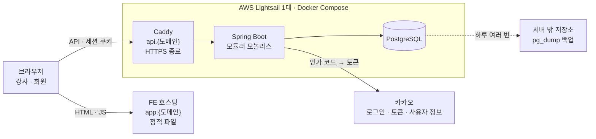

# 아키텍처 개요

BE가 어떻게 생겼는지 한 장으로 본다. 각 항목의 이유는 링크한 설계 결정에 있다.

## 시스템 구성



- 브라우저가 `api.`를 직접 호출한다. FE 호스팅은 요청을 중계하지 않는다(DEC-0008)
- 호스팅 · 백업 · 환경은 [BE-ADR-0015](../decisions/0015-hosting-lightsail.md)

## 모듈

배포 단위는 하나이고, 안에서 도메인 6개를 최상위 패키지로 나눈다([BE-ADR-0011](../decisions/0011-modular-monolith.md)). 패키지 이름은 `docs/spec`의 도메인 폴더 이름과 같다.

| 모듈 | 테이블 | 의존하는 모듈 |
|---|---|---|
| instructor | instructor · setting · instructor_session | 없음 |
| schedule | recurrence · class_slot | instructor |
| membership | member · member_link | instructor |
| entitlement | entitlement · subscription · entitlement_adjustment | membership |
| booking | booking · waitlist | membership · schedule · entitlement |
| analytics | event_log | membership · schedule |

의존 방향은 [컨텍스트 맵](context-map.md)의 외래 키 방향과 같다. 순환을 만들지 않고, Spring Modulith 검증 테스트가 빌드마다 확인한다.

### 모듈 안의 레이어

```
{모듈}/
  api/           HTTP 요청 · 응답, 입력 검증, 에러 코드 변환
  application/   유스케이스. 트랜잭션 경계. 다른 모듈이 부르는 유일한 패키지
  infra/         Repository(SQL), 외부 API 클라이언트
```

- 호출은 `api → application → infra` 한 방향이다
- 다른 모듈은 상대의 `application`만 부른다
- 쓰기는 Transaction Script다. 서비스 메서드 하나가 트랜잭션 하나이고, 규칙은 SQL 조건과 DB 제약에 둔다. 전술적 DDD(Entity · Aggregate)는 쓰지 않는다
- SQL은 `infra`의 Repository에만 두고, Repository는 `record`를 주고받는다([BE-ADR-0012](../decisions/0012-jdbc-client.md))

## 기술 스택

| 항목 | 선택 | 결정 |
|---|---|---|
| 언어 · 프레임워크 | Java 최신 LTS, Spring Boot 최신 GA, Spring MVC | [BE-ADR-0013](../decisions/0013-stack-and-testing.md) |
| 모듈 경계 검사 | Spring Modulith | [BE-ADR-0011](../decisions/0011-modular-monolith.md) |
| 데이터 접근 | `JdbcClient`, SQL 직접 작성 | [BE-ADR-0012](../decisions/0012-jdbc-client.md) |
| 스키마 | Flyway | [BE-ADR-0013](../decisions/0013-stack-and-testing.md) |
| DB | PostgreSQL. `btree_gist` 확장 | [BE-ADR-0009](../decisions/0009-entitlement-kind-exclusion.md) |
| 로그인 | 카카오 직접 구현(OAuth2 Client 미사용) | [BE-ADR-0014](../decisions/0014-kakao-login-direct.md) |
| 세션 | 직접 만든 `instructor_session`, 세션 ID 해시 저장 | [BE-ADR-0008](../decisions/0008-session-store.md) |
| 테스트 | JUnit 5 · AssertJ · Testcontainers(PostgreSQL) · MockMvc, `Clock` 주입 | [BE-ADR-0013](../decisions/0013-stack-and-testing.md) |
| 데이터 클래스 | Java `record`. Lombok 미사용 | [BE-ADR-0013](../decisions/0013-stack-and-testing.md) |
| 호스팅 | AWS Lightsail 1대, Docker Compose(Caddy · Spring · PostgreSQL) | [BE-ADR-0015](../decisions/0015-hosting-lightsail.md) |

## 환경

| 환경 | 주소 | DB |
|---|---|---|
| local | `localhost` | Docker Compose. 언제든 초기화 |
| dev | `api-dev.{도메인}` · `app-dev.{도메인}` | FE 연동용. 1차 배포 전까지 초기화할 수 있다 |
| prod | `api.{도메인}` · `app.{도메인}` | 초기화하지 않는다 |

local 프로필은 쿠키 이름에 `__Host-Http-` 접두사를 쓰지 않는다([BE-ADR-0014](../decisions/0014-kakao-login-direct.md)).

## 설계 문서의 위치

| 구분 | 상세 |
|---|---|
| 목적 | PRD 1~5의 User Story · 인수 조건에서 물리 테이블을 도출한다. 백엔드 구현의 출발점 |
| 입력 | PRD 0(상위 개념), PRD 1~5 본문과 각 하위 페이지의 US · AC |
| 제품 형태 | **개인 강사 단위 SaaS.** 강사가 카카오 계정으로 각자 가입해 각자의 회원 · 시간표 · 설정만 본다. 한 사업장에서 여러 강사가 회원을 공유하는 것은 범위 밖. 첫 검증은 강사 5명 중 3명 |
| 출력 | 도메인별 ERD, 테이블 13개 DDL(기능별 개발 PRD), AC 대 제약 매핑표, 쓰기 경로(예약 · 수강권), 설계 결정(BE-ADR), 열린 질문 |
| DB | PostgreSQL. `timestamptz`, 부분 인덱스(partial index), 조건부 UPDATE를 전제로 한다 |
| 상태 | 아키텍처 · 스택 · 호스팅 결정 완료(BE-ADR-0011 ~ 0015). 각 기능은 recatch-tdd prd 단계 전 |

물리 설계의 원본은 이 레포다. PRD 1의 `6. 데이터`는 테이블 목록과 이 레포 링크만 둔다.
