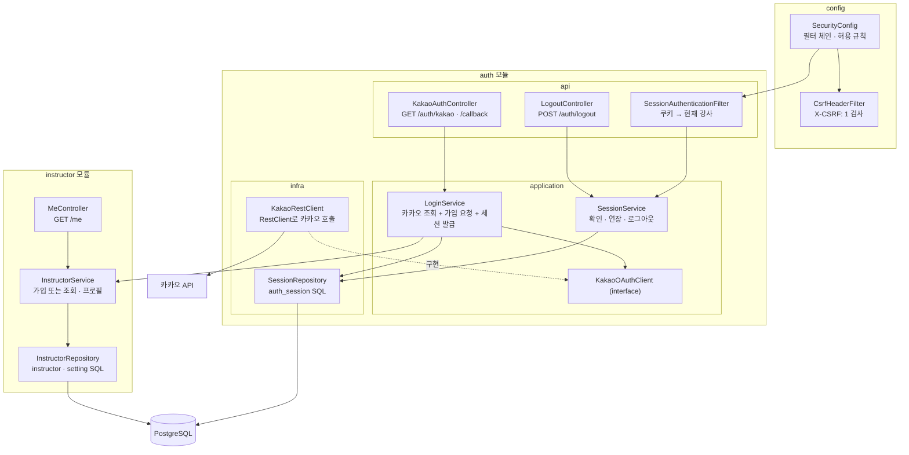
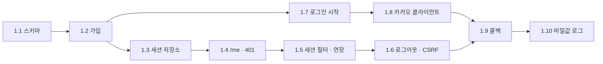
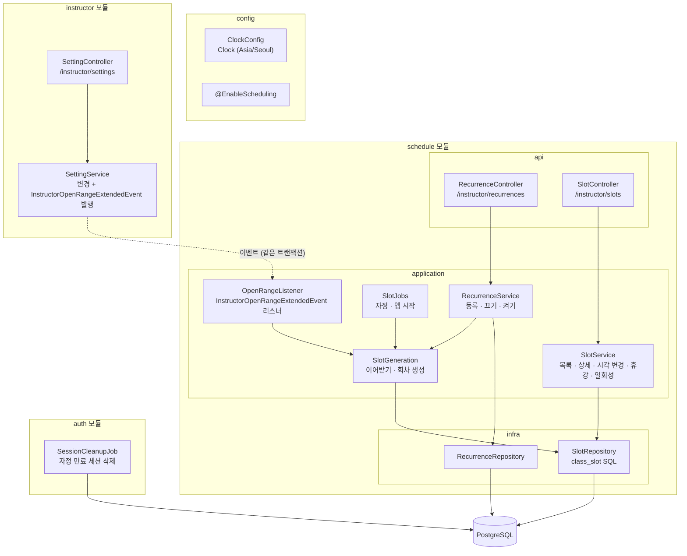
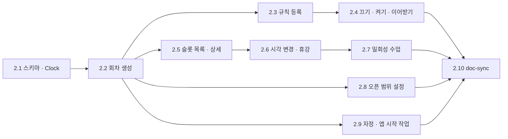
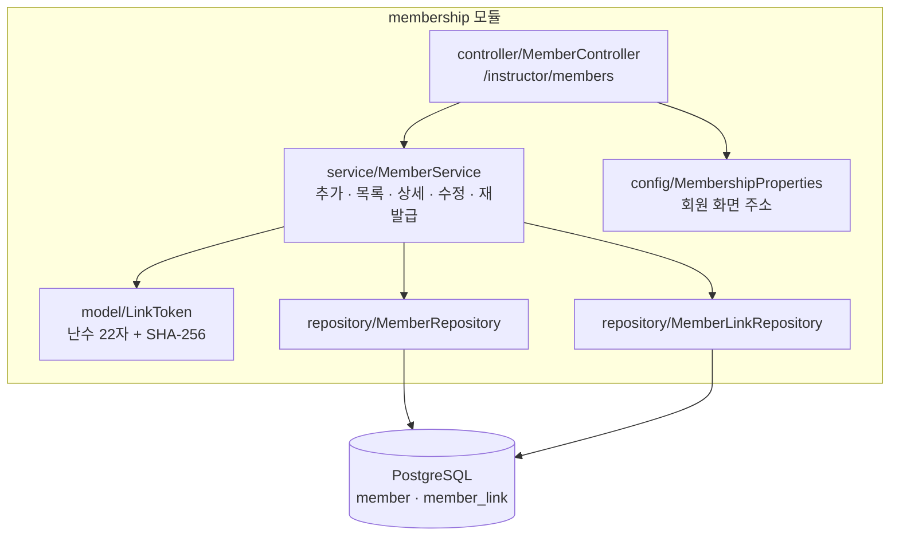
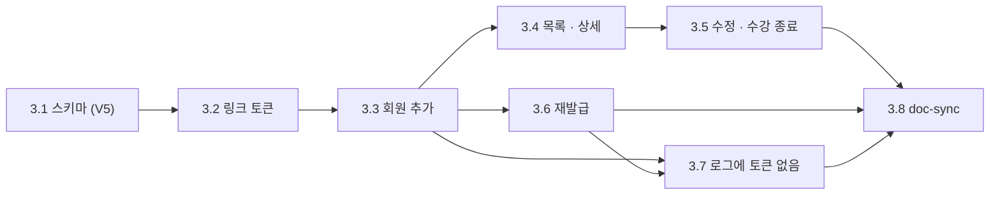
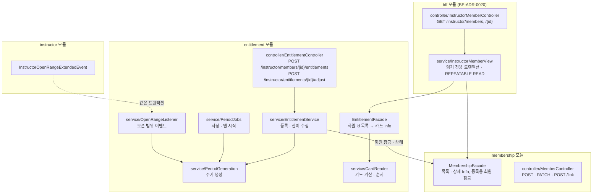
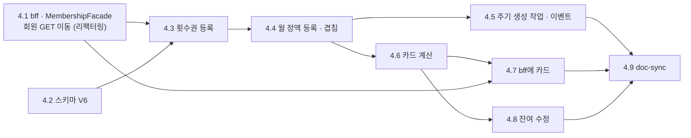

# BE-0001 구현 플랜 · 강사 세팅

근거: [prd.md](prd.md) · [ac.yml](ac.yml)

## 개요

| Phase | User Story | AC | 상태 |
|---|---|---|---|
| 1 | PRD-0001 US 1 가입 · 로그인 · 세션 | AC-1 ~ AC-10 | 완료 |
| 2 | US 2 시간표 · 오픈 범위, 매일 자정 작업 | AC-11 ~ AC-22 | 완료 |
| 3 | US 3 회원 · US 4 링크 · US 5 개봉 상태 | AC-23 ~ AC-28 | 완료 |
| 4 | US 3 수강권 · 회원 카드 · 월 정액 주기 | AC-29 ~ AC-35 | 계획 |

### Phase 1 구조

- 로그인 · 세션 코드는 `auth` 모듈에 둔다([BE-ADR-0016](../../../decisions/0016-auth-module.md)). 1.1 ~ 1.6은 `instructor`에 만들었다가 1.6 뒤에 옮겼다
- 의존 방향은 `config → auth → instructor` 한쪽이다. `auth`는 가입할 때 `instructor`의 `application`(`InstructorService.signUpOrFind`)을 부른다
- `MeController`는 `auth`를 부르지 않는다. 필터가 SecurityContext에 남긴 강사 id를 `@AuthenticationPrincipal Long`으로 받는다
- `config`가 필터를 끼울 수 있도록 `auth`는 `SessionAuthenticationFilter` 하나만 `@NamedInterface("session-filter")`로 공개한다
- 카카오 호출은 `application`의 인터페이스(`KakaoOAuthClient`) 뒤에 둔다. 흐름 테스트는 가짜 구현으로 바꿔 끼우고, 실제 HTTP는 1.8에서 따로 검증한다

### 설정값

`application.yml`에 `fitlink.auth.*`로 둔다. 비밀값은 환경변수로만 받는다.

| 키 | local 값 | 비고 |
|---|---|---|
| `fitlink.auth.kakao.client-id` | `${KAKAO_CLIENT_ID}` | REST API 키 |
| `fitlink.auth.kakao.client-secret` | `${KAKAO_CLIENT_SECRET}` | 로그 금지(AC-10) |
| `fitlink.auth.kakao.redirect-uri` | `http://localhost:8080/auth/kakao/callback` | |
| `fitlink.auth.success-url` · `failure-url` | `http://localhost:5173/` · `http://localhost:5173/?login=failed` | Q30 임시값 |
| `fitlink.auth.cookie.session` · `cookie.state` | `SESSION` · `KAKAO-STATE` | dev · prod는 `__Host-Http-` 접두사 |

### 테스트 방식

- DB가 닿는 테스트는 공통 기반 클래스 하나(Testcontainers + MockMvc + 가짜 `KakaoOAuthClient`)를 상속한다. 클래스마다 설정을 바꾸지 않아 Spring 컨텍스트 · 컨테이너를 재사용한다
- 테스트 사이 데이터는 매 테스트 전에 Phase 1 테이블을 `TRUNCATE ... RESTART IDENTITY CASCADE`로 비운다. AC-3 동시성 테스트가 `@Transactional` 롤백과 맞지 않아서다
- 14일 경과(AC-7)는 `expires_at`을 SQL로 과거로 바꿔 만든다(prd 3.3 시각)

## Phase 1: PRD-0001 US 1 — 가입 · 로그인 · 세션

### 1.1 스키마 (V1)

- [x] RED: 실패하는 테스트 — `[BE-0001 AC-3] 같은 provider · provider_user_id 두 번째 INSERT는 instructor_identity_uk 위반`
- [x] GREEN: `V1__instructor.sql`에 `instructor` · `setting` · `instructor_session`(prd 3.1 DDL 그대로). auth 모듈 분리 때 세션 테이블을 `V2__auth_session.sql`로 옮기고 이름을 `auth_session`으로 바꿈
- [x] REFACTOR: 공통 테스트 기반 클래스 · TRUNCATE 정리 도입

### 1.2 가입 또는 조회 (InstructorRepository · InstructorService)

- [x] RED: `[BE-0001 AC-2] 처음 보는 카카오 번호는 instructor 1행과 setting(open_range_days=14) 1행을 만든다`
- [x] RED: `[BE-0001 AC-2] 닉네임 · 이메일이 없어도 가입하고 name · email은 null`
- [x] RED: `[BE-0001 AC-3] 같은 번호로 다시 가입 처리하면 같은 id, 행 수 그대로`
- [x] RED: `[BE-0001 AC-3] 같은 번호의 가입 처리 두 개를 동시에 실행해도 instructor · setting 1행씩`
- [x] GREEN: `INSERT ... ON CONFLICT ON CONSTRAINT instructor_identity_uk DO NOTHING RETURNING id` → 1행이면 `setting` INSERT, 0행이면 조회. 한 트랜잭션
- [x] REFACTOR: 카카오 사용자 정보를 받는 record(`KakaoUser(id, nickname, email)`) 정리 — GREEN에서 입력 타입으로 바로 도입

### 1.3 세션 저장소 (SessionRepository)

- [x] RED: `[BE-0001 AC-4] 발급한 세션 ID는 32바이트 난수이고 DB에는 SHA-256 해시만 저장된다`
- [x] RED: `[BE-0001 AC-7] 확인하면 expires_at이 now + 14일로 연장되고 instructor_id를 돌려준다`
- [x] RED: `[BE-0001 AC-7] expires_at이 지난 세션은 확인 결과가 비어 있다`
- [x] RED: `[BE-0001 AC-8] revoke하면 revoked_at이 채워지고 이후 확인 결과가 비어 있다`
- [x] GREEN: prd 3.1 로그인 세션 절의 조건부 UPDATE · revoke SQL
- [x] REFACTOR: 해시 계산을 한 곳(`SessionToken`)으로

### 1.4 `GET /me` 응답 모양과 401

- [x] RED: `[BE-0001 AC-6] 쿠키 없이 GET /me는 401 { code: UNAUTHENTICATED }`
- [x] RED: `[BE-0001 AC-6] DB에 없는 쿠키 값이면 401`
- [x] GREEN: Security entry point가 401 본문 `{ "code": "UNAUTHENTICATED", "message": ... }`을 쓴다
- [x] REFACTOR: 에러 본문 record(`ErrorResponse(code, message)`)를 공통으로

### 1.5 세션 확인 필터와 연장

- [x] RED: `[BE-0001 AC-6] 유효한 세션 쿠키로 GET /me는 200 { id, name, email }`
- [x] RED: `[BE-0001 AC-7] 인증된 요청 뒤 expires_at이 요청 시각 + 14일`
- [x] RED: `[BE-0001 AC-7] 만료된 세션 쿠키로 GET /me는 401`
- [x] GREEN: `SessionAuthenticationFilter`(쿠키 → `SessionService` → SecurityContext에 강사 id), `MeController`
- [x] REFACTOR: 컨트롤러가 현재 강사 id를 받는 방식(`@AuthenticationPrincipal` 또는 argument resolver) 하나로 정하고 Modulith 공개 범위 정리. `ModularityTests` 통과 확인 — `@AuthenticationPrincipal Long`, 필터 클래스에만 `@NamedInterface("session-filter")`

### 1.6 로그아웃과 CSRF 헤더

- [x] RED: `[BE-0001 AC-8] POST /auth/logout은 204, 쿠키 Max-Age=0, 세션 행 revoked_at 채움`
- [x] RED: `[BE-0001 AC-8] 로그아웃한 쿠키로 GET /me는 401`
- [x] RED: `[BE-0001 AC-8] 쿠키 없이 로그아웃해도 204`
- [x] RED: `[BE-0001 AC-9] X-CSRF 헤더 없는 로그아웃은 403 CSRF_HEADER_MISSING이고 세션은 그대로`
- [x] RED: `[BE-0001 AC-9] 인증이 필요한 경로에 세션 · 헤더 없이 POST하면 401`
- [x] GREEN: `LogoutController`, `CsrfHeaderFilter`(AuthorizationFilter 뒤)
- [x] REFACTOR: 쿠키 생성 · 삭제를 한 곳(`AuthCookies`)으로. 이름은 설정값 — 세션 필터를 Bean으로 바꾸고 서블릿 자동 등록을 끔. `config`는 `SessionService`를 직접 참조하지 않음

### 1.7 로그인 시작 `GET /auth/kakao`

- [x] RED: `[BE-0001 AC-1] 302 Location이 kauth.kakao.com/oauth/authorize이고 client_id · redirect_uri · response_type=code · state를 가진다`
- [x] RED: `[BE-0001 AC-1] KAKAO-STATE 쿠키가 Location의 state와 같고 HttpOnly · Secure · SameSite=Lax · Path=/ · Max-Age=600`
- [x] RED: `[BE-0001 AC-1] 두 번 호출하면 state가 다르다`
- [x] GREEN: `KakaoAuthController.start`, `AuthCookies.state`, `GET /auth/kakao` 허용 규칙
- [x] REFACTOR: 설정 record(`AuthProperties`)로 묶기 — 모듈 최상위 패키지에 둠(api · infra가 같이 씀). 카카오 키는 `.env`(git 제외)나 환경변수로 받음

### 1.8 카카오 클라이언트 (KakaoRestClient)

- [x] RED: `[BE-0001 AC-2] code로 토큰 요청 → 사용자 조회 결과를 KakaoUser로 바꾼다` (MockRestServiceServer로 카카오 응답 고정)
- [x] RED: `[BE-0001 AC-2] kakao_account에 닉네임 · 이메일이 없으면 null`
- [x] RED: `[BE-0001 AC-5] 토큰 · 사용자 조회가 4xx · 5xx면 정해진 예외 하나로 바꾼다`
- [x] GREEN: `RestClient`로 `POST kauth.kakao.com/oauth/token`(form: grant_type · client_id · client_secret · redirect_uri · code), `GET kapi.kakao.com/v2/user/me`
- [x] REFACTOR: 타임아웃 설정(연결 3초 · 응답 5초), 응답 JSON record 정리 — Spring Boot의 RestClient 자동 구성 모듈이 없어 `RestClient.builder()`를 직접 쓴다. 테스트는 MockRestServiceServer를 묶은 builder를 생성자로 넘긴다

### 1.9 콜백 `GET /auth/kakao/callback`

- [x] RED: `[BE-0001 AC-4] 성공하면 302 성공 주소, SESSION 쿠키, 세션 행, KAKAO-STATE 삭제`
- [x] RED: `[BE-0001 AC-4] 요청 파라미터로 목적지를 바꿀 수 없다`
- [x] RED: `[BE-0001 AC-4] 이전 SESSION 쿠키를 들고 로그인하면 새 값이 다르고 이전 세션은 revoked`
- [x] RED: `[BE-0001 AC-5] error=access_denied면 302 실패 주소, 세션 · 강사 행 없음`
- [x] RED: `[BE-0001 AC-5] KAKAO-STATE 쿠키가 없거나 state가 다르면 302 실패 주소`
- [x] RED: `[BE-0001 AC-5] 카카오 호출이 실패하면 302 실패 주소`
- [x] GREEN: `KakaoAuthController.callback` → `LoginService.login(code)`(가입 또는 조회 + 이전 세션 무효 + 새 세션, 한 트랜잭션) — 카카오 호출은 트랜잭션 밖(`TransactionTemplate`). state는 `MessageDigest.isEqual`로 비교. 테스트는 `@MockitoBean KakaoOAuthClient`
- [x] RED: `[BE-0001 AC-7] 인증된 요청은 SESSION 쿠키도 같은 값 · Max-Age 14일로 다시 준다`, `인증에 실패한 요청은 SESSION 쿠키를 다시 주지 않는다`
- [x] GREEN: 로그인 때 SESSION 쿠키 Max-Age 14일, 세션 필터가 인증 성공마다 같은 쿠키를 다시 발급 — DB 만료만 연장하면 활동 중이어도 로그인 14일 뒤 쿠키가 사라진다. 로그아웃 · 재로그인 응답에는 SESSION 쿠키가 하나뿐인지 테스트로 확인
- [x] REFACTOR: 실패 원인을 로그에 남기되 code · 토큰은 빼기 — `KakaoLoginException`은 원래 예외를 담지 않고 HTTP 상태만. `error` 파라미터는 카카오 에러 코드 형식일 때만 기록

### 1.10 비밀값이 로그에 없다

- [x] RED: `[BE-0001 AC-10] 로그인 · 재로그인 · 인증 · 로그아웃 흐름의 로그에 code · client secret · 세션 ID가 없다`, `카카오가 실패하고 에러 본문에 code · 토큰을 실어 보내도 로그에 없다` (`OutputCaptureExtension`, 우리 코드와 Spring 웹 · 보안 · JDBC logger를 TRACE로 낮춰 실행. 카카오 실패는 실제 `KakaoRestClient`를 가짜 카카오 서버에 붙임)
- [x] RED: `[BE-0001 AC-10] 세션 테이블에는 세션 ID 원본 컬럼이 없고 어느 테이블에도 카카오 토큰 컬럼이 없다`. 저장값이 쿠키 값의 SHA-256(32바이트)인 것은 1.3 · 1.9 테스트가 이미 확인
- [x] GREEN: 우리 코드의 로그는 걸리지 않았다. Spring logger 4개가 DEBUG · TRACE에서 code(요청 주소 · 컨트롤러 인자)와 client secret(카카오로 보내는 form)을 찍어 `application.yml`에서 INFO로 고정 — 상위 패키지 수준을 낮춰도 따라 내려가지 않는다. 4줄 각각 지우면 테스트가 실패하는 것 확인. MockMvc 테스트에 없는 Tomcat 요청 원문 logger(`Http11InputBuffer`)도 같이 고정. 목록 방식이라 운영에서 프레임워크 전체를 DEBUG로 내리지 않는다는 규칙을 설정 주석 · `overview.md`에 둠
- [x] REFACTOR: doc-sync — 기능 상태 in-progress, 강사 `POLICY.md` 규칙 절(가입 · 로그인 · 세션), `overview.md` 인증 흐름. `data-model.md`는 auth 모듈 분리 때 반영됨

## Phase 1 끝난 뒤 확인

- [x] `./gradlew test` 전체 통과(2026-11-05 기준 43개), `ModularityTests` 통과. local 프로필 · 실제 compose DB로 띄워 마이그레이션 V1 · V2 적용, 카카오를 부르지 않는 응답(로그인 시작 302 · `/me` 401 · 로그아웃 403/204 · state 불일치 302 실패 주소) 확인. 지금은 카카오 키가 비면 앱이 뜨지 않으므로, 다시 할 때는 `.env`에 아무 값이나 넣는다
- [x] local에서 카카오 앱으로 실제 로그인: `/auth/kakao` → 카카오 → 콜백 → `/me` 200 → 로그아웃 → `/me` 401. Chrome으로 2026-11-10 확인. 강사 · 설정 1행, 세션은 32바이트 해시로 저장 후 `revoked_at` 채워짐, 앱 로그에 비밀값 패턴 0건. `.env` 값에 따옴표를 넣으면 값의 일부가 되어 KOE101이 난다

## Phase 2: PRD-0001 US 2 — 시간표 · 오픈 범위 · 매일 자정 작업

### Phase 2 구조

- 의존 방향은 `schedule → instructor` 그대로다. `instructor`는 `InstructorOpenRangeExtendedEvent(instructorId, today, now)`를 발행만 하고 `schedule`을 모른다. 이벤트 record는 `instructor` 모듈 루트에 둔다(BE-ADR-0019)
- 회차 생성 SQL은 `setting.open_range_days`를 JOIN으로 읽기만 한다. 쓰기는 `instructor`만 한다
- 컨트롤러는 Phase 1처럼 `@AuthenticationPrincipal Long`으로 강사 id를 받는다
- 자정 작업은 모듈마다 자기 `@Scheduled`를 갖는다. 월 정액 주기 생성(Phase 4 이후)이 "회차 생성 뒤 같은 `today`로" 붙을 자리는 그때 정한다

### 시각 · 테스트 방식

- `Clock` 빈(`Asia/Seoul`) 하나에서 `today` · `now`를 요청 · 작업 시작 때 한 번 구해 서비스 → 저장소 → SQL 파라미터로 넘긴다. 시간표 SQL은 `now()`를 쓰지 않는다(prd 3.3 시각)
- 테스트는 공통 기반 클래스가 바꿀 수 있는 고정 `Clock`을 `@Primary`로 넣는다. 기본값은 고정 날짜(목요일 12:00 서울)이고 `@BeforeEach`에서 되돌린다. 컨텍스트 설정이 같아 Phase 1 테스트와 컨텍스트를 같이 쓴다
- TRUNCATE 목록에 `recurrence` · `class_slot`을 더한다. 격리 테스트는 강사를 2명 만든다(BE-ADR-0013)
- 예약(`booking`)은 아직 없으므로 SLOT_HAS_BOOKINGS는 `taken`을 SQL로 올려 만든다
- 테스트 컨텍스트에서는 스케줄 실행을 끈다(`fitlink.scheduling.enabled=false`, `@EnableScheduling`을 둔 설정에 `@ConditionalOnProperty`). 자정을 넘겨 도는 CI에서 실제 cron이 테스트 도중 데이터를 바꾸지 않게 하려는 것이다. 작업은 테스트가 메서드를 직접 부른다
- 세션 만료 테스트(AC-22)는 Phase 1처럼 DB 시각 기준으로 `expires_at`을 만든다. 고정 `Clock`과 섞지 않는다

### 2.1 스키마 (V3) · Clock

- [x] RED: `[BE-0001 AC-12] 같은 recurrence_id · occurs_on 두 번째 INSERT는 class_slot_occurrence_uk 위반`
- [x] RED: `[BE-0001 AC-15] 같은 강사 · 같은 starts_at의 휴강 아닌 슬롯 두 번째 INSERT는 class_slot_time_uidx 위반, 휴강한 행과는 겹쳐도 된다`
- [x] RED: `[BE-0001 AC-11] 같은 강사 · 요일 · 시각의 켜진 규칙 두 번째 INSERT는 recurrence_slot_uidx 위반, 꺼진 규칙과는 겹쳐도 된다`
- [x] GREEN: `V3__schedule.sql`에 `recurrence` · `class_slot`(prd 3.1 DDL 그대로), `ClockConfig`, 테스트용 고정 `Clock` — `TestClock`(기본 목요일 12:00 서울)을 `@Primary`로 넣고 `IntegrationTest`가 테스트마다 되돌린다. 부분 유니크 조건(`WHERE canceled_at IS NULL` · `WHERE active`)을 각각 빼면 테스트가 실패하는 것 확인. 소유자 복합 FK · `taken` 범위 CHECK도 테스트로 고정. `TestClock.withZone`은 고정 사본이 아니라 같은 "지금"을 보는 시계를 돌려준다(빈이 미리 받아 둔 시계도 `set()`을 따라감)
- [x] REFACTOR: 테스트에서 강사 · 규칙 · 슬롯을 만드는 도우미(SQL 직접 INSERT) 정리 — `ScheduleFixtures`. 테스트 전 TRUNCATE 대상은 DB의 테이블 목록에서 읽는다(마이그레이션에 테이블을 더해도 고칠 곳 없음)

### 2.2 회차 생성 (SlotGeneration · SlotRepository)

- [x] RED: `[BE-0001 AC-12] 목요일 12:00 · 14일에 화 20:00 규칙이면 다음 화요일 2개, 20:00+09:00, 정원 복사`
- [x] RED: `[BE-0001 AC-12] 화요일 21:00에 돌리면 오늘 회차는 없다`, `목요일 12:00 · 7일에 목 20:00 규칙이면 오늘 회차만 있고 다음 목요일은 없다`
- [x] RED: `[BE-0001 AC-16] 두 번 돌려도 행 수가 같고, 휴강 · 시각을 바꾼 회차가 다시 생기지 않는다`
- [x] RED: `[BE-0001 AC-16] 강사를 정하지 않으면 모든 강사의 회차를 만든다`
- [x] RED: `[BE-0001 AC-14] 꺼진 규칙의 회차 하나는 휴강 · 하나는 19:30일 때 같은 요일 · 시각 규칙을 켜면 이어받고 새 회차가 없다, 정원은 원래 값`
- [x] RED: `[BE-0001 AC-15] 다음 주 화 20:00 일회성 수업을 휴강한 뒤 화 20:00 규칙을 켜도 그 날짜에는 회차가 없다` (`NOT EXISTS`를 빼면 실패해야 한다)
- [x] GREEN: prd 3.1 시간표 절의 이어받기 UPDATE와 회차 생성 쿼리(`$today` · `$now` · `CAST($instructorId AS bigint)` · `NOT EXISTS` · `ORDER BY` · `ON CONFLICT DO NOTHING`). 이어받기는 요일 · 시각을 파라미터로 받지 않고 새 규칙 행과 JOIN한다. 이어받기는 소유자 · 켜진 새 규칙을 SQL에서 다시 확인하고, 날짜마다 한 행만 옮긴다. 규칙을 여러 개 켜면 모두 이어받은 뒤 회차 생성을 한 번만 돈다. SQL 조건을 하나씩 깨면 테스트가 실패하는 것 확인(`NOT old_rule.active`만 유니크 · 자기 회차 조건과 겹쳐 결과가 같다. 읽는 사람을 위해 남김). 휴강 포함 조회용 `class_slot_owner_idx`를 V3에 더함. `DB 세션 타임존이 달라도 서울 시각` 테스트를 더함(pgjdbc가 세션 타임존을 JVM 기본값으로 맞춰서, 없으면 `AT TIME ZONE`을 빼도 서울 PC에서는 통과한다)
- [x] REFACTOR: `today` · `now`를 묶은 값(예: `GenerationTime`)으로 한 번만 구하게 — GREEN에서 `GenerationTime.at(clock)`으로 바로 도입

### 2.3 규칙 등록 · 목록 `/instructor/recurrences`

- [x] RED: `[BE-0001 AC-11] [MON, WED] 20:00 · 8 → 201 items 2개`, `GET 목록은 월 → 일 · 시각 순, 다른 강사 규칙 없음`
- [x] RED: `[BE-0001 AC-11] weekdays 빈 · 중복, startTime 형식, capacity 0 · 51 → 400, 행 없음`
- [x] RED: `[BE-0001 AC-11] WED 20:00이 켜져 있으면 [MON, WED] → 409 RECURRENCE_DUPLICATE weekdays [WED], MON도 없음`
- [x] RED: `[BE-0001 AC-12] 등록 응답 뒤 오픈 범위 안 회차가 있다`
- [x] GREEN: `RecurrenceController` · `RecurrenceService`(한 트랜잭션: 겹침 확인 → INSERT → 이어받기 → 회차 생성). 동시 등록이 유니크에 걸리면 `recurrence_slot_uidx` → 409로 바꾼다(prd 3.2 공통 규칙) — 요일 이름 ↔ DB 번호(0 = 일요일) 변환은 `Weekday` enum 한 곳. 시각은 `@JsonFormat(pattern = "HH:mm")`라 `8:00` · `20:00:00` · `25:00`은 400. 모르는 요일 · 시각 형식 오류는 Jackson 예외 경로에서 필드 이름을 찾는다. 꺼진 같은 요일 · 시각 규칙과는 겹치지 않고 남은 회차를 이어받는 API 테스트를 더함. 조건을 하나씩 깨면 테스트가 실패하는 것 확인
- [x] REFACTOR: 제약 이름 → 에러 코드 대응을 한 곳으로(`class_slot_time_uidx` · `recurrence_slot_uidx`) — `schedule.api`의 `ScheduleErrorHandler`. 모듈마다 `api`가 에러 코드를 바꾼다(BE-ADR-0011). 대응표에 없는 제약은 그대로 던져 500. 경합 재현이 어려워 처리기를 직접 부르는 테스트로 확인. 리뷰 반영: 요일 목록의 `null` 원소 400, 정수 필드의 소수 거부(`accept-float-as-int: false`), 등록 응답도 월요일부터 정렬, 규칙 중복 응답을 한 곳에서 생성. 처리되지 않은 예외가 `/error`로 다시 들어올 때 인증을 요구해 500이 401로 보이던 문제(Phase 1부터)는 main 대상 별도 PR에서 `config`의 ERROR 디스패치 허용으로 고침

### 2.4 규칙 끄기 · 다시 켜기 · 이어받기

- [x] RED: `[BE-0001 AC-13] 끄면 이미 만든 회차는 그대로, 하루 넘겨 생성해도 새 회차 없음`
- [x] RED: `[BE-0001 AC-13] 다시 켜면 응답 전에 회차가 생긴다`, `같은 시각 켜진 규칙이 있으면 409이고 active false 그대로`
- [x] RED: `[BE-0001 AC-14] A를 끄고 B 등록 → 이어받기, B를 끄고 A 켜기 → 다시 이어받기`, `늘어난 범위의 새 회차는 B 정원`
- [x] GREEN: `PATCH /instructor/recurrences/{id}`. 다른 강사 id는 404 — 없는 id도 같은 404 `NOT_FOUND`. `active`가 없으면 400, 경로 id가 숫자가 아니면 400(필드 `id`). 이미 그 상태면 200이고 바꾸지 않는다(켜진 규칙을 다시 켜도 자기 자신과 겹친다고 409를 주지 않는다). 규칙 행은 `FOR NO KEY UPDATE`로 잠근다. `FOR UPDATE`는 회차 INSERT의 외래 키 확인(KEY SHARE)과 충돌해 자정 생성과 deadlock이 날 수 있다(리뷰 반영)
- [x] REFACTOR: 등록과 다시 켜기의 "이어받기 → 생성"을 한 메서드로 — `RecurrenceService`의 `rejectActiveOverlap` · `fillOpenRange`. 동시에 두 꺼진 규칙을 켜면 DB 유니크에 걸려 409의 `weekdays`가 빈 목록인 것은 등록과 같게 둔다. 조건을 하나씩 깨면 테스트가 실패하는 것 확인

### 2.5 슬롯 목록 · 상세

- [x] RED: `[BE-0001 AC-17] 지금 이후 자기 슬롯만 시각 순, 지난 · 진행 중 · 다른 강사 슬롯 없음, openRangeDays`
- [x] RED: `[BE-0001 AC-17] 휴강 슬롯은 canceledAt과 함께, 범위를 줄인 뒤 범위 밖 슬롯도 들어 있다`
- [x] RED: `[BE-0001 AC-17] 상세: 반복 회차는 recurrence, 일회성은 null, 다른 강사 id는 404`
- [x] GREEN: `SlotController` · `SlotService`. 쿼리는 `class_slot.instructor_id`로 거르고 `recurrence`는 LEFT JOIN(일회성이 빠지지 않게) — 오픈 범위는 `instructor` 모듈의 `SettingService`로 읽는다(schedule → instructor 방향). 범위와 슬롯을 같은 시점으로 읽도록 목록은 REPEATABLE READ. "지금 이후"는 `starts_at > now`라 지금 막 시작한 수업은 빠진다. 시각은 DB가 UTC로 돌려줄 수 있어 응답에서 서울 시각(+09:00)으로 바꾼다. 경로 id가 숫자가 아니면 400
- [x] REFACTOR: 응답 record(`SlotSummary` · `SlotDetail`) 정리 — 응답 record는 `SlotController` 안에 두고, `HH:mm` · 서울 시각 표기는 `ApiFormats` 한 곳으로 모았다(규칙 API와 함께 씀). 리뷰 반영: 설정 행이 없을 때 원인이 보이는 예외, 상세도 readOnly 트랜잭션. 조건을 하나씩 깨면 테스트가 실패하는 것 확인

### 2.6 회차 시각 변경 · 휴강

- [x] RED: `[BE-0001 AC-18] 19:30으로 바꾸면 그 슬롯만, occurs_on · 다른 주 회차 그대로`
- [x] RED: `[BE-0001 AC-18] 휴강 → SLOT_CANCELED, 시작 → CLASS_STARTED, 지난 시각 · date → 400, taken > 0 → SLOT_HAS_BOOKINGS, 같은 시각 → SLOT_TIME_TAKEN, 여러 개면 앞의 것`
- [x] RED: `[BE-0001 AC-19] 휴강하면 canceled_at, 다시 보내면 처음 값 그대로 200, 시작한 슬롯은 CLASS_STARTED`, `taken > 0이어도 휴강된다`
- [x] GREEN: 읽고 판정 → 조건부 UPDATE. 시각 변경은 `WHERE taken = 0 AND canceled_at IS NULL AND starts_at > $now`, 휴강은 `SET canceled_at = $now WHERE canceled_at IS NULL AND starts_at > $now`(예약이 있어도 휴강한다). 0행이면 다시 읽어 각자의 순서로 답한다. 휴강은 이미 휴강이면 200, 시작했으면 CLASS_STARTED — 0행일 때 다시 읽기는 3번까지, 그래도 못 바꾸면 500. 조건부 UPDATE가 판정 없이도 휴강 · 예약 · 시작한 슬롯과 다른 강사 슬롯을 막는지 레포지토리 테스트로 확인. 시작한 수업의 휴강은 허용하지 않는다(2026-11-11 확정). 일회성 수업의 `date`는 2.7 전까지 반복 회차와 같이 400
- [x] REFACTOR: 판정 순서를 한 메서드로(2.7과 같이 씀) — 휴강 · 시작 판정을 `rejectClosed`로 묶었다. 400을 서비스에서도 던지도록 `InvalidRequestException`을 application으로 옮기고, 서울 zone은 `ScheduleZone` 한 곳에 둔다. 리뷰 반영: 지금 시각을 마이크로초로 잘라 자바 판정과 UPDATE의 WHERE가 경계에서 같은 값을 쓰게 했다

### 2.7 일회성 수업

- [x] RED: `[BE-0001 AC-20] 등록 → 201, recurrence null, occurs_on = date`
- [x] RED: `[BE-0001 AC-20] 지난 시각 · 범위 밖 날짜 · capacity 0 · 51 → 400 fields`
- [x] RED: `[BE-0001 AC-15] 반복 회차와 같은 시각 → 409 SLOT_TIME_TAKEN, 휴강한 시각은 허용, 다른 강사는 같은 시각 허용`
- [x] RED: `[BE-0001 AC-20] PATCH date로 다른 날로 옮기면 starts_at · occurs_on 같이 바뀜, 새 날짜가 범위 밖이면 400`, `범위를 줄여 범위 밖에 남은 일회성 수업도 startTime만은 바뀐다`
- [x] GREEN: `POST /instructor/slots`, `PATCH`의 `date` 처리 — 등록은 INSERT의 `class_slot_time_uidx` 위반을 409로 바꾼다(공통 처리기의 제약 대응표). 회차 생성은 돌지 않는다. 조건부 UPDATE가 `occurs_on`도 같이 바꾸고, 반복 회차는 SQL에서도 날짜를 옮기지 못하게 `recurrence_id IS NULL OR occurs_on = 같은 날`을 건다(레포지토리 테스트). 400 안의 순서는 날짜 문제(반복 회차의 date · 범위 밖) → 시각 문제(지금 이전)다. 어제 날짜를 보내면 `startTime`이 아니라 `date`를 준다. 지금 날짜를 그대로 보내면 날짜를 옮기는 것이 아니므로 범위를 보지 않고, 반복 회차도 받는다(FE가 수정 화면에서 date를 늘 보내도 되게. 리뷰 반영으로 AC-18 · prd 문구를 "다른 날짜를 보내면 400"으로 고침). 일회성 수업을 다른 날로 옮기면 비워진 원래 시각에 같은 요일 · 시각 규칙의 회차가 다음 생성 때 생길 수 있다. 휴강과 달리 강사가 그 시각 수업을 없앤 것이 아니므로 규칙대로 채우는 것을 맞는 동작으로 둔다(같은 날 시각만 옮길 때도 2.6부터 같다). 조건을 하나씩 깨면 테스트가 실패하는 것 확인
- [x] REFACTOR: 등록 · 수정의 입력 검사 공유 — `requireInOpenRange` · `requireAfterNow`. 시각 변경 · 휴강의 "읽고 판정 → 조건부 UPDATE → 0행이면 다시 읽기(3번까지)" 반복문도 `untilApplied` 한 곳으로 모았다

### 2.8 오픈 범위 설정 `/instructor/settings`

- [x] RED: `[BE-0001 AC-21] GET → 14, PATCH 6 · 29 → 400`
- [x] RED: `[BE-0001 AC-21] 14 → 28이면 응답 전에 15 ~ 28일째 회차가 있다`, `28 → 7이면 범위 밖 슬롯이 남는다`
- [x] RED: `[BE-0001 AC-21] 회차 생성이 실패하면 PATCH가 실패하고 open_range_days 그대로` (실패는 테스트 안에서 `class_slot`에 `CHECK (false) NOT VALID` 제약을 잠시 건다. `NOT VALID`라 이미 있는 회차는 검사하지 않고 새 INSERT만 실패한다. `finally`에서 지우고, `@BeforeEach`도 `DROP CONSTRAINT IF EXISTS`로 남은 것을 지운다. TRUNCATE는 제약을 지우지 않기 때문이다. 빈을 바꿔 끼우면 Spring 컨텍스트가 새로 떠서 피한다)
- [x] GREEN: `instructor`의 `SettingController` · `SettingService`(UPDATE 뒤 늘었을 때만 `InstructorOpenRangeExtendedEvent` 발행), `schedule`의 동기 `@EventListener`(`OpenRangeListener`) — 바꾸기 전 값은 `SELECT … FOR UPDATE`로 읽어 같은 강사의 동시 변경을 차례로 돌린다. 같은 값이나 줄이는 변경은 발행하지 않는다(28 → 28 · 28 → 7 테스트). 이벤트에는 요청에서 구한 오늘 · 지금을 싣고 리스너는 시계를 다시 읽지 않는다(이벤트를 직접 발행하는 리스너 테스트). 이벤트 record의 자리는 BE-ADR-0019로 정했다: 모듈 루트의 `{모듈}{무엇}Event`, ArchUnit 루트 이름 규칙에 `Event`를 더함. 변이 6개(`>=` · 항상 발행 · 트랜잭션 제거 · 틀린 오늘 · 리스너가 시계 읽기 · 리스너 제거)를 모두 테스트가 잡음
- [x] REFACTOR: `ModularityTests`로 `instructor → schedule` 의존이 없는지 확인

### 2.9 매일 자정 · 앱 시작 작업

- [x] RED: `[BE-0001 AC-16] 강사 2명, Clock을 하루 넘겨 전체 작업을 돌리면 두 강사 모두 범위 끝 날 회차가 생긴다`, `ApplicationReadyEvent를 발행하면 회차가 생긴다`(앱 시작 리스너가 실제로 이어져 있는지)
- [x] RED: `[BE-0001 AC-22] 만료 · 로그아웃 미만료 · 유효 세션 중 만료 행만 지워지고, 지운 쿠키는 401`
- [x] GREEN: `SlotJobs`(`@Scheduled(cron = "0 0 0 * * *", zone = "Asia/Seoul")` + `ApplicationReadyEvent`), `SessionCleanupJob`, `@EnableScheduling`, `V4__auth_session_expires_idx.sql` — 두 작업은 각 모듈의 `service` 폴더에 둔다. `@EnableScheduling`은 `FitlinkApplication` 안의 설정 클래스에 두고 `fitlink.scheduling.enabled`(기본 켜짐)로 끈다. 모듈이 아닌 루트 패키지라 `common`의 허용 목록을 넓히지 않는다. 만료 판정은 세션 확인과 같이 DB의 `now()`로 한다(`expires_at <= now()`). 2.8 리뷰에서 넘어온 자정 틈(23:59에 오픈 범위를 늘리는 요청이 자정 작업보다 늦게 커밋되면 새 범위의 마지막 하루가 다음 실행까지 빔)은 막지 않기로 했다. 드물고 다음 실행이 채운다. 생성 SQL에 `FOR SHARE`를 거는 것으로는 막지 못한다: PostgreSQL은 잠금을 기다린 뒤 이미 펼친 날짜 행만 새 값으로 다시 검사하고 늘어난 날짜 행을 새로 만들지 않는다. 막으려면 별도 잠금 문장과 모듈 간 잠금이 필요해 비용이 더 크다. 리뷰 반영: 스케줄러는 벽시계로 기다릴 시간을 계산해 시계 보정 중 23:59:59.9xx에 일찍 깨어날 수 있으므로, 자정 작업은 1분 뒤 시각의 날짜를 오늘로 쓴다(지금은 그대로). 변이 9개(cron · zone · 실패 삼키기 · 앱 시작 리스너 · 고정된 시계 · 조기 실행 여유 · 로그아웃 행 삭제 · 만료 기준 · 기본 꺼짐)를 모두 테스트가 잡음
- [x] REFACTOR: cron · zone 값이 AC와 같은지 확인하는 테스트(어노테이션 값을 읽음. 테스트에서는 스케줄 실행을 꺼 두므로). 작업 실패는 로그만 남기고 앱을 멈추지 않는다

### 2.10 doc-sync

- [x] REFACTOR: 시간표 `POLICY.md` 규칙 절 · `data-model.md`, 강사 `POLICY.md`(오픈 범위), `overview.md`(자정 작업 · 이벤트), `feature.yaml` 상태

## Phase 2 끝난 뒤 확인

- [x] `./gradlew test` 전체 통과(203개), `ModularityTests` 통과
- [x] local에서 앱을 띄워 규칙 등록 → 슬롯 목록 → 시각 변경 · 휴강 → 일회성 수업 → 오픈 범위 변경을 curl로 한 번씩 — 2026-11-16. 점검용 강사 · 세션은 DB에 직접 넣고 끝난 뒤 지웠다. 앱 시작 회차 생성 로그, 같은 시각 409, 28일로 늘린 뒤 12-01 · 12-08 회차, 6일 400까지 확인

## Phase 3: PRD-0001 US 3 · 4 · 5 — 회원 · 링크 · 개봉 상태

### Phase 3 구조

- 이번 Phase는 `membership` 모듈 하나만 쓴다. 다른 모듈을 부르지 않고, 다른 모듈도 아직 `membership`을 부르지 않으므로 `MembershipFacade`는 만들지 않는다(필요한 Phase에서 만든다)
- 폴더 구조는 BE-ADR-0017 그대로다(`controller` · `dto` · `service` · `model` · `repository` · `exception` · `config`). 새 구조는 없다
- `member.instructor_id`는 `instructor` 테이블을 가리키는 외래 키일 뿐이고, Java 코드는 `instructor` 모듈을 부르지 않는다. 강사 id는 Phase 1처럼 `@AuthenticationPrincipal Long`으로 받는다
- 토큰 생성은 `auth`의 세션 토큰과 비슷하지만 `auth` 안에 package-private로 있고 모듈이 다르므로 `membership`에 따로 둔다. 둘 다 몇 줄이라 공통으로 빼지 않는다
- 회원 화면 주소는 `fitlink.membership.link-base-url`(local 기본 `http://localhost:5173`)이다. 도메인을 사면 설정만 바꾼다(Q32)

### 테스트 방식

- TRUNCATE 대상은 DB의 테이블 목록에서 읽으므로 새 테이블을 따로 등록하지 않는다(2.1 REFACTOR)
- `first_opened_at`은 기능 0002가 채운다. 이번 테스트는 SQL로 채운다
- 격리 테스트는 강사를 2명 만든다. 회원 · 링크를 만드는 도우미는 `ScheduleFixtures`와 같은 방식(SQL 직접 INSERT)으로 `MembershipFixtures`를 둔다
- PATCH의 "필드가 없음"과 "`null`을 보냄"을 구분해야 한다(AC-27의 `memo: null`은 삭제, 빠진 `memo`는 그대로). 요청 record에 필드마다 "보냈는지"를 담는 방법은 GREEN에서 정한다. 후보는 Jackson `JsonNode`로 받기, 필드별 `Optional` 래퍼다

### 3.1 스키마 (V5)

- [x] RED: `[BE-0001 AC-23] member.name 0자 · 51자, memo 501자 INSERT는 CHECK 위반, status는 ACTIVE · ENDED만`
- [x] RED: `[BE-0001 AC-28] 한 회원에 revoked_at이 빈 member_link 두 번째 INSERT는 member_link_active_uidx 위반, 끊은 링크는 여러 개여도 된다`
- [x] RED: `[BE-0001 AC-24] 같은 token_hash 두 번째 INSERT는 유니크 위반(다른 회원이어도)`
- [x] GREEN: `V5__membership.sql`에 `member` · `member_link` · `member_owner_idx` · `member_link_active_uidx`(prd 3.1 DDL 그대로). `token_hash`에 32바이트 길이 CHECK(`member_link_token_hash_length`)를 더했다. 부분 유니크 조건(`WHERE revoked_at IS NULL`)을 빼거나 길이 CHECK를 `>= 16`으로 풀면 테스트가 실패하는 것 확인. Phase 1의 "어느 테이블에도 토큰 컬럼이 없다" 테스트가 `member_link.token_hash`를 잡아서, 해시 컬럼 하나만 허용하도록 고쳤다. `member_link` 컬럼 목록을 고정하는 테스트를 더함
- [x] REFACTOR: `MembershipFixtures`(강사 · 회원 · 링크를 SQL로 만드는 도우미) — RED를 쓰면서 바로 만들었다

### 3.2 링크 토큰 (LinkToken)

- [x] RED: `[BE-0001 AC-24] 토큰은 [A-Za-z0-9_-] 22자이고 해시는 SHA-256 32바이트`, `두 번 만든 토큰이 다르다`
- [x] GREEN: `model/LinkToken(String raw, byte[] hash)`. `SecureRandom` 16바이트 → base64url(패딩 없음). 해시는 `MessageDigest` SHA-256. `toString`은 원본을 내보내지 않는다. 토큰을 12바이트로 줄이거나 `toString` 재정의를 빼면 테스트가 실패한다
- [x] REFACTOR: 없음

### 3.3 회원 추가 `POST /instructor/members`

- [x] RED: `[BE-0001 AC-23] '  김OO  ' · '목요반' → 201, name 앞뒤 공백 제거, ACTIVE, linkOpened false, 살아 있는 링크 1행`
- [x] RED: `[BE-0001 AC-24] linkUrl = 설정 주소 + /m/ + token, token_hash = SHA-256(token), Cache-Control이 정확히 no-store`
- [x] RED: `[BE-0001 AC-23] name 빈 · 공백만 · 51자, memo 501자 → 400 fields, 행 없음`, `memo ''는 null`, `같은 이름 두 번 → 회원 2명`
- [x] RED: `[BE-0001 AC-23] 링크 INSERT가 실패하면 회원 행도 없다` (2.8처럼 `member_link`에 `CHECK (false) NOT VALID`를 잠시 건다)
- [x] RED: `[BE-0001 AC-23] 로그인하지 않으면 401, X-CSRF 없으면 403`
- [x] GREEN: `MemberController`(링크 응답에 `CacheControl.noStore()`. 앱이 `Cache-Control`을 먼저 쓰면 Security는 기본값을 덮어쓰지 않는다) · `MemberService`(한 트랜잭션: 회원 INSERT → 토큰 생성 → 링크 INSERT) · `MemberRepository` · `MemberLinkRepository` · `MembershipProperties`. 공백만 있는 이름은 지운 뒤 0자라 400이다 — 이름 공백 제거 · 빈 메모 null은 요청 record의 생성자에서 하고 Bean Validation이 정리된 값을 검사한다. 길이는 Java 문자(UTF-16) 수라 DB CHECK(코드 포인트 수)보다 엄격하다. 응답은 `AddedMember(Member, IssuedLink)`이고 `IssuedLink.toString`은 주소를 가린다. 회원 화면 주소는 `fitlink.membership.link-base-url`. 변이 4개(`@Transactional` · `noStore` · `strip` · 빈 메모 null)를 모두 테스트가 잡음. 리뷰 반영: 메모 null 응답을 `nullValue()`로 확인, 통과하는 쪽 경계값(공백을 지운 이름 50자 · 메모 500자) 테스트를 더해 `max` 경계 변이도 잡음, 회원 화면 주소 끝의 `/` 금지(`//m/` 방지), 회원 추가 응답 record의 `toString`이 `linkUrl`을 가리게 3.7보다 먼저 고침(로그 검사 테스트는 3.7)
- [x] REFACTOR: 이름 · 메모 정리(공백 제거 · 빈 메모 null)를 한 곳으로 — 요청 record 생성자 한 곳. 3.5에서 PATCH 요청과 나눠 쓸 방법을 정한다

### 3.4 회원 목록 · 상세

- [x] RED: `[BE-0001 AC-25] 미개봉 ACTIVE 나 · 가, 개봉 ACTIVE 다, 미개봉 ENDED 라, 개봉 ENDED 마 → unopenedCount 2, 순서 가 나 다 라 마, 다른 강사 회원 없음`
- [x] RED: `[BE-0001 AC-25] 같은 이름 두 명은 id 순`, `연 링크를 재발급하면 linkOpened false이고 unopenedCount에 들어간다`
- [x] RED: `[BE-0001 AC-26] 상세 → MemberDetail, 다른 강사 · 없는 id → 같은 404, id가 숫자가 아니면 400`
- [x] GREEN: 목록은 쿼리 하나(`member` LEFT JOIN 살아 있는 `member_link`)로 `linkOpened`와 정렬을 SQL에서 한다. `unopenedCount`는 같은 결과에서 센다. 이름순은 DB 정렬 규칙(collation)을 따르는데, 테스트 DB와 운영 DB의 정렬 규칙이 다르면 순서가 달라질 수 있으므로 `COLLATE "C"`(유니코드 코드 순. 한글 음절은 가나다 순)를 명시할지 이때 정한다 — 명시했다. 테스트 DB(`postgres:17` 기본 en_US.utf8)에서는 `a, B` 순이라 C와 다르다(`B, a`). 대소문자가 섞인 이름으로 고정했다. 정렬 앞 묶음은 `CASE`, `unopenedCount`는 응답 record가 목록에서 센다. 변이: 살아 있는 링크 조건 · ENDED 묶음 · 두 소유자 조건 · 이름 정렬 · C 정렬 · 미개봉 수의 ACTIVE 조건을 모두 테스트가 잡음(살아 있는 링크 조건은 처음에 살아남아, 재발급 테스트가 목록 길이까지 보게 고침). 같은 이름의 `id` 순은 변이가 살아남는다. 행이 적으면 DB가 넣은 순서대로 돌려줘 테스트로 강제할 수 없다(먼저 넣은 회원 · 링크 행을 UPDATE해 저장 위치를 뒤로 보내도 살아남았다). 리뷰 반영: 목록 · 상세를 `readOnly` 트랜잭션으로(시간표 모듈과 같게), 상세도 재발급 뒤 미개봉인지 확인
- [x] REFACTOR: 목록 · 상세 응답 record 정리 — 지금은 같은 모양이지만 수강권 단계에서 목록은 `frontCard`, 상세는 `cards`로 갈라지므로 나눠 둔다

### 3.5 수정 · 수강 종료 · 다시 활성화 `PATCH /instructor/members/{id}`

- [x] RED: `[BE-0001 AC-27] memo만 보내면 memo만 바뀐다`, `name null → 400`, `name '' · 51자 → 400`, `memo null · '' → null`
- [x] RED: `[BE-0001 AC-27] ENDED → 행 · 링크 그대로, 다시 ACTIVE`, `status DELETED · null → 400`, `{} → 200 그대로`, `ENDED에 ENDED → 200`, `다른 강사 id → 404, 그 회원 그대로`
- [x] GREEN: 보낸 필드만 SET하는 UPDATE(`WHERE id = ? AND instructor_id = ?`), 0행이면 404. "보냈는지"를 구분하는 방법을 여기서 정한다 — JSON 트리(`JsonNode`)로 받아 `MemberChangeRequest.from`이 필드마다 `has` · `isNull`로 나눈다. `Optional` 필드 record는 기본 설정으로는 구분하지 못한다. Jackson 3은 보내지 않은 필드도 `Optional.empty()`로 채워 "null을 보냄"과 같아진다(테스트로 확인). `USE_NULL_FOR_MISSING_REFERENCE_VALUES`를 켜면 구분되지만 앱 전체 설정이라 쓰지 않았다. 그래서 검사는 Bean Validation이 아니라 이 메서드가 하고, 길이는 회원 추가와 같은 값(이름 1 ~ 50 · 메모 500)이다. 문자열이 아닌 값 · 객체가 아닌 본문 · 소문자 상태도 400. UPDATE 하나로 `coalesce`와 `CASE WHEN :memoChanged`를 써서 보낸 필드만 바꾸고, 빈 본문도 행이 있으면 1행이라 200이다. 응답은 바꾼 뒤 다시 읽는다. 변이 9개 중 8개를 테스트가 잡음. UPDATE의 소유자 조건은 빼도 살아남는다: 남의 회원을 바꾼 뒤 다시 읽기가 404를 던져 같은 트랜잭션이 되돌리기 때문이다. 이중 방어로 남긴다. 리뷰 반영: 400의 `fields[0].name` 확인, 문자열이 아닌 상태 · 객체 이름 · 깨진 JSON · 빈 본문 · 여러 필드 한 번에 테스트 추가. 오류는 처음 걸린 필드 하나만 준다(추가는 Bean Validation이라 모두 준다). 모르는 필드(오타 포함)는 추가와 같이 무시한다
- [x] REFACTOR: 없음. 이름 · 메모 규칙이 추가(Bean Validation)와 수정(직접 검사) 두 곳에 있다. 둘 다 테스트가 경계값을 고정한다

### 3.6 링크 재발급 `POST /instructor/members/{id}/link`

- [x] RED: `[BE-0001 AC-28] 재발급 → 201, 이전 링크 revoked_at, 새 링크 first_opened_at 비어 있음, 회원 id 그대로`
- [x] RED: `[BE-0001 AC-28] ENDED 회원도 201`, `다른 강사 id → 404, 링크 그대로`
- [x] RED: `[BE-0001 AC-28] 같은 회원에게 두 요청을 동시에 → 둘 다 201, 살아 있는 링크 1개` (스레드 2개 + `CountDownLatch`)
- [x] GREEN: 한 트랜잭션: 회원 행 `SELECT … FOR NO KEY UPDATE`(소유자 조건, 0행이면 404) → 살아 있는 링크 `revoked_at = now()` → 새 링크 INSERT. 잠금이 없으면 동시 요청 하나가 `member_link_active_uidx`에 걸려 500이 되는지 변이로 확인한다 — 확인했다(잠금을 빼면 3번 돌려 3번 모두 동시 테스트 실패). 그 밖의 변이(이전 링크 끊기 제거 · 잠금의 소유자 조건 · `no-store` · 끊기의 `revoked_at IS NULL`)도 모두 테스트가 잡음. 마지막 것은 처음에 살아남아 "이미 끊은 링크의 끊은 시각은 그대로" 테스트를 더했다. 응답 record `LinkIssuedResponse`의 `toString`도 링크를 가린다. 리뷰 반영: 동시 테스트가 두 요청이 겹치지 않아도 통과할 수 있어, 테스트가 이전 링크 행을 `FOR UPDATE`로 잡고 두 요청이 모두 잠금을 기다리는 것(`pg_stat_activity`의 `wait_event_type = 'Lock'` 2개)을 확인한 뒤 놓도록 바꿨다. 이제 회원 잠금을 빼면 반드시 실패한다. 숫자가 아닌 id 400 테스트 추가. `revoked_at` · `issued_at`이 DB `now()`인 것을 `ClockConfig` 주석과 prd 시각 절에 적었다
- [x] REFACTOR: 회원 추가와 재발급의 "토큰 생성 → INSERT → linkUrl 조립"을 한 메서드로 — GREEN에서 바로 `issue`로 묶었다

### 3.7 로그에 토큰이 없다

- [x] RED: `[BE-0001 AC-24] 로그를 TRACE로 낮추고 회원 추가 · 재발급을 한 뒤 출력 전체에 token이 없다` (`SecretLoggingTests`와 같은 방식)
- [x] GREEN: Spring MVC는 응답을 쓸 때 본문 객체의 `toString`을 DEBUG에서는 100자까지, TRACE에서는 전체를 남긴다. 링크를 담는 응답 record의 `toString`이 `linkUrl`을 가린다. logger 수준을 설정에서 INFO로 묶는 방법은 쓰지 않는다. 운영에서 그 logger를 직접 낮추면 다시 찍히기 때문이다. `toString` 재정의를 빼면 테스트가 실패하는 것 확인 — 응답 record의 가림은 3.3 · 3.6 리뷰 반영으로 먼저 넣어서, 이 테스트는 처음부터 통과했다(RED 없음). 대신 `MemberAddedResponse` · `LinkIssuedResponse`의 `toString` 재정의를 각각 빼면 이 테스트가 실패하는 것으로 테스트가 실제로 잡는지 확인했다. 흐름은 회원 추가 → 재발급 → 목록, TRACE 로그가 실제로 찍혔는지(` TRACE `)도 본다
- [x] REFACTOR: 없음

### 3.8 doc-sync

- [x] REFACTOR: 회원 `POLICY.md` 규칙 절 · `data-model.md`, `overview.md`(필요하면), `feature.yaml`, prd 3.1 AC 대 제약 표, `application.yml` 설정 설명 — 회원 `POLICY.md` 규칙 · 하지 않는 것, `data-model.md`의 목록 · 재발급 쿼리와 제약 표, prd AC 대 제약 표에 Phase 3 행. `overview.md`는 바뀐 구조가 없어 그대로, `feature.yaml`은 Phase 4가 남아 `in-progress` 그대로, 설정 설명은 3.3에서 `application.yml`에 적었다

## Phase 3 끝난 뒤 확인

- [x] `./gradlew test` 전체 통과(277개), `ModularityTests` 통과
- [x] local에서 앱을 띄워 회원 추가 → 목록 → 수정 · 수강 종료 → 재발급을 curl로 한 번씩. 응답의 `linkUrl` 토큰이 앱 로그에 없는지 확인 — 2026-11-18. 점검용 강사 · 세션은 DB에 직접 넣고 끝난 뒤 지웠다. V5 적용, 이름 공백 제거, 응답 `Cache-Control: no-store`, 공백 이름 400, 목록 순서(링크 연 회원이 뒤, `Bob` → `amy` 코드 순), 메모 지우기 + 종료, ENDED 재발급 뒤 미개봉, 이전 링크 끊김 · 해시 32바이트, 없는 id 404, 앱 로그에 토큰 2개 모두 0회

## Phase 4: PRD-0001 US 3 수강권 — 등록 · 카드 · 월 정액 주기 · 잔여 수정

### Phase 4 구조

- 시작 전제: Phase 3의 PR(3.5 ~ 3.8)이 main에 머지된 뒤 시작한다. 4.1이 `MemberController`를 고치므로 3.5 · 3.6과 부딪힌다
- 의존: `bff → membership · entitlement`, `entitlement → membership · instructor`. `membership`은 `entitlement`를 모른다. `bff`의 하위 폴더는 모듈 내부라 다른 모듈이 의존하면 `ModularityTests`가 실패한다(별도 규칙 없음)
- 쓰기 응답(회원 추가 · 수정)은 카드 없는 회원 정보다. 카드가 있는 응답은 `bff`의 목록 · 상세뿐이다
- 수강권 등록의 회원 확인 · 잠금은 `MembershipFacade`로 한다(등록 트랜잭션 안에서 `SELECT status … FOR NO KEY UPDATE`, 소유자 조건). SQL은 `membership` 안에 있다
- 주기 생성 SQL은 `member` · `setting`을 JOIN으로 읽기만 한다(시간표 회차 생성이 `setting`을 JOIN하는 것과 같은 예외). 쓰기는 `entitlement` 테이블에만 한다
- 자정 주기 생성은 `entitlement`의 자기 `@Scheduled`로 돈다. 시간표 작업과 같은 방식(1분 뒤 시각의 날짜를 오늘로)이라 같은 날짜를 쓴다. 두 작업은 서로 다른 테이블에 쓰므로 순서를 맞추지 않는다(prd 3.1 시간표 절도 이렇게 고쳤다)
- 에러 코드는 `entitlement/exception`의 enum, `entitlement_kind_no_overlap` → ENTITLEMENT_PERIOD_OVERLAP은 제약 대응표(BE-ADR-0018)

### 시각 · 테스트 방식

- "오늘"은 `Clock`(서울)에서 요청 · 작업 시작 때 한 번 구해 SQL에 넘긴다. 기본 테스트 시계는 2026-11-12 목요일 12:00
- 수강권 · 월 정액 준비 데이터는 SQL로 넣는 `EntitlementFixtures`를 둔다. 회원은 `MembershipFixtures`를 쓴다
- 건별 실패는 Phase 2처럼 테스트 안에서 `CHECK (...) NOT VALID` 제약을 잠시 건다(특정 `source_id`만 실패하게)
- 동시 등록은 3.6처럼 회원 행을 테스트가 먼저 잠그고, 두 요청이 모두 잠금을 기다리는 것(`pg_stat_activity`)을 확인한 뒤 놓는다
- "카드 조회 SQL이 한 번"은 카드 SQL에 식별 주석(예: `/* member cards */`)을 달고, 테스트가 `org.springframework.jdbc.core.JdbcTemplate`를 DEBUG로 낮춰 출력에서 그 주석이 나온 횟수를 센다

### 진행 순서와 병렬 가능 묶음

- 처음 묶음: 4.1과 4.2는 파일이 겹치지 않아 동시에 할 수 있다. 4.3은 4.1이 만든 `MembershipFacade`에 회원 잠금 메서드를 더하므로 4.1 · 4.2 뒤다
- 다음 묶음: 4.4 뒤 4.5와 4.6은 겹치지 않는다. 4.7(bff)과 4.8(잔여 수정 응답이 카드)은 4.6 뒤에 서로 겹치지 않는다

### 4.1 bff 모듈과 회원 목록 · 상세 GET 이동 (리팩터링)

- [x] REFACTOR: `bff` 모듈(`package-info.java` · `controller` · `dto` · `service`), `MembershipFacade` · `MembershipMemberInfo`. `MemberController`의 GET 두 개와 목록 · 상세 응답 record를 `bff`로 옮기고 `MemberReadApiTests`도 옮긴다. 단언은 바꾸지 않는다(동작 그대로). 회원 추가 · 수정 응답은 `membership`에 남는 카드 없는 회원 record다
- [x] REFACTOR: `ModularityTests` 통과. 다른 모듈에 `bff/service`를 부르는 클래스를 잠시 만들어 `ModularityTests`가 실패하는지 확인
- 정한 것: 쓰기 응답 record 이름은 `membership/dto/MemberResponse`다(JSON 모양 그대로). `ArchitectureTests`가 모듈 루트의 `Info`를 service에서만 받게 하므로 `bff/model/InstructorMember`를 더해 `InstructorMemberView`가 `MembershipMemberInfo`를 이것으로 바꿔 넘긴다. 미개봉 판정(ACTIVE이고 링크를 열지 않음)은 `MembershipMemberInfo.unopened()`가 정하고 `bff`는 세기만 한다

### 4.2 스키마 (V6)

- [ ] RED: `[BE-0001 AC-31] 같은 회원의 PASS와 SUBSCRIPTION 행 기간이 겹치면 entitlement_kind_no_overlap 위반, 같은 종류는 겹쳐도 된다`
- [ ] RED: `[BE-0001 AC-30] subscription_end · subscription_four_week_multiple · subscription_max_length CHECK`, `[BE-0001 AC-32] 같은 source_id · window_start 두 번째 INSERT는 entitlement_period_uidx 위반`
- [ ] RED: `[BE-0001 AC-29] max_count 0 · 1000, used_count 범위 밖, kind와 source_id 모양이 다르면 CHECK 위반`
- [ ] GREEN: `V6__entitlement.sql`(prd 3.1 수강권 · 월 정액 DDL 그대로: `btree_gist`, `subscription`, `entitlement`, 인덱스 · 제약). 조건을 하나씩 빼면 테스트가 실패하는 것 확인
- [ ] REFACTOR: `EntitlementFixtures`

### 4.3 횟수권 등록 `POST /instructor/members/{id}/entitlements`

- [ ] RED: `[BE-0001 AC-29] PASS 11-01 ~ 12-31 · 10 → 201 카드, 1행`, `오늘 종료는 된다`, `같은 기간 두 번 → 2행`
- [ ] RED: `[BE-0001 AC-29] startsOn > endsOn · maxCount 0 · 1000 · endsOn 어제 · kind 없음 · 모르는 kind → 400 fields, 행 없음`
- [ ] RED: `[BE-0001 AC-31] 다른 강사 · 없는 회원 → 404, ENDED → 422 MEMBER_ENDED`
- [ ] GREEN: `EntitlementController` · `EntitlementService`(한 트랜잭션: 4.1의 `MembershipFacade`에 더한 회원 잠금 메서드로 잠금 · 상태 → 검사 → INSERT) · `EntitlementRepository`. 요청은 `kind`로 갈리는 두 모양이라 받는 방법(하나의 record + 종류별 검사, 또는 다형 역직렬화)을 여기서 정한다
- [ ] REFACTOR: 카드 응답 조립을 4.6과 나눠 쓸 수 있게 정리

### 4.4 월 정액 등록 · 종류 겹침

- [ ] RED: `[BE-0001 AC-30] WEEK 2회 · 11-05 · 8주 → 201, subscription(period_count 8, ends_on 12-30), 주기 11-12 · 11-19 두 행`, `FOUR_WEEKS 8주 → period_count 2, 28일 주기`
- [ ] RED: `[BE-0001 AC-30] weeks 3 · 0 · 52, count 0 · 100, per MONTH, 종료일이 어제 → 400`
- [ ] RED: `[BE-0001 AC-31] 살아 있는 횟수권이 있으면 월 정액 → OTHER_KIND_ACTIVE + availableFrom`, `월 정액의 아직 안 만든 주기와 겹치는 횟수권 → OTHER_KIND_ACTIVE`, `다른 종류가 만료됐고 기간만 겹치면 PERIOD_OVERLAP`, `만료됐고 안 겹치면 201`
- [ ] RED: `[BE-0001 AC-31] 같은 회원에게 횟수권 · 월 정액을 동시에 → 하나만 201`, `entitlement_kind_no_overlap 위반은 422 PERIOD_OVERLAP`(처리기를 직접 부르는 테스트)
- [ ] GREEN: 등록 트랜잭션에 월 정액 INSERT → 그 한 건의 주기 생성(수강권 쓰기 경로 1.2 · 2의 SQL). 다른 종류 검사는 쓰기 경로 1.1 · 1.2의 `active_until` · `overlaps` 한 쿼리로 하고, 월 정액은 `starts_on ~ ends_on` 전체와 비교한다
- [ ] REFACTOR: 두 종류의 검사를 한 메서드로

### 4.5 주기 생성 작업 · 오픈 범위 이벤트

- [ ] RED: `[BE-0001 AC-32] 강사 2명, Clock을 하루 넘겨 전체 생성 → 두 강사 모두 새 주기`, `한 건 INSERT 실패 → 다른 건은 생기고 실패 로그`, `ApplicationReadyEvent → 주기 생성`, `두 번 돌려도 같음, period_count를 넘지 않음, ENDED 회원도 생성`
- [ ] RED: `[BE-0001 AC-32] 오픈 범위 14 → 28이면 응답 전에 주기가 늘고, 한 건이 실패해도 open_range_days 28 · 회차 · 다른 건 주기는 저장`
- [ ] GREEN: `PeriodGeneration`(한 건 / 강사 / 전체), `PeriodJobs`(`@Scheduled` cron · zone · 1분 여유, 앱 시작, 건별 트랜잭션, 실패는 로그), `OpenRangeListener`(이벤트의 today, 건마다 savepoint)
- [ ] REFACTOR: cron · zone 값 테스트(시간표 작업과 같은 방식)

### 4.6 카드 계산 (EntitlementFacade · CardReader)

- [ ] RED: `[BE-0001 AC-33] 횟수권 ACTIVE · NOT_STARTED · EXPIRED · 잔여 0, 월 정액 ACTIVE + currentPeriod, 주기 행이 없으면 currentPeriod null`
- [ ] RED: `[BE-0001 AC-33] 섞인 카드 순서`, `다른 강사 회원의 카드는 없다`
- [ ] GREEN: `EntitlementFacade.cards(instructorId, memberIds)` → 회원별 정렬된 `EntitlementCardInfo` 목록. 회원 id 목록을 한 번에 받아 쿼리 수를 고정한다. 상태 · 순서는 오늘 기준으로 계산한다
- [ ] REFACTOR: 등록 · 잔여 수정 응답이 같은 카드 계산을 쓰게

### 4.7 bff에 카드 붙이기

- [ ] RED: `[BE-0001 AC-34] 목록 frontCard = 맨 앞, 수강권 없음 · 만료만 → null`, `상세 cards 전부, EXPIRED 맨 뒤`, `회원 3명 목록의 카드 조회 SQL 1번`
- [ ] GREEN: `InstructorMemberView`가 `MembershipFacade` 목록 → id 목록으로 `EntitlementFacade.cards` 한 번 → 짝짓기. 읽기 전용 · REPEATABLE READ
- [ ] REFACTOR: 응답 record 정리

### 4.8 잔여 수정 `POST /instructor/entitlements/{id}/adjust`

- [ ] RED: `[BE-0001 AC-35] used 3/10에 delta 1 → remaining 8`, `delta 0 · 없음 · 1.5 → 400`, `종료일 지난 횟수권 → ENTITLEMENT_EXPIRED`, `시작 전 횟수권 → 200`
- [ ] RED: `[BE-0001 AC-35] 월 정액 지난 · 다음 주기 → PERIOD_NOT_CURRENT, 지금 주기 → 200 월 정액 카드`, `0 · max 밖 → REMAINING_OUT_OF_RANGE`, `다른 강사 → 404`, `여러 개면 앞의 것`
- [ ] GREEN: prd 3.2 API 5절의 조건부 UPDATE(`used_count - $delta`, 소유자 조건) → 0행이면 다시 읽어 순서대로 답한다
- [ ] REFACTOR: 없음이면 건너뜀

### 4.9 doc-sync

- [ ] REFACTOR: 수강권 `POLICY.md` · `data-model.md` · `write-paths.md`(구현과 다른 곳), 회원 `POLICY.md`(수강 종료와 수강권), AC 대 제약 표(3.2.15 · 3.2.19 · 3.2.21 · 3.3.4 등 Phase 4 줄), `overview.md`, `feature.yaml`

## Phase 4 끝난 뒤 확인

- [ ] `./gradlew test` 전체 통과, `ModularityTests` · `ArchitectureTests` 통과
- [ ] local에서 횟수권 · 월 정액 등록 → 회원 목록 · 상세의 카드 → 잔여 수정 → 오픈 범위 늘리기 뒤 주기를 curl로 한 번씩

