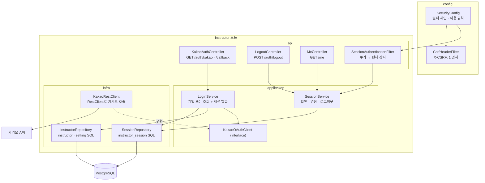
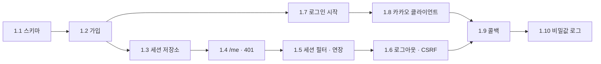

# BE-0001 구현 플랜 · 강사 세팅

근거: [prd.md](prd.md) · [ac.yml](ac.yml)

## 개요

| Phase | User Story | AC | 상태 |
|---|---|---|---|
| 1 | PRD-0001 US 1 가입 · 로그인 · 세션 | AC-1 ~ AC-10 | 진행 중 (1.2 완료) |
| 2 ~ | US 2 ~ 5 시간표 · 회원 · 수강권 · 링크 | AC-11 ~ (추가 예정) | 열린 질문 해소 후 작성 |

### Phase 1 구조

- `config`가 `instructor`의 필터를 체인에 끼운다. 방향은 `config → instructor` 한쪽이다(overview 모듈 절)
- `SessionAuthenticationFilter`는 HTTP를 다루므로 `api`에 둔다. 다른 모듈은 이 필터를 부르지 않는다. 다만 `config`가 끼우려면 공개돼야 하므로 공개 범위는 1.5에서 정한다(Modulith `@NamedInterface` 또는 `config`가 `application`의 팩토리를 부르는 방식)
- 카카오 호출은 `application`의 인터페이스(`KakaoOAuthClient`) 뒤에 둔다. 흐름 테스트는 가짜 구현으로 바꿔 끼우고, 실제 HTTP는 1.8에서 따로 검증한다

### 설정값

`application.properties`에 `fitlink.auth.*`로 둔다. 비밀값은 환경변수로만 받는다.

| 키 | local 값 | 비고 |
|---|---|---|
| `fitlink.auth.kakao.client-id` | `${KAKAO_CLIENT_ID}` | REST API 키 |
| `fitlink.auth.kakao.client-secret` | `${KAKAO_CLIENT_SECRET}` | 로그 금지(AC-10) |
| `fitlink.auth.kakao.redirect-uri` | `http://localhost:8080/auth/kakao/callback` | |
| `fitlink.auth.success-url` · `failure-url` | `http://localhost:5173/` · `http://localhost:5173/?login=failed` | Q30 임시값 |
| `fitlink.auth.cookie.session` · `cookie.state` | `SESSION` · `KAKAO-STATE` | dev · prod는 `__Host-Http-` 접두사 |

### 테스트 방식

- DB가 닿는 테스트는 공통 기반 클래스 하나(Testcontainers + MockMvc + 가짜 `KakaoOAuthClient`)를 상속한다. 클래스마다 설정을 바꾸지 않아 Spring 컨텍스트 · 컨테이너를 재사용한다
- 테스트 사이 데이터는 매 테스트 전에 Phase 1 테이블을 `TRUNCATE ... RESTART IDENTITY CASCADE`로 비운다. AC-3 동시성 테스트가 `@Transactional` 롤백과 맞지 않아서다
- 14일 경과(AC-7)는 `expires_at`을 SQL로 과거로 바꿔 만든다(prd 3.3 시각)

## Phase 1: PRD-0001 US 1 — 가입 · 로그인 · 세션

### 1.1 스키마 (V1)

- [x] RED: 실패하는 테스트 — `[BE-0001 AC-3] 같은 provider · provider_user_id 두 번째 INSERT는 instructor_identity_uk 위반`
- [x] GREEN: `V1__instructor.sql`에 `instructor` · `setting` · `instructor_session`(prd 3.1 DDL 그대로)
- [x] REFACTOR: 공통 테스트 기반 클래스 · TRUNCATE 정리 도입

### 1.2 가입 또는 조회 (InstructorRepository · LoginService 일부)

- [x] RED: `[BE-0001 AC-2] 처음 보는 카카오 번호는 instructor 1행과 setting(open_range_days=14) 1행을 만든다`
- [x] RED: `[BE-0001 AC-2] 닉네임 · 이메일이 없어도 가입하고 name · email은 null`
- [x] RED: `[BE-0001 AC-3] 같은 번호로 다시 가입 처리하면 같은 id, 행 수 그대로`
- [x] RED: `[BE-0001 AC-3] 같은 번호의 가입 처리 두 개를 동시에 실행해도 instructor · setting 1행씩`
- [x] GREEN: `INSERT ... ON CONFLICT ON CONSTRAINT instructor_identity_uk DO NOTHING RETURNING id` → 1행이면 `setting` INSERT, 0행이면 조회. 한 트랜잭션
- [x] REFACTOR: 카카오 사용자 정보를 받는 record(`KakaoUser(id, nickname, email)`) 정리 — GREEN에서 입력 타입으로 바로 도입

### 1.3 세션 저장소 (SessionRepository)

- [ ] RED: `[BE-0001 AC-4] 발급한 세션 ID는 32바이트 난수이고 DB에는 SHA-256 해시만 저장된다`
- [ ] RED: `[BE-0001 AC-7] 확인하면 expires_at이 now + 14일로 연장되고 instructor_id를 돌려준다`
- [ ] RED: `[BE-0001 AC-7] expires_at이 지난 세션은 확인 결과가 비어 있다`
- [ ] RED: `[BE-0001 AC-8] revoke하면 revoked_at이 채워지고 이후 확인 결과가 비어 있다`
- [ ] GREEN: prd 3.1 로그인 세션 절의 조건부 UPDATE · revoke SQL
- [ ] REFACTOR: 해시 계산을 한 곳(`SessionToken`)으로

### 1.4 `GET /me` 응답 모양과 401

- [ ] RED: `[BE-0001 AC-6] 쿠키 없이 GET /me는 401 { code: UNAUTHENTICATED }`
- [ ] RED: `[BE-0001 AC-6] DB에 없는 쿠키 값이면 401`
- [ ] GREEN: Security entry point가 401 본문 `{ "code": "UNAUTHENTICATED", "message": ... }`을 쓴다
- [ ] REFACTOR: 에러 본문 record(`ErrorResponse(code, message)`)를 공통으로

### 1.5 세션 확인 필터와 연장

- [ ] RED: `[BE-0001 AC-6] 유효한 세션 쿠키로 GET /me는 200 { id, name, email }`
- [ ] RED: `[BE-0001 AC-7] 인증된 요청 뒤 expires_at이 요청 시각 + 14일`
- [ ] RED: `[BE-0001 AC-7] 만료된 세션 쿠키로 GET /me는 401`
- [ ] GREEN: `SessionAuthenticationFilter`(쿠키 → `SessionService` → SecurityContext에 강사 id), `MeController`
- [ ] REFACTOR: 컨트롤러가 현재 강사 id를 받는 방식(`@AuthenticationPrincipal` 또는 argument resolver) 하나로 정하고 Modulith 공개 범위 정리. `ModularityTests` 통과 확인

### 1.6 로그아웃과 CSRF 헤더

- [ ] RED: `[BE-0001 AC-8] POST /auth/logout은 204, 쿠키 Max-Age=0, 세션 행 revoked_at 채움`
- [ ] RED: `[BE-0001 AC-8] 로그아웃한 쿠키로 GET /me는 401`
- [ ] RED: `[BE-0001 AC-8] 쿠키 없이 로그아웃해도 204`
- [ ] RED: `[BE-0001 AC-9] X-CSRF 헤더 없는 로그아웃은 403 CSRF_HEADER_MISSING이고 세션은 그대로`
- [ ] RED: `[BE-0001 AC-9] 인증이 필요한 경로에 세션 · 헤더 없이 POST하면 401`
- [ ] GREEN: `LogoutController`, `CsrfHeaderFilter`(AuthorizationFilter 뒤)
- [ ] REFACTOR: 쿠키 생성 · 삭제를 한 곳(`AuthCookies`)으로. 이름은 설정값

### 1.7 로그인 시작 `GET /auth/kakao`

- [ ] RED: `[BE-0001 AC-1] 302 Location이 kauth.kakao.com/oauth/authorize이고 client_id · redirect_uri · response_type=code · state를 가진다`
- [ ] RED: `[BE-0001 AC-1] KAKAO-STATE 쿠키가 Location의 state와 같고 HttpOnly · Secure · SameSite=Lax · Path=/ · Max-Age=600`
- [ ] RED: `[BE-0001 AC-1] 두 번 호출하면 state가 다르다`
- [ ] GREEN: `KakaoAuthController.start`
- [ ] REFACTOR: 설정 record(`AuthProperties`)로 묶기

### 1.8 카카오 클라이언트 (KakaoRestClient)

- [ ] RED: `[BE-0001 AC-2] code로 토큰 요청 → 사용자 조회 결과를 KakaoUser로 바꾼다` (MockRestServiceServer로 카카오 응답 고정)
- [ ] RED: `[BE-0001 AC-2] kakao_account에 닉네임 · 이메일이 없으면 null`
- [ ] RED: `[BE-0001 AC-5] 토큰 · 사용자 조회가 4xx · 5xx면 정해진 예외 하나로 바꾼다`
- [ ] GREEN: `RestClient`로 `POST kauth.kakao.com/oauth/token`(form: grant_type · client_id · client_secret · redirect_uri · code), `GET kapi.kakao.com/v2/user/me`
- [ ] REFACTOR: 타임아웃 설정, 응답 JSON record 정리

### 1.9 콜백 `GET /auth/kakao/callback`

- [ ] RED: `[BE-0001 AC-4] 성공하면 302 성공 주소, SESSION 쿠키, 세션 행, KAKAO-STATE 삭제`
- [ ] RED: `[BE-0001 AC-4] 요청 파라미터로 목적지를 바꿀 수 없다`
- [ ] RED: `[BE-0001 AC-4] 이전 SESSION 쿠키를 들고 로그인하면 새 값이 다르고 이전 세션은 revoked`
- [ ] RED: `[BE-0001 AC-5] error=access_denied면 302 실패 주소, 세션 · 강사 행 없음`
- [ ] RED: `[BE-0001 AC-5] KAKAO-STATE 쿠키가 없거나 state가 다르면 302 실패 주소`
- [ ] RED: `[BE-0001 AC-5] 카카오 호출이 실패하면 302 실패 주소`
- [ ] GREEN: `KakaoAuthController.callback` → `LoginService.login(code)`(가입 또는 조회 + 이전 세션 무효 + 새 세션, 한 트랜잭션)
- [ ] REFACTOR: 실패 원인을 로그에 남기되 code · 토큰은 빼기

### 1.10 비밀값이 로그에 없다

- [ ] RED: `[BE-0001 AC-10] 로그인 · 로그아웃 흐름의 로그 출력에 code · 액세스 토큰 · client secret · 세션 ID 문자열이 없다` (`OutputCaptureExtension`)
- [ ] RED: `[BE-0001 AC-10] instructor_session에 저장된 값은 쿠키 값과 다르고 32바이트다`
- [ ] GREEN: 걸린 로그 문구 수정
- [ ] REFACTOR: 문서 doc-sync 준비(prd 4절 목록)

## Phase 1 끝난 뒤 확인

- [ ] `./gradlew test` 전체 통과, `ModularityTests` 통과
- [ ] local에서 카카오 앱으로 실제 로그인: `/auth/kakao` → 카카오 → 콜백 → `/me` 200 → 로그아웃 → `/me` 401
