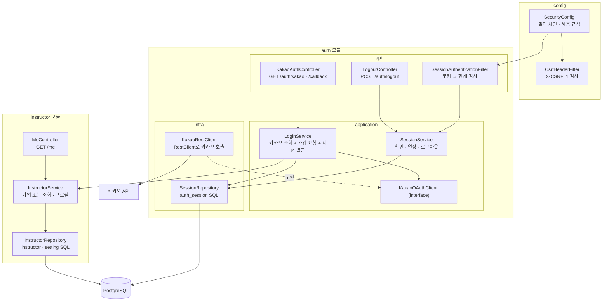
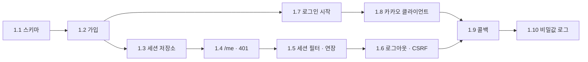
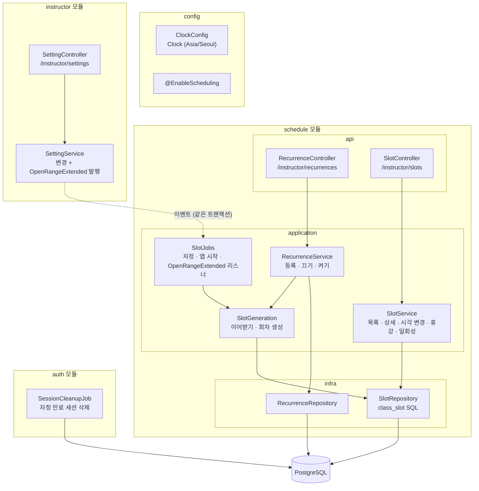
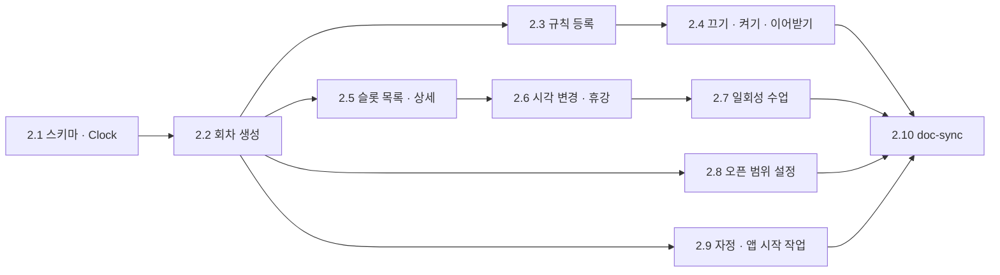

# BE-0001 구현 플랜 · 강사 세팅

근거: [prd.md](prd.md) · [ac.yml](ac.yml)

## 개요

| Phase | User Story | AC | 상태 |
|---|---|---|---|
| 1 | PRD-0001 US 1 가입 · 로그인 · 세션 | AC-1 ~ AC-10 | 완료 |
| 2 | US 2 시간표 · 오픈 범위, 매일 자정 작업 | AC-11 ~ AC-22 | 진행 중 (2.6 완료) |
| 3 ~ | US 3 ~ 5 회원 · 수강권 · 링크 | 추가 예정 | Phase 2 뒤 작성 |

### Phase 1 구조

- 로그인 · 세션 코드는 `auth` 모듈에 둔다([BE-ADR-0016](../../../decisions/0016-auth-module.md)). 1.1 ~ 1.6은 `instructor`에 만들었다가 1.6 뒤에 옮겼다
- 의존 방향은 `config → auth → instructor` 한쪽이다. `auth`는 가입할 때 `instructor`의 `application`(`InstructorService.signUpOrFind`)을 부른다
- `MeController`는 `auth`를 부르지 않는다. 필터가 SecurityContext에 남긴 강사 id를 `@AuthenticationPrincipal Long`으로 받는다
- `config`가 필터를 끼울 수 있도록 `auth`는 `SessionAuthenticationFilter` 하나만 `@NamedInterface("session-filter")`로 공개한다
- 카카오 호출은 `application`의 인터페이스(`KakaoOAuthClient`) 뒤에 둔다. 흐름 테스트는 가짜 구현으로 바꿔 끼우고, 실제 HTTP는 1.8에서 따로 검증한다

### 설정값

`application.yml`에 `fitlink.auth.*`로 둔다. 비밀값은 환경변수로만 받는다.

| 키 | local 값 | 비고 |
|---|---|---|
| `fitlink.auth.kakao.client-id` | `${KAKAO_CLIENT_ID}` | REST API 키 |
| `fitlink.auth.kakao.client-secret` | `${KAKAO_CLIENT_SECRET}` | 로그 금지(AC-10) |
| `fitlink.auth.kakao.redirect-uri` | `http://localhost:8080/auth/kakao/callback` | |
| `fitlink.auth.success-url` · `failure-url` | `http://localhost:5173/` · `http://localhost:5173/?login=failed` | Q30 임시값 |
| `fitlink.auth.cookie.session` · `cookie.state` | `SESSION` · `KAKAO-STATE` | dev · prod는 `__Host-Http-` 접두사 |

### 테스트 방식

- DB가 닿는 테스트는 공통 기반 클래스 하나(Testcontainers + MockMvc + 가짜 `KakaoOAuthClient`)를 상속한다. 클래스마다 설정을 바꾸지 않아 Spring 컨텍스트 · 컨테이너를 재사용한다
- 테스트 사이 데이터는 매 테스트 전에 Phase 1 테이블을 `TRUNCATE ... RESTART IDENTITY CASCADE`로 비운다. AC-3 동시성 테스트가 `@Transactional` 롤백과 맞지 않아서다
- 14일 경과(AC-7)는 `expires_at`을 SQL로 과거로 바꿔 만든다(prd 3.3 시각)

## Phase 1: PRD-0001 US 1 — 가입 · 로그인 · 세션

### 1.1 스키마 (V1)

- [x] RED: 실패하는 테스트 — `[BE-0001 AC-3] 같은 provider · provider_user_id 두 번째 INSERT는 instructor_identity_uk 위반`
- [x] GREEN: `V1__instructor.sql`에 `instructor` · `setting` · `instructor_session`(prd 3.1 DDL 그대로). auth 모듈 분리 때 세션 테이블을 `V2__auth_session.sql`로 옮기고 이름을 `auth_session`으로 바꿈
- [x] REFACTOR: 공통 테스트 기반 클래스 · TRUNCATE 정리 도입

### 1.2 가입 또는 조회 (InstructorRepository · InstructorService)

- [x] RED: `[BE-0001 AC-2] 처음 보는 카카오 번호는 instructor 1행과 setting(open_range_days=14) 1행을 만든다`
- [x] RED: `[BE-0001 AC-2] 닉네임 · 이메일이 없어도 가입하고 name · email은 null`
- [x] RED: `[BE-0001 AC-3] 같은 번호로 다시 가입 처리하면 같은 id, 행 수 그대로`
- [x] RED: `[BE-0001 AC-3] 같은 번호의 가입 처리 두 개를 동시에 실행해도 instructor · setting 1행씩`
- [x] GREEN: `INSERT ... ON CONFLICT ON CONSTRAINT instructor_identity_uk DO NOTHING RETURNING id` → 1행이면 `setting` INSERT, 0행이면 조회. 한 트랜잭션
- [x] REFACTOR: 카카오 사용자 정보를 받는 record(`KakaoUser(id, nickname, email)`) 정리 — GREEN에서 입력 타입으로 바로 도입

### 1.3 세션 저장소 (SessionRepository)

- [x] RED: `[BE-0001 AC-4] 발급한 세션 ID는 32바이트 난수이고 DB에는 SHA-256 해시만 저장된다`
- [x] RED: `[BE-0001 AC-7] 확인하면 expires_at이 now + 14일로 연장되고 instructor_id를 돌려준다`
- [x] RED: `[BE-0001 AC-7] expires_at이 지난 세션은 확인 결과가 비어 있다`
- [x] RED: `[BE-0001 AC-8] revoke하면 revoked_at이 채워지고 이후 확인 결과가 비어 있다`
- [x] GREEN: prd 3.1 로그인 세션 절의 조건부 UPDATE · revoke SQL
- [x] REFACTOR: 해시 계산을 한 곳(`SessionToken`)으로

### 1.4 `GET /me` 응답 모양과 401

- [x] RED: `[BE-0001 AC-6] 쿠키 없이 GET /me는 401 { code: UNAUTHENTICATED }`
- [x] RED: `[BE-0001 AC-6] DB에 없는 쿠키 값이면 401`
- [x] GREEN: Security entry point가 401 본문 `{ "code": "UNAUTHENTICATED", "message": ... }`을 쓴다
- [x] REFACTOR: 에러 본문 record(`ErrorResponse(code, message)`)를 공통으로

### 1.5 세션 확인 필터와 연장

- [x] RED: `[BE-0001 AC-6] 유효한 세션 쿠키로 GET /me는 200 { id, name, email }`
- [x] RED: `[BE-0001 AC-7] 인증된 요청 뒤 expires_at이 요청 시각 + 14일`
- [x] RED: `[BE-0001 AC-7] 만료된 세션 쿠키로 GET /me는 401`
- [x] GREEN: `SessionAuthenticationFilter`(쿠키 → `SessionService` → SecurityContext에 강사 id), `MeController`
- [x] REFACTOR: 컨트롤러가 현재 강사 id를 받는 방식(`@AuthenticationPrincipal` 또는 argument resolver) 하나로 정하고 Modulith 공개 범위 정리. `ModularityTests` 통과 확인 — `@AuthenticationPrincipal Long`, 필터 클래스에만 `@NamedInterface("session-filter")`

### 1.6 로그아웃과 CSRF 헤더

- [x] RED: `[BE-0001 AC-8] POST /auth/logout은 204, 쿠키 Max-Age=0, 세션 행 revoked_at 채움`
- [x] RED: `[BE-0001 AC-8] 로그아웃한 쿠키로 GET /me는 401`
- [x] RED: `[BE-0001 AC-8] 쿠키 없이 로그아웃해도 204`
- [x] RED: `[BE-0001 AC-9] X-CSRF 헤더 없는 로그아웃은 403 CSRF_HEADER_MISSING이고 세션은 그대로`
- [x] RED: `[BE-0001 AC-9] 인증이 필요한 경로에 세션 · 헤더 없이 POST하면 401`
- [x] GREEN: `LogoutController`, `CsrfHeaderFilter`(AuthorizationFilter 뒤)
- [x] REFACTOR: 쿠키 생성 · 삭제를 한 곳(`AuthCookies`)으로. 이름은 설정값 — 세션 필터를 Bean으로 바꾸고 서블릿 자동 등록을 끔. `config`는 `SessionService`를 직접 참조하지 않음

### 1.7 로그인 시작 `GET /auth/kakao`

- [x] RED: `[BE-0001 AC-1] 302 Location이 kauth.kakao.com/oauth/authorize이고 client_id · redirect_uri · response_type=code · state를 가진다`
- [x] RED: `[BE-0001 AC-1] KAKAO-STATE 쿠키가 Location의 state와 같고 HttpOnly · Secure · SameSite=Lax · Path=/ · Max-Age=600`
- [x] RED: `[BE-0001 AC-1] 두 번 호출하면 state가 다르다`
- [x] GREEN: `KakaoAuthController.start`, `AuthCookies.state`, `GET /auth/kakao` 허용 규칙
- [x] REFACTOR: 설정 record(`AuthProperties`)로 묶기 — 모듈 최상위 패키지에 둠(api · infra가 같이 씀). 카카오 키는 `.env`(git 제외)나 환경변수로 받음

### 1.8 카카오 클라이언트 (KakaoRestClient)

- [x] RED: `[BE-0001 AC-2] code로 토큰 요청 → 사용자 조회 결과를 KakaoUser로 바꾼다` (MockRestServiceServer로 카카오 응답 고정)
- [x] RED: `[BE-0001 AC-2] kakao_account에 닉네임 · 이메일이 없으면 null`
- [x] RED: `[BE-0001 AC-5] 토큰 · 사용자 조회가 4xx · 5xx면 정해진 예외 하나로 바꾼다`
- [x] GREEN: `RestClient`로 `POST kauth.kakao.com/oauth/token`(form: grant_type · client_id · client_secret · redirect_uri · code), `GET kapi.kakao.com/v2/user/me`
- [x] REFACTOR: 타임아웃 설정(연결 3초 · 응답 5초), 응답 JSON record 정리 — Spring Boot의 RestClient 자동 구성 모듈이 없어 `RestClient.builder()`를 직접 쓴다. 테스트는 MockRestServiceServer를 묶은 builder를 생성자로 넘긴다

### 1.9 콜백 `GET /auth/kakao/callback`

- [x] RED: `[BE-0001 AC-4] 성공하면 302 성공 주소, SESSION 쿠키, 세션 행, KAKAO-STATE 삭제`
- [x] RED: `[BE-0001 AC-4] 요청 파라미터로 목적지를 바꿀 수 없다`
- [x] RED: `[BE-0001 AC-4] 이전 SESSION 쿠키를 들고 로그인하면 새 값이 다르고 이전 세션은 revoked`
- [x] RED: `[BE-0001 AC-5] error=access_denied면 302 실패 주소, 세션 · 강사 행 없음`
- [x] RED: `[BE-0001 AC-5] KAKAO-STATE 쿠키가 없거나 state가 다르면 302 실패 주소`
- [x] RED: `[BE-0001 AC-5] 카카오 호출이 실패하면 302 실패 주소`
- [x] GREEN: `KakaoAuthController.callback` → `LoginService.login(code)`(가입 또는 조회 + 이전 세션 무효 + 새 세션, 한 트랜잭션) — 카카오 호출은 트랜잭션 밖(`TransactionTemplate`). state는 `MessageDigest.isEqual`로 비교. 테스트는 `@MockitoBean KakaoOAuthClient`
- [x] RED: `[BE-0001 AC-7] 인증된 요청은 SESSION 쿠키도 같은 값 · Max-Age 14일로 다시 준다`, `인증에 실패한 요청은 SESSION 쿠키를 다시 주지 않는다`
- [x] GREEN: 로그인 때 SESSION 쿠키 Max-Age 14일, 세션 필터가 인증 성공마다 같은 쿠키를 다시 발급 — DB 만료만 연장하면 활동 중이어도 로그인 14일 뒤 쿠키가 사라진다. 로그아웃 · 재로그인 응답에는 SESSION 쿠키가 하나뿐인지 테스트로 확인
- [x] REFACTOR: 실패 원인을 로그에 남기되 code · 토큰은 빼기 — `KakaoLoginException`은 원래 예외를 담지 않고 HTTP 상태만. `error` 파라미터는 카카오 에러 코드 형식일 때만 기록

### 1.10 비밀값이 로그에 없다

- [x] RED: `[BE-0001 AC-10] 로그인 · 재로그인 · 인증 · 로그아웃 흐름의 로그에 code · client secret · 세션 ID가 없다`, `카카오가 실패하고 에러 본문에 code · 토큰을 실어 보내도 로그에 없다` (`OutputCaptureExtension`, 우리 코드와 Spring 웹 · 보안 · JDBC logger를 TRACE로 낮춰 실행. 카카오 실패는 실제 `KakaoRestClient`를 가짜 카카오 서버에 붙임)
- [x] RED: `[BE-0001 AC-10] 세션 테이블에는 세션 ID 원본 컬럼이 없고 어느 테이블에도 카카오 토큰 컬럼이 없다`. 저장값이 쿠키 값의 SHA-256(32바이트)인 것은 1.3 · 1.9 테스트가 이미 확인
- [x] GREEN: 우리 코드의 로그는 걸리지 않았다. Spring logger 4개가 DEBUG · TRACE에서 code(요청 주소 · 컨트롤러 인자)와 client secret(카카오로 보내는 form)을 찍어 `application.yml`에서 INFO로 고정 — 상위 패키지 수준을 낮춰도 따라 내려가지 않는다. 4줄 각각 지우면 테스트가 실패하는 것 확인. MockMvc 테스트에 없는 Tomcat 요청 원문 logger(`Http11InputBuffer`)도 같이 고정. 목록 방식이라 운영에서 프레임워크 전체를 DEBUG로 내리지 않는다는 규칙을 설정 주석 · `overview.md`에 둠
- [x] REFACTOR: doc-sync — 기능 상태 in-progress, 강사 `POLICY.md` 규칙 절(가입 · 로그인 · 세션), `overview.md` 인증 흐름. `data-model.md`는 auth 모듈 분리 때 반영됨

## Phase 1 끝난 뒤 확인

- [x] `./gradlew test` 전체 통과(2026-11-05 기준 43개), `ModularityTests` 통과. local 프로필 · 실제 compose DB로 띄워 마이그레이션 V1 · V2 적용, 카카오를 부르지 않는 응답(로그인 시작 302 · `/me` 401 · 로그아웃 403/204 · state 불일치 302 실패 주소) 확인. 지금은 카카오 키가 비면 앱이 뜨지 않으므로, 다시 할 때는 `.env`에 아무 값이나 넣는다
- [x] local에서 카카오 앱으로 실제 로그인: `/auth/kakao` → 카카오 → 콜백 → `/me` 200 → 로그아웃 → `/me` 401. Chrome으로 2026-11-10 확인. 강사 · 설정 1행, 세션은 32바이트 해시로 저장 후 `revoked_at` 채워짐, 앱 로그에 비밀값 패턴 0건. `.env` 값에 따옴표를 넣으면 값의 일부가 되어 KOE101이 난다

## Phase 2: PRD-0001 US 2 — 시간표 · 오픈 범위 · 매일 자정 작업

### Phase 2 구조

- 의존 방향은 `schedule → instructor` 그대로다. `instructor`는 `OpenRangeExtended(instructorId, today, now)`를 발행만 하고 `schedule`을 모른다. 이벤트 record는 `instructor.application`에 둔다
- 회차 생성 SQL은 `setting.open_range_days`를 JOIN으로 읽기만 한다. 쓰기는 `instructor`만 한다
- 컨트롤러는 Phase 1처럼 `@AuthenticationPrincipal Long`으로 강사 id를 받는다
- 자정 작업은 모듈마다 자기 `@Scheduled`를 갖는다. 월 정액 주기 생성(Phase 4 이후)이 "회차 생성 뒤 같은 `today`로" 붙을 자리는 그때 정한다

### 시각 · 테스트 방식

- `Clock` 빈(`Asia/Seoul`) 하나에서 `today` · `now`를 요청 · 작업 시작 때 한 번 구해 서비스 → 저장소 → SQL 파라미터로 넘긴다. 시간표 SQL은 `now()`를 쓰지 않는다(prd 3.3 시각)
- 테스트는 공통 기반 클래스가 바꿀 수 있는 고정 `Clock`을 `@Primary`로 넣는다. 기본값은 고정 날짜(목요일 12:00 서울)이고 `@BeforeEach`에서 되돌린다. 컨텍스트 설정이 같아 Phase 1 테스트와 컨텍스트를 같이 쓴다
- TRUNCATE 목록에 `recurrence` · `class_slot`을 더한다. 격리 테스트는 강사를 2명 만든다(BE-ADR-0013)
- 예약(`booking`)은 아직 없으므로 SLOT_HAS_BOOKINGS는 `taken`을 SQL로 올려 만든다
- 테스트 컨텍스트에서는 스케줄 실행을 끈다(`fitlink.scheduling.enabled=false`, `@EnableScheduling`을 둔 설정에 `@ConditionalOnProperty`). 자정을 넘겨 도는 CI에서 실제 cron이 테스트 도중 데이터를 바꾸지 않게 하려는 것이다. 작업은 테스트가 메서드를 직접 부른다
- 세션 만료 테스트(AC-22)는 Phase 1처럼 DB 시각 기준으로 `expires_at`을 만든다. 고정 `Clock`과 섞지 않는다

### 2.1 스키마 (V3) · Clock

- [x] RED: `[BE-0001 AC-12] 같은 recurrence_id · occurs_on 두 번째 INSERT는 class_slot_occurrence_uk 위반`
- [x] RED: `[BE-0001 AC-15] 같은 강사 · 같은 starts_at의 휴강 아닌 슬롯 두 번째 INSERT는 class_slot_time_uidx 위반, 휴강한 행과는 겹쳐도 된다`
- [x] RED: `[BE-0001 AC-11] 같은 강사 · 요일 · 시각의 켜진 규칙 두 번째 INSERT는 recurrence_slot_uidx 위반, 꺼진 규칙과는 겹쳐도 된다`
- [x] GREEN: `V3__schedule.sql`에 `recurrence` · `class_slot`(prd 3.1 DDL 그대로), `ClockConfig`, 테스트용 고정 `Clock` — `TestClock`(기본 목요일 12:00 서울)을 `@Primary`로 넣고 `IntegrationTest`가 테스트마다 되돌린다. 부분 유니크 조건(`WHERE canceled_at IS NULL` · `WHERE active`)을 각각 빼면 테스트가 실패하는 것 확인. 소유자 복합 FK · `taken` 범위 CHECK도 테스트로 고정. `TestClock.withZone`은 고정 사본이 아니라 같은 "지금"을 보는 시계를 돌려준다(빈이 미리 받아 둔 시계도 `set()`을 따라감)
- [x] REFACTOR: 테스트에서 강사 · 규칙 · 슬롯을 만드는 도우미(SQL 직접 INSERT) 정리 — `ScheduleFixtures`. 테스트 전 TRUNCATE 대상은 DB의 테이블 목록에서 읽는다(마이그레이션에 테이블을 더해도 고칠 곳 없음)

### 2.2 회차 생성 (SlotGeneration · SlotRepository)

- [x] RED: `[BE-0001 AC-12] 목요일 12:00 · 14일에 화 20:00 규칙이면 다음 화요일 2개, 20:00+09:00, 정원 복사`
- [x] RED: `[BE-0001 AC-12] 화요일 21:00에 돌리면 오늘 회차는 없다`, `목요일 12:00 · 7일에 목 20:00 규칙이면 오늘 회차만 있고 다음 목요일은 없다`
- [x] RED: `[BE-0001 AC-16] 두 번 돌려도 행 수가 같고, 휴강 · 시각을 바꾼 회차가 다시 생기지 않는다`
- [x] RED: `[BE-0001 AC-16] 강사를 정하지 않으면 모든 강사의 회차를 만든다`
- [x] RED: `[BE-0001 AC-14] 꺼진 규칙의 회차 하나는 휴강 · 하나는 19:30일 때 같은 요일 · 시각 규칙을 켜면 이어받고 새 회차가 없다, 정원은 원래 값`
- [x] RED: `[BE-0001 AC-15] 다음 주 화 20:00 일회성 수업을 휴강한 뒤 화 20:00 규칙을 켜도 그 날짜에는 회차가 없다` (`NOT EXISTS`를 빼면 실패해야 한다)
- [x] GREEN: prd 3.1 시간표 절의 이어받기 UPDATE와 회차 생성 쿼리(`$today` · `$now` · `CAST($instructorId AS bigint)` · `NOT EXISTS` · `ORDER BY` · `ON CONFLICT DO NOTHING`). 이어받기는 요일 · 시각을 파라미터로 받지 않고 새 규칙 행과 JOIN한다. 이어받기는 소유자 · 켜진 새 규칙을 SQL에서 다시 확인하고, 날짜마다 한 행만 옮긴다. 규칙을 여러 개 켜면 모두 이어받은 뒤 회차 생성을 한 번만 돈다. SQL 조건을 하나씩 깨면 테스트가 실패하는 것 확인(`NOT old_rule.active`만 유니크 · 자기 회차 조건과 겹쳐 결과가 같다. 읽는 사람을 위해 남김). 휴강 포함 조회용 `class_slot_owner_idx`를 V3에 더함. `DB 세션 타임존이 달라도 서울 시각` 테스트를 더함(pgjdbc가 세션 타임존을 JVM 기본값으로 맞춰서, 없으면 `AT TIME ZONE`을 빼도 서울 PC에서는 통과한다)
- [x] REFACTOR: `today` · `now`를 묶은 값(예: `GenerationTime`)으로 한 번만 구하게 — GREEN에서 `GenerationTime.at(clock)`으로 바로 도입

### 2.3 규칙 등록 · 목록 `/instructor/recurrences`

- [x] RED: `[BE-0001 AC-11] [MON, WED] 20:00 · 8 → 201 items 2개`, `GET 목록은 월 → 일 · 시각 순, 다른 강사 규칙 없음`
- [x] RED: `[BE-0001 AC-11] weekdays 빈 · 중복, startTime 형식, capacity 0 · 51 → 400, 행 없음`
- [x] RED: `[BE-0001 AC-11] WED 20:00이 켜져 있으면 [MON, WED] → 409 RECURRENCE_DUPLICATE weekdays [WED], MON도 없음`
- [x] RED: `[BE-0001 AC-12] 등록 응답 뒤 오픈 범위 안 회차가 있다`
- [x] GREEN: `RecurrenceController` · `RecurrenceService`(한 트랜잭션: 겹침 확인 → INSERT → 이어받기 → 회차 생성). 동시 등록이 유니크에 걸리면 `recurrence_slot_uidx` → 409로 바꾼다(prd 3.2 공통 규칙) — 요일 이름 ↔ DB 번호(0 = 일요일) 변환은 `Weekday` enum 한 곳. 시각은 `@JsonFormat(pattern = "HH:mm")`라 `8:00` · `20:00:00` · `25:00`은 400. 모르는 요일 · 시각 형식 오류는 Jackson 예외 경로에서 필드 이름을 찾는다. 꺼진 같은 요일 · 시각 규칙과는 겹치지 않고 남은 회차를 이어받는 API 테스트를 더함. 조건을 하나씩 깨면 테스트가 실패하는 것 확인
- [x] REFACTOR: 제약 이름 → 에러 코드 대응을 한 곳으로(`class_slot_time_uidx` · `recurrence_slot_uidx`) — `schedule.api`의 `ScheduleErrorHandler`. 모듈마다 `api`가 에러 코드를 바꾼다(BE-ADR-0011). 대응표에 없는 제약은 그대로 던져 500. 경합 재현이 어려워 처리기를 직접 부르는 테스트로 확인. 리뷰 반영: 요일 목록의 `null` 원소 400, 정수 필드의 소수 거부(`accept-float-as-int: false`), 등록 응답도 월요일부터 정렬, 규칙 중복 응답을 한 곳에서 생성. 처리되지 않은 예외가 `/error`로 다시 들어올 때 인증을 요구해 500이 401로 보이던 문제(Phase 1부터)는 main 대상 별도 PR에서 `config`의 ERROR 디스패치 허용으로 고침

### 2.4 규칙 끄기 · 다시 켜기 · 이어받기

- [x] RED: `[BE-0001 AC-13] 끄면 이미 만든 회차는 그대로, 하루 넘겨 생성해도 새 회차 없음`
- [x] RED: `[BE-0001 AC-13] 다시 켜면 응답 전에 회차가 생긴다`, `같은 시각 켜진 규칙이 있으면 409이고 active false 그대로`
- [x] RED: `[BE-0001 AC-14] A를 끄고 B 등록 → 이어받기, B를 끄고 A 켜기 → 다시 이어받기`, `늘어난 범위의 새 회차는 B 정원`
- [x] GREEN: `PATCH /instructor/recurrences/{id}`. 다른 강사 id는 404 — 없는 id도 같은 404 `NOT_FOUND`. `active`가 없으면 400, 경로 id가 숫자가 아니면 400(필드 `id`). 이미 그 상태면 200이고 바꾸지 않는다(켜진 규칙을 다시 켜도 자기 자신과 겹친다고 409를 주지 않는다). 규칙 행은 `FOR NO KEY UPDATE`로 잠근다. `FOR UPDATE`는 회차 INSERT의 외래 키 확인(KEY SHARE)과 충돌해 자정 생성과 deadlock이 날 수 있다(리뷰 반영)
- [x] REFACTOR: 등록과 다시 켜기의 "이어받기 → 생성"을 한 메서드로 — `RecurrenceService`의 `rejectActiveOverlap` · `fillOpenRange`. 동시에 두 꺼진 규칙을 켜면 DB 유니크에 걸려 409의 `weekdays`가 빈 목록인 것은 등록과 같게 둔다. 조건을 하나씩 깨면 테스트가 실패하는 것 확인

### 2.5 슬롯 목록 · 상세

- [x] RED: `[BE-0001 AC-17] 지금 이후 자기 슬롯만 시각 순, 지난 · 진행 중 · 다른 강사 슬롯 없음, openRangeDays`
- [x] RED: `[BE-0001 AC-17] 휴강 슬롯은 canceledAt과 함께, 범위를 줄인 뒤 범위 밖 슬롯도 들어 있다`
- [x] RED: `[BE-0001 AC-17] 상세: 반복 회차는 recurrence, 일회성은 null, 다른 강사 id는 404`
- [x] GREEN: `SlotController` · `SlotService`. 쿼리는 `class_slot.instructor_id`로 거르고 `recurrence`는 LEFT JOIN(일회성이 빠지지 않게) — 오픈 범위는 `instructor` 모듈의 `SettingService`로 읽는다(schedule → instructor 방향). 범위와 슬롯을 같은 시점으로 읽도록 목록은 REPEATABLE READ. "지금 이후"는 `starts_at > now`라 지금 막 시작한 수업은 빠진다. 시각은 DB가 UTC로 돌려줄 수 있어 응답에서 서울 시각(+09:00)으로 바꾼다. 경로 id가 숫자가 아니면 400
- [x] REFACTOR: 응답 record(`SlotSummary` · `SlotDetail`) 정리 — 응답 record는 `SlotController` 안에 두고, `HH:mm` · 서울 시각 표기는 `ApiFormats` 한 곳으로 모았다(규칙 API와 함께 씀). 리뷰 반영: 설정 행이 없을 때 원인이 보이는 예외, 상세도 readOnly 트랜잭션. 조건을 하나씩 깨면 테스트가 실패하는 것 확인

### 2.6 회차 시각 변경 · 휴강

- [x] RED: `[BE-0001 AC-18] 19:30으로 바꾸면 그 슬롯만, occurs_on · 다른 주 회차 그대로`
- [x] RED: `[BE-0001 AC-18] 휴강 → SLOT_CANCELED, 시작 → CLASS_STARTED, 지난 시각 · date → 400, taken > 0 → SLOT_HAS_BOOKINGS, 같은 시각 → SLOT_TIME_TAKEN, 여러 개면 앞의 것`
- [x] RED: `[BE-0001 AC-19] 휴강하면 canceled_at, 다시 보내면 처음 값 그대로 200, 시작한 슬롯은 CLASS_STARTED`, `taken > 0이어도 휴강된다`
- [x] GREEN: 읽고 판정 → 조건부 UPDATE. 시각 변경은 `WHERE taken = 0 AND canceled_at IS NULL AND starts_at > $now`, 휴강은 `SET canceled_at = $now WHERE canceled_at IS NULL AND starts_at > $now`(예약이 있어도 휴강한다). 0행이면 다시 읽어 각자의 순서로 답한다. 휴강은 이미 휴강이면 200, 시작했으면 CLASS_STARTED — 0행일 때 다시 읽기는 3번까지, 그래도 못 바꾸면 500. 조건부 UPDATE가 판정 없이도 휴강 · 예약 · 시작한 슬롯과 다른 강사 슬롯을 막는지 레포지토리 테스트로 확인. 시작한 수업의 휴강은 허용하지 않는다(2026-11-11 확정). 일회성 수업의 `date`는 2.7 전까지 반복 회차와 같이 400
- [x] REFACTOR: 판정 순서를 한 메서드로(2.7과 같이 씀) — 휴강 · 시작 판정을 `rejectClosed`로 묶었다. 400을 서비스에서도 던지도록 `InvalidRequestException`을 application으로 옮기고, 서울 zone은 `ScheduleZone` 한 곳에 둔다. 리뷰 반영: 지금 시각을 마이크로초로 잘라 자바 판정과 UPDATE의 WHERE가 경계에서 같은 값을 쓰게 했다

### 2.7 일회성 수업

- [x] RED: `[BE-0001 AC-20] 등록 → 201, recurrence null, occurs_on = date`
- [x] RED: `[BE-0001 AC-20] 지난 시각 · 범위 밖 날짜 · capacity 0 · 51 → 400 fields`
- [x] RED: `[BE-0001 AC-15] 반복 회차와 같은 시각 → 409 SLOT_TIME_TAKEN, 휴강한 시각은 허용, 다른 강사는 같은 시각 허용`
- [x] RED: `[BE-0001 AC-20] PATCH date로 다른 날로 옮기면 starts_at · occurs_on 같이 바뀜, 새 날짜가 범위 밖이면 400`, `범위를 줄여 범위 밖에 남은 일회성 수업도 startTime만은 바뀐다`
- [x] GREEN: `POST /instructor/slots`, `PATCH`의 `date` 처리 — 등록은 INSERT의 `class_slot_time_uidx` 위반을 409로 바꾼다(공통 처리기의 제약 대응표). 회차 생성은 돌지 않는다. 조건부 UPDATE가 `occurs_on`도 같이 바꾸고, 반복 회차는 SQL에서도 날짜를 옮기지 못하게 `recurrence_id IS NULL OR occurs_on = 같은 날`을 건다(레포지토리 테스트). 400 안의 순서는 날짜 문제(반복 회차의 date · 범위 밖) → 시각 문제(지금 이전)다. 어제 날짜를 보내면 `startTime`이 아니라 `date`를 준다. 지금 날짜를 그대로 보내면 날짜를 옮기는 것이 아니므로 범위를 보지 않고, 반복 회차도 받는다(FE가 수정 화면에서 date를 늘 보내도 되게. 리뷰 반영으로 AC-18 · prd 문구를 "다른 날짜를 보내면 400"으로 고침). 일회성 수업을 다른 날로 옮기면 비워진 원래 시각에 같은 요일 · 시각 규칙의 회차가 다음 생성 때 생길 수 있다. 휴강과 달리 강사가 그 시각 수업을 없앤 것이 아니므로 규칙대로 채우는 것을 맞는 동작으로 둔다(같은 날 시각만 옮길 때도 2.6부터 같다). 조건을 하나씩 깨면 테스트가 실패하는 것 확인
- [x] REFACTOR: 등록 · 수정의 입력 검사 공유 — `requireInOpenRange` · `requireAfterNow`. 시각 변경 · 휴강의 "읽고 판정 → 조건부 UPDATE → 0행이면 다시 읽기(3번까지)" 반복문도 `untilApplied` 한 곳으로 모았다

### 2.8 오픈 범위 설정 `/instructor/settings`

- [ ] RED: `[BE-0001 AC-21] GET → 14, PATCH 6 · 29 → 400`
- [ ] RED: `[BE-0001 AC-21] 14 → 28이면 응답 전에 15 ~ 28일째 회차가 있다`, `28 → 7이면 범위 밖 슬롯이 남는다`
- [ ] RED: `[BE-0001 AC-21] 회차 생성이 실패하면 PATCH가 실패하고 open_range_days 그대로` (실패는 테스트 안에서 `class_slot`에 `CHECK (false) NOT VALID` 제약을 잠시 건다. `NOT VALID`라 이미 있는 회차는 검사하지 않고 새 INSERT만 실패한다. `finally`에서 지우고, `@BeforeEach`도 `DROP CONSTRAINT IF EXISTS`로 남은 것을 지운다. TRUNCATE는 제약을 지우지 않기 때문이다. 빈을 바꿔 끼우면 Spring 컨텍스트가 새로 떠서 피한다)
- [ ] GREEN: `instructor`의 `SettingController` · `SettingService`(UPDATE 뒤 늘었을 때만 `OpenRangeExtended` 발행), `schedule`의 동기 `@EventListener`
- [ ] REFACTOR: `ModularityTests`로 `instructor → schedule` 의존이 없는지 확인

### 2.9 매일 자정 · 앱 시작 작업

- [ ] RED: `[BE-0001 AC-16] 강사 2명, Clock을 하루 넘겨 전체 작업을 돌리면 두 강사 모두 범위 끝 날 회차가 생긴다`, `ApplicationReadyEvent를 발행하면 회차가 생긴다`(앱 시작 리스너가 실제로 이어져 있는지)
- [ ] RED: `[BE-0001 AC-22] 만료 · 로그아웃 미만료 · 유효 세션 중 만료 행만 지워지고, 지운 쿠키는 401`
- [ ] GREEN: `SlotJobs`(`@Scheduled(cron = "0 0 0 * * *", zone = "Asia/Seoul")` + `ApplicationReadyEvent`), `SessionCleanupJob`, `@EnableScheduling`, `V4__auth_session_expires_idx.sql`
- [ ] REFACTOR: cron · zone 값이 AC와 같은지 확인하는 테스트(어노테이션 값을 읽음. 테스트에서는 스케줄 실행을 꺼 두므로). 작업 실패는 로그만 남기고 앱을 멈추지 않는다

### 2.10 doc-sync

- [ ] REFACTOR: 시간표 `POLICY.md` 규칙 절 · `data-model.md`, 강사 `POLICY.md`(오픈 범위), `overview.md`(자정 작업 · 이벤트), `feature.yaml` 상태

## Phase 2 끝난 뒤 확인

- [ ] `./gradlew test` 전체 통과, `ModularityTests` 통과
- [ ] local에서 앱을 띄워 규칙 등록 → 슬롯 목록 → 시각 변경 · 휴강 → 일회성 수업 → 오픈 범위 변경을 curl로 한 번씩
