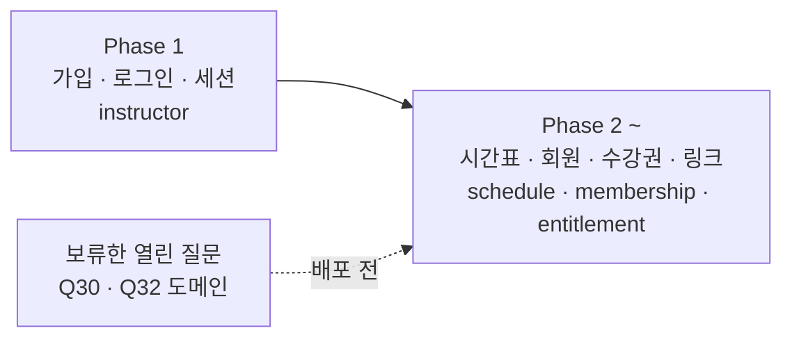
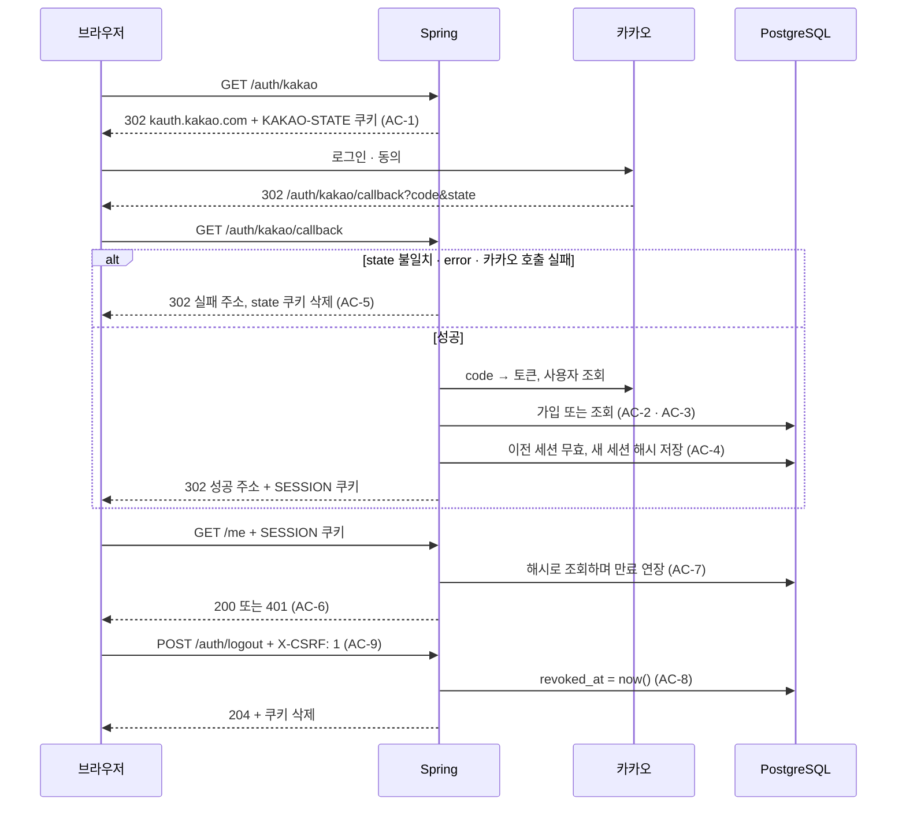
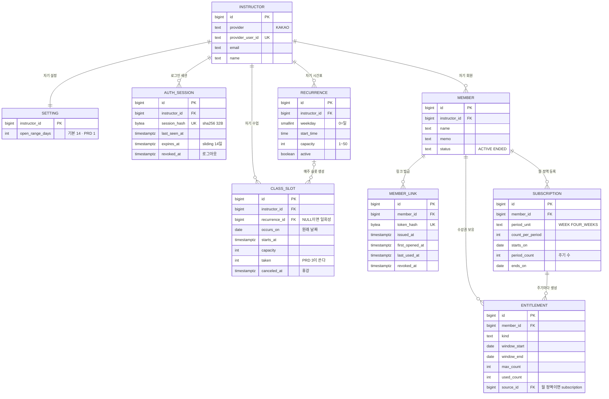
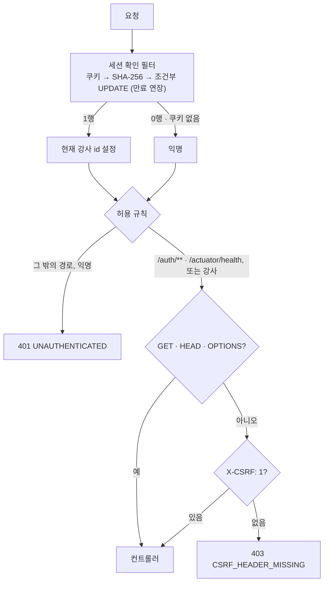

# BE-0001 개발 PRD · 강사 세팅

## 근거

- 제품 PRD: [PRD-0001](https://github.com/Fit-link-v2/Fit-link-PRD/tree/main/prd/0001-instructor-setup)
- 관련 결정: [DEC-0001](https://github.com/Fit-link-v2/Fit-link-PRD/blob/main/decisions/0001-instructor-kakao-oauth.md) 카카오 로그인 · [DEC-0008](https://github.com/Fit-link-v2/Fit-link-PRD/blob/main/decisions/0008-react-spa-backend-cookie.md) SPA · 쿠키 · 인증 API · [BE-ADR-0008](../../../decisions/0008-session-store.md) 세션 저장소 · [BE-ADR-0014](../../../decisions/0014-kakao-login-direct.md) 카카오 직접 구현 · [BE-ADR-0012](../../../decisions/0012-jdbc-client.md) JdbcClient. 나머지는 `feature.yaml`의 `decisions`

## 1. 개요

| 구분 | 내용 |
|---|---|
| 목적 | 강사가 카카오로 가입 · 로그인하고, 반복 시간표 · 회원 · 링크 · 수강권을 만든다. PRD-0002(회원 화면) · 0003(예약)이 기대는 데이터를 준비한다 |
| 담당 도메인 | instructor |
| 참여 도메인 | schedule · membership · entitlement |
| 범위 밖 | 예약 · 대기(0003 · 0004), 취소 마감(0005), 이벤트 로그. 카카오 외 로그인 수단 |

### 진행 단위

열린 질문이 없는 US 1(가입 · 로그인)을 먼저 끝까지 만든다. US 2 ~ 5를 막던 열린 질문(Q23 월 정액 요청 모양 · 일회성 수업 규칙)은 정했다. 이 문서의 2절에 AC를 더하고 plan에 Phase를 더한다.

| Phase | 제품 User Story | 개발 AC | 상태 |
|---|---|---|---|
| 1 | US 1 가입 · 로그인 · 세션 | AC-1 ~ AC-10 | 이 문서에서 확정 |
| 2 ~ | US 2 시간표 · US 3 회원 · 수강권 · US 4 링크 · US 5 개봉 상태 | 추가 예정 | 3절 설계. 막던 열린 질문 해소, AC 작성 전 |

baseline 동결은 Phase 단위로 한다. Phase 1의 AC-1 ~ AC-10은 plan 승인 뒤 바꾸지 않는다. Phase 2 이후 AC는 번호를 이어서(AC-11 ~) 더하고 그때 다시 baseline을 커밋한다.



## 2. 인수 조건

기계용 계약은 [`ac.yml`](ac.yml)이 원본이다. 쿠키 이름은 dev · prod 기준이고 local 프로필은 `__Host-Http-` 접두사를 뺀다(BE-ADR-0014).

### AC-1. 로그인 시작은 state 쿠키를 심고 카카오로 보낸다

근거: PRD-0001 AC 1.1.8, DEC-0008, BE-ADR-0014

- [ ] `GET /auth/kakao`는 302로 카카오 인가 주소(`https://kauth.kakao.com/oauth/authorize`)에 `client_id` · `redirect_uri` · `response_type=code` · `state`를 붙여 보낸다
- [ ] `state`는 요청마다 새로 만든 난수(32바이트 이상)이고, 같은 값을 `__Host-Http-KAKAO-STATE` 쿠키(`HttpOnly` · `Secure` · `SameSite=Lax` · `Path=/` · `Max-Age=600`)에 담는다

### AC-2. 처음 로그인한 카카오 계정은 그 자리에서 가입된다

근거: PRD-0001 AC 1.2.1 · 1.2.2 · 1.2.4

- [ ] 콜백에서 `state`가 쿠키와 같고 카카오 토큰 교환 · 사용자 조회가 성공하면, 처음 보는 카카오 회원 번호는 `instructor` 1행과 `setting` 1행(`open_range_days` 14)을 한 트랜잭션에서 만든다
- [ ] 카카오가 닉네임 · 이메일을 주지 않아도 가입한다. `name` · `email`은 `null`로 둔다

### AC-3. 같은 카카오 계정은 다시 가입되지 않는다

근거: PRD-0001 AC 1.2.3

- [ ] 이미 가입한 카카오 회원 번호로 로그인하면 기존 강사로 로그인되고 `instructor` · `setting` 행이 늘지 않는다
- [ ] 같은 카카오 계정의 콜백 두 개가 동시에 와도 `instructor`는 1행이다(`instructor_identity_uk` + `ON CONFLICT DO NOTHING`)

### AC-4. 로그인 성공은 새 세션을 발급하고 강사 화면으로 보낸다

근거: PRD-0001 AC 1.1.8, DEC-0008, BE-ADR-0008

- [ ] 성공 응답은 302이고 `Location`은 설정의 성공 주소다. 요청 파라미터로 목적지를 받지 않는다(Q30)
- [ ] 세션 ID는 32바이트 난수이고 `__Host-Http-SESSION` 쿠키(`HttpOnly` · `Secure` · `SameSite=Lax` · `Path=/`)로 준다. DB에는 SHA-256 해시만 저장한다
- [ ] 로그인할 때마다 새 세션 ID를 만든다. 요청에 이전 세션 쿠키가 있었으면 그 세션은 무효가 된다
- [ ] `state` 쿠키는 성공 · 실패와 상관없이 콜백 응답에서 지운다

### AC-5. 로그인 실패는 세션 없이 실패 주소로 보낸다

근거: PRD-0001 AC 1.1.5

- [ ] 다음 경우 302로 설정의 실패 주소에 보내고 세션을 만들지 않는다: 카카오가 `error`를 줌(동의 취소 등), `state` 쿠키가 없음, `state`가 다름, 토큰 교환 실패, 사용자 조회 실패
- [ ] 실패해도 `instructor` · `auth_session` 행이 생기지 않는다

### AC-6. 로그인 상태는 `GET /me`로 확인한다

근거: PRD-0001 AC 1.1.3, DEC-0008

- [ ] 유효한 세션 쿠키가 있으면 200 `{ "id", "name", "email" }`
- [ ] 쿠키가 없거나, DB에 없거나, 만료 · 로그아웃된 세션이면 401 `{ "code": "UNAUTHENTICATED" }`. 강사 API 전체에 같은 규칙을 적용한다

### AC-7. 세션은 마지막 요청으로부터 14일 유지된다

근거: PRD-0001 AC 1.1.6

- [ ] 인증된 요청마다 `expires_at`이 그 시각 + 14일로 바뀐다
- [ ] 세션 쿠키의 `Max-Age`도 14일이고, 인증된 요청마다 같은 값으로 다시 준다. 브라우저를 닫아도 로그인이 유지되고, 쿠키가 DB 만료보다 먼저 사라지지 않는다
- [ ] 마지막 요청 뒤 14일이 지나면 같은 쿠키는 401이다

### AC-8. 로그아웃하면 세션이 즉시 무효가 된다

근거: PRD-0001 AC 1.1.7

- [ ] `POST /auth/logout`은 204를 주고 세션 쿠키를 지운다(`Max-Age=0`). 세션 행은 `revoked_at`이 채워진다
- [ ] 로그아웃한 쿠키로 다시 요청하면 401이다
- [ ] 세션 쿠키가 없거나 이미 무효여도 204다

### AC-9. GET이 아닌 요청은 `X-CSRF: 1` 헤더가 있어야 한다

근거: DEC-0008

- [ ] GET · HEAD · OPTIONS가 아닌 요청에 `X-CSRF: 1`이 없으면 403 `{ "code": "CSRF_HEADER_MISSING" }`. 로그아웃도 해당한다
- [ ] 인증이 필요한 경로는 401이 403보다 먼저다. 로그아웃은 세션 없이 열린 경로라 헤더가 없으면 403이다

### AC-10. 비밀 값은 저장 · 로그에 남지 않는다

근거: DEC-0002, BE-ADR-0014

- [ ] DB에 세션 ID 원본 · 카카오 토큰이 없다(`auth_session`에 해시 컬럼만, 카카오 토큰 컬럼 없음)
- [ ] 애플리케이션 로그에 카카오 `code` · 액세스 토큰 · client secret · 세션 ID가 찍히지 않는다. 알려진 Spring · Tomcat logger는 수준을 낮춰도 찍히지 않게 INFO로 고정한다

### Phase 1 흐름



## 3. 기술 설계

### 3.1 데이터 모델

#### 이 기능이 만드는 범위

PRD 1 단계에서 실제로 `CREATE TABLE`하는 것은 이 9개다. `booking` · `waitlist` · `event_log` · `entitlement_adjustment`는 PRD 3 이후에 붙는다.



| 컬럼 | PRD 1이 쓰나 | 지금 넣는 이유 |
|---|---|---|
| `class_slot.taken` | **아니오** | PRD 3 AC 1.3.1의 조건부 UPDATE 대상. 나중에 넣으려면 이미 생성된 슬롯 전부를 backfill해야 한다 |
| `entitlement.used_count` | 예 | AC 3.2.3의 "잔여 = max_count - used_count"와 강사의 수기 수정에 쓴다 |
| `member_link.revoked_at` | 예 | AC 4.3.1 재발급 |
| `class_slot.canceled_at` | 예 (쓰기) | AC 2.3.1 휴강. 읽는 쪽은 PRD 2다 |

표에서 첫 줄 하나만 "PRD 1이 안 쓰는" 컬럼이다. 그리고 그 하나가 **PRD 1의 인수 조건만으로는 도출되지 않는다.**

AC 2.1.1은 `capacity`(정원 상한)를 요구하지만 `taken`(현재 찬 인원)을 요구하지 않는다. PRD 1 범위에는 `booking`이 없어 자리를 차지하는 쓰기 경로 자체가 없고, 따라서 경쟁도 없다. `taken`이 필요해지는 근거는 **"예약이라는 쓰기 경로가 생긴다"**는 사실이고, 그것은 PRD 0(상위 구상)에 있다.

정리하면 이렇다. 세부 인수 조건(PRD 3~5)이 없어도 상위 구상만 있으면 `taken`은 나온다. 그러나 **PRD 1만으로는 나오지 않는다.** 그 상태에서 설계하면 "예약 인원은 `booking`을 COUNT하면 되니 `taken`은 필요 없다"로 가게 되고, 정원 조건부 UPDATE를 쓸 수 없게 된다.

반대로 `booking.restored`(PRD 3 휴강 · PRD 5 마감)처럼 **PRD 1 시점에 알 수도 없고 나중에 넣으면 비싼** 항목도 남는다. 스키마를 앞 단계 문서만으로 전부 확정할 수는 없다는 뜻이다. 이 문서가 PRD 1~5를 한 번에 읽고 작성된 이유다.

팀원과 공유할 때는 전체 그림과 이 절을 같이 본다. 전체 그림은 "최종적으로 여기로 간다", 이 절은 "이번 단계에 손대는 범위"를 말한다.

#### 테이블 정의 (DDL)

##### 1. 강사 · 설정

```sql
CREATE TABLE instructor (
  id               bigserial   PRIMARY KEY,
  provider         text        NOT NULL CHECK (provider IN ('KAKAO')),
  provider_user_id text        NOT NULL,
  email            text,       -- 카카오 필수 동의로 받는다. 비즈 앱 전환 전에는 비어 있을 수 있다
  name             text,
  created_at       timestamptz NOT NULL DEFAULT now(),

  CONSTRAINT instructor_identity_uk UNIQUE (provider, provider_user_id)
);

-- 강사마다 1행. PK가 곧 소유자다.
CREATE TABLE setting (
  instructor_id         bigint      PRIMARY KEY REFERENCES instructor(id),
  open_range_days       int         NOT NULL DEFAULT 14
                          CHECK (open_range_days BETWEEN 7 AND 28),
  updated_at            timestamptz NOT NULL DEFAULT now()
);
```

비밀번호를 담는 컬럼이 없다. 카카오가 인증을 끝내고 우리는 `(provider, provider_user_id)`만 받는다([DEC-0001](https://github.com/Fit-link-v2/Fit-link-PRD/blob/main/decisions/0001-instructor-kakao-oauth.md)). 유출 시 비밀번호가 새지 않고, 재설정 화면도 필요 없다. `provider` CHECK는 지금 `KAKAO` 하나다. 다른 로그인 수단을 붙이면 CHECK 값만 늘린다.

`instructor_identity_uk`가 PRD 1 AC 1.2.3("같은 카카오 계정으로 다시 로그인하면 새로 가입되지 않는다")의 물리적 표현이다. 가입은 `INSERT ... ON CONFLICT (provider, provider_user_id) DO NOTHING` 뒤 조회로 처리하면 동시에 두 번 눌러도 강사가 두 명 생기지 않는다.

`cancel_deadline_hours`(취소 마감)는 기능 0005의 마이그레이션 004에서 붙는다.

`setting`의 PK가 `instructor_id`이므로 강사당 정확히 1행이 강제된다. 가입과 같은 트랜잭션에서 기본값으로 1행을 만든다(PRD 1 AC 1.2.2).

##### 1-1. 로그인 세션

```sql
-- 강사 로그인 세션 (DEC-0002 · DEC-0008). 세션 ID 원본은 쿠키에만 있고 DB에는 해시만 남는다.
CREATE TABLE auth_session (
  id            bigserial   PRIMARY KEY,
  instructor_id bigint      NOT NULL REFERENCES instructor(id),
  session_hash  bytea       NOT NULL UNIQUE,   -- SHA-256, 32바이트
  created_at    timestamptz NOT NULL DEFAULT now(),
  last_seen_at  timestamptz NOT NULL DEFAULT now(),
  expires_at    timestamptz NOT NULL,          -- last_seen_at + 14일
  revoked_at    timestamptz                    -- 로그아웃
);

CREATE INDEX auth_session_owner_idx ON auth_session (instructor_id);
```

```sql
-- 요청마다: 유효한 세션인지 확인하면서 만료를 연장한다 (PRD 1 AC 1.1.6)
UPDATE auth_session
   SET last_seen_at = now(), expires_at = now() + interval '14 days'
 WHERE session_hash = $hash AND revoked_at IS NULL AND expires_at > now()
RETURNING instructor_id;
-- 0행이면 로그인 화면으로

-- 로그아웃 (PRD 1 AC 1.1.7)
UPDATE auth_session SET revoked_at = now()
 WHERE session_hash = $hash AND revoked_at IS NULL;
```

세션 ID 원본을 저장하지 않는 이유는 `member_link`와 같다. DB가 유출돼도 살아 있는 세션을 가져갈 수 없다([DEC-0002](https://github.com/Fit-link-v2/Fit-link-PRD/blob/main/decisions/0002-instructor-session-cookie.md), [DEC-0008](https://github.com/Fit-link-v2/Fit-link-PRD/blob/main/decisions/0008-react-spa-backend-cookie.md)).

만료를 요청마다 연장하면 요청마다 쓰기가 한 번 생긴다. 강사 수십 명 규모에서는 문제되지 않는다. 부담이 되면 `last_seen_at`이 일정 시간 이상 지났을 때만 갱신한다. 만료된 행은 슬롯 생성 배치와 같은 시각(매일 자정)에 지운다. 세션은 이력이 아니라 보안 자료라 BE-ADR-0003(지우지 않는다)의 예외다.

```sql
DELETE FROM auth_session WHERE expires_at <= now();
```

로그아웃한 행도 만료(마지막 요청 + 14일)가 지나면 같이 지워진다. 지운 세션의 쿠키로 요청하면 해시가 없어 만료 · 로그아웃과 똑같이 401이다. 만료 뒤 남겨 둘 이유(감사 기록 등)가 없어 보관 기간을 두지 않는다. 이 실행은 `auth` 모듈이 따로 갖는다(`schedule` 모듈을 부르지 않는다). 지금 `auth_session`에는 `expires_at` 인덱스가 없어 이 DELETE가 표 전체를 읽는다. 이 작업을 넣는 마이그레이션에서 `auth_session (expires_at)` 인덱스를 같이 더한다.

Spring Session JDBC를 쓰지 않고 이 테이블을 직접 만든다([BE-ADR-0008](../../../decisions/0008-session-store.md)). Spring Session JDBC의 기본 스키마는 세션 ID를 원본으로 저장한다.

##### 2. 시간표

```sql
CREATE TABLE recurrence (
  id            bigserial   PRIMARY KEY,
  instructor_id bigint      NOT NULL REFERENCES instructor(id),
  weekday       smallint    NOT NULL CHECK (weekday BETWEEN 0 AND 6),  -- 0=일
  start_time    time        NOT NULL,
  capacity      int         NOT NULL CHECK (capacity BETWEEN 1 AND 50),
  active        boolean     NOT NULL DEFAULT true,
  created_at    timestamptz NOT NULL DEFAULT now(),

  -- class_slot의 복합 FK 대상. id가 이미 유일하므로 행을 더 제한하지 않는다
  CONSTRAINT recurrence_owner_uk UNIQUE (id, instructor_id)
);

CREATE INDEX recurrence_owner_idx ON recurrence (instructor_id);

-- 같은 강사가 같은 요일 · 같은 시각에 규칙을 두 개 두지 못한다.
CREATE UNIQUE INDEX recurrence_slot_uidx
  ON recurrence (instructor_id, weekday, start_time) WHERE active;

CREATE TABLE class_slot (
  id            bigserial   PRIMARY KEY,
  instructor_id bigint      NOT NULL REFERENCES instructor(id),
  recurrence_id bigint,                 -- NULL이면 일회성 수업
  occurs_on     date        NOT NULL,   -- 원래 날짜. 시각을 바꿔도 그대로. 일회성이면 수업 날짜
  starts_at     timestamptz NOT NULL,
  capacity      int         NOT NULL CHECK (capacity >= 0),
  taken         int         NOT NULL DEFAULT 0,
  canceled_at   timestamptz,
  created_at    timestamptz NOT NULL DEFAULT now(),

  -- 규칙이 만든 슬롯은 그 규칙의 강사와 같은 instructor_id를 가진다
  CONSTRAINT class_slot_recurrence_owner_fk
    FOREIGN KEY (recurrence_id, instructor_id) REFERENCES recurrence (id, instructor_id),
  CONSTRAINT class_slot_occurrence_uk UNIQUE (recurrence_id, occurs_on),
  CONSTRAINT class_slot_taken_range CHECK (taken >= 0 AND taken <= capacity)
);

-- 같은 강사의 휴강 아닌 수업은 한 시각에 하나다.
-- 회원 화면이 "그 강사의 휴강 아닌 슬롯을 시각순으로" 읽는 인덱스도 겸한다.
CREATE UNIQUE INDEX class_slot_time_uidx
  ON class_slot (instructor_id, starts_at) WHERE canceled_at IS NULL;
```

**같은 시각에 수업은 하나.** 규칙 회차 · 일회성 수업 · 시각을 바꾼 회차가 어떤 조합으로 겹치든 `class_slot_time_uidx`가 막는다. 휴강한 행은 빠지므로 휴강한 시각에는 새 수업을 열 수 있다. 일회성 수업 생성과 시각 변경이 이 유니크에 걸리면 409 SLOT_TIME_TAKEN이다. 슬롯 생성 쿼리는 걸리는 회차를 건너뛴다.

**일회성 수업.** 반복 규칙 없이 한 번만 여는 수업(와이어프레임 I-03 "한 번만")도 `class_slot` 행이다. `recurrence_id`가 NULL이고 `occurs_on`은 수업 날짜, 정원은 강사가 직접 넣는다(1 ~ 50). 1차 배포에 포함한다. 규칙은 아래와 같고 API는 3.2의 2절이다.

- 시작 시각이 지금 이후이고, 날짜가 오픈 범위 `[오늘, 오늘 + N일)` 안이어야 만든다. 아니면 400
- 같은 시각에 휴강 아닌 수업이 이미 있으면 409 SLOT_TIME_TAKEN(`class_slot_time_uidx`)
- 휴강은 반복 회차와 같다(되돌릴 수 없음, 시작한 수업은 거부)
- 수정은 반복 회차와 달리 **날짜도 바꿀 수 있다.** 반복 회차는 규칙의 요일을 따라야 하므로 시각만 바꾼다(PRD-0001 AC 2.3.2). 일회성 수업은 따를 규칙이 없다. 날짜를 바꾸면 `occurs_on`도 같이 바꾼다. 검사는 만들 때와 같고(지금 이후 · 오픈 범위 안 · 같은 시각 없음), 예약이 있으면 시각 변경과 같이 거부한다(SLOT_HAS_BOOKINGS)
- 오픈 범위를 줄여 범위 밖에 남은 일회성 수업은 반복 회차와 같이 지우지 않는다(AC 2.4.2)

**소유자는 `class_slot.instructor_id`로 직접 본다.** 일회성 수업은 `recurrence`가 없으므로 `recurrence`를 타고 소유자를 찾을 수 없다. 강사 · 회원 화면의 슬롯 쿼리는 `recurrence`를 조인하지 않고 `class_slot.instructor_id`로 거른다. `recurrence`를 inner join하면 일회성 수업이 결과에서 빠진다.

**복합 FK가 소유자 불일치를 막는다.** `instructor_id`는 규칙이 만든 슬롯에서 `recurrence.instructor_id`와 같은 값을 한 번 더 저장한다. 두 값이 어긋나면 강사 A의 규칙이 만든 슬롯이 강사 B 화면에 나온다. `class_slot_recurrence_owner_fk`가 `(recurrence_id, instructor_id)` 쌍이 `recurrence`에 실제로 있어야 저장되게 한다. 그 대상이 되도록 `recurrence`에 `UNIQUE (id, instructor_id)`를 둔다. FK 컬럼 중 하나라도 NULL이면 PostgreSQL은 FK를 검사하지 않으므로(기본 `MATCH SIMPLE`), 일회성 수업은 이 FK에 걸리지 않는다.

`class_slot.capacity`는 생성 시점에 `recurrence.capacity`를 복사한다. 반복 규칙의 정원을 나중에 바꿔도 이미 생성된 슬롯은 흔들리지 않는다. 복사하지 않고 참조하면 "그때 정원이 몇이었나"를 영원히 복원할 수 없다.

`class_slot_taken_range`는 예약 트랜잭션의 조건부 UPDATE가 뚫렸을 때를 막는 마지막 방어선이다. 애플리케이션 버그로 정원을 넘기는 UPDATE가 들어오면 DB가 거부한다.

**슬롯 생성의 중복 방지 키는 `(recurrence_id, occurs_on)`이다.** `starts_at`으로 걸면 강사가 개별 슬롯의 시각을 바꾼 뒤(PRD 1 AC 2.3.2) 다음 배치가 "원래 시각 슬롯이 없다"고 보고 다시 만든다. 그러면 AC 2.3.3(변경은 그 슬롯에만)과 AC 2.2.2(여러 번 돌려도 결과 같음)가 깨진다. 원래 날짜를 따로 저장하고 그것으로 중복을 막으면 시각을 바꿔도 배치가 같은 회차를 다시 만들지 않는다. 휴강은 행을 지우지 않으므로(`canceled_at`) 역시 다시 만들어지지 않는다. 일회성 수업은 `recurrence_id`가 NULL이라 이 유니크의 대상이 아니다(UNIQUE는 NULL끼리를 같은 값으로 보지 않는다). 배치가 만드는 행이 아니므로 중복 생성 문제도 없다.

**꺼진 규칙의 남은 회차는 같은 요일 · 시각의 새 규칙이 이어받는다.** 규칙 A(화 20:00)를 끄면 이미 만든 회차는 남는다(AC 2.1.4). 이어서 같은 요일 · 시각으로 규칙 B를 만들면, B의 배치는 `(B, 날짜)`를 찾으므로 A의 회차를 자기 것으로 알아보지 못한다. 그러면 A의 회차를 강사가 19:30으로 옮겨 둔 날에 B가 20:00 회차를 또 만든다. 그래서 규칙을 만들거나 다시 켤 때, 같은 강사 · 요일 · 시각의 꺼진 규칙이 가진 오늘 이후 회차의 `recurrence_id`를 새 규칙으로 바꾼다. 시각 · 휴강 · 정원 · 예약은 그대로다. 이후 배치는 `(B, 날짜)`가 이미 있어 그 날을 건너뛴다.

```sql
-- 규칙 INSERT(또는 다시 켜는 UPDATE) 뒤, 슬롯 생성 전. 같은 트랜잭션
UPDATE class_slot s SET recurrence_id = $recurrenceId
  FROM recurrence old
 WHERE s.recurrence_id = old.id
   AND old.instructor_id = $instructorId
   AND old.weekday = $weekday AND old.start_time = $startTime
   AND NOT old.active
   AND s.occurs_on >= $today;
```

- 정원은 바꾸지 않는다(BE-ADR-0005). 정원 8인 A를 끄고 정원 10인 B를 만들면 이어받은 회차는 8, B가 새로 만드는 회차부터 10이다
- 이어받을 회차를 가진 꺼진 규칙은 많아야 하나다. 규칙이 켜질 때마다 그 시각의 미래 회차를 모두 가져가고, 켜진 규칙은 같은 요일 · 시각에 하나뿐이기 때문이다(`recurrence_slot_uidx`). 그래서 `(recurrence_id, occurs_on)` 유니크에 걸리지 않는다
- 복합 FK(`class_slot_recurrence_owner_fk`)는 같은 강사의 규칙끼리라 그대로 맞는다

**슬롯 생성 쿼리.** 켜진 규칙마다 오픈 범위 `[오늘, 오늘 + N일)`([BE-ADR-0006](../../../decisions/0006-time-and-timezone.md))의 날짜 중 규칙 요일과 같은 날의 슬롯을 만든다. 이미 있는 회차는 건너뛴다.

```sql
-- $today: 실행 하나에서 한 번 구한 (now() AT TIME ZONE 'Asia/Seoul')::date. 수강권 주기 생성과 같은 값을 쓴다
INSERT INTO class_slot (instructor_id, recurrence_id, occurs_on, starts_at, capacity)
SELECT r.instructor_id, r.id, d.day, d.starts_at, r.capacity     -- 정원은 생성 시점 값을 복사
  FROM recurrence r
  JOIN setting st ON st.instructor_id = r.instructor_id
  CROSS JOIN LATERAL generate_series(0, st.open_range_days - 1) AS g(n)
  CROSS JOIN LATERAL (
         SELECT $today + g.n AS day,
                ($today + g.n + r.start_time) AT TIME ZONE 'Asia/Seoul' AS starts_at   -- 서울 날짜 + 시각 → timestamptz
       ) AS d
 WHERE r.active
   AND (CAST($instructorId AS bigint) IS NULL OR r.instructor_id = $instructorId)   -- NULL이면 전체 강사
   AND extract(dow FROM d.day) = r.weekday                                        -- 둘 다 0 = 일요일
   AND d.starts_at > now()                                                        -- 오늘 이미 지난 회차는 만들지 않는다
   AND NOT EXISTS (SELECT 1 FROM class_slot c                                     -- 그 시각에 행이 있으면 휴강이어도 건너뛴다
                    WHERE c.instructor_id = r.instructor_id AND c.starts_at = d.starts_at)
 ORDER BY r.id, d.day                                                             -- 동시 실행끼리 같은 순서로 넣는다
ON CONFLICT DO NOTHING;                                                           -- 회차 유니크 · 시각 유니크 둘 다
```

- 날짜 + 시각(`date + time`)은 타임존 없는 `timestamp`다. `AT TIME ZONE 'Asia/Seoul'`이 그것을 서울 시각으로 읽어 `timestamptz`로 바꾼다. DB 세션 타임존과 상관없다. 한국은 일광 절약 시간이 없어 없는 시각 · 두 번 오는 시각이 생기지 않는다
- `generate_series(0, N - 1)`이라 끝 날짜(오늘 + N일)는 들어가지 않는다. AC 2.1.2의 예(화 20:00, 14일이면 화요일 2개)는 맞는다. 단 화요일 20:00이 지난 뒤 등록하면 오늘 회차가 빠져 1개이고, 두 번째는 다음 자정에 생긴다. "오늘 지난 회차 미생성"은 Q34의 BE 기본값이다
- `$instructorId`는 null일 수 있어 `CAST`로 타입을 정한다. 없으면 PostgreSQL이 null 파라미터의 타입을 몰라 `IS NULL`에서 에러가 난다
- 일회성 수업은 규칙이 없으므로 이 쿼리가 만들지 않는다. 휴강(`canceled_at`) · 시각을 바꾼 슬롯은 `(recurrence_id, occurs_on)`이 이미 있어 다시 만들어지지 않는다
- `NOT EXISTS`는 휴강한 행까지 본다. 시각 유니크는 휴강한 행을 빼므로, 이것이 없으면 강사가 휴강한 일회성 수업 자리에 규칙 회차가 다음 배치 때 새로 생긴다(PRD-0001 AC 2.3.4 휴강은 되돌릴 수 없음). 같은 시각에 휴강 아닌 수업이 있는 경우도 여기서 건너뛴다. 동시에 들어온 일회성 수업 생성과 겹치면 `ON CONFLICT`가 받는다
- 유니크가 둘(`class_slot_occurrence_uk`, `class_slot_time_uidx`)이라 `ON CONFLICT`에 대상을 적지 않는다. 대상을 적으면 그 하나만 받고 다른 유니크 위반은 에러가 된다. 부분 유니크 인덱스는 `ON CONSTRAINT`로 이름을 댈 수도 없다
- 종류 겹침 EXCLUDE 같은 다른 제약에 걸릴 일이 없어, 수강권 생성([수강권 쓰기 경로](../../entitlement/write-paths.md) 2)과 달리 전체 강사를 한 문장으로 돌아도 된다
- 동시 실행: 규칙 끄기와 겹치면 이 문장이 시작할 때 본 상태로 만든다(끄기 직전에 시작한 실행이 만든 슬롯은 남는다). 자정 배치와 오픈 범위 확대가 같은 회차를 동시에 넣으면 `ON CONFLICT`는 앞 트랜잭션의 커밋을 기다린다. 두 문장이 여러 회차를 서로 다른 순서로 넣으면 deadlock이 나므로 `ORDER BY r.id, d.day`로 순서를 맞춘다
- local PostgreSQL 17에서 확인: 오늘 지난 회차 제외, 꺼진 규칙 제외, `N = 7`이면 다음 주 같은 요일 제외, 두 번 돌려도 같은 결과, 슬롯 시각을 바꾼 뒤 다시 돌려도 회차가 늘지 않음. 이어받기와 시각 유니크를 더한 뒤: A(정원 8)의 회차 하나를 휴강하고 하나를 19:30으로 옮긴 다음 A를 끄고 B(정원 10)를 만들면, 2개를 이어받고 새로 생기는 회차는 0개. 이어받지 않으면 19:30 회차 옆에 20:00 회차가 하나 더 생김. 범위를 늘리면 새 회차만 정원 10. B 회차와 같은 시각의 일회성 수업은 `class_slot_time_uidx` 위반, 휴강한 시각에는 생성됨. 그 일회성 수업을 휴강해도 배치가 그 시각을 다시 채우지 않음. B를 끄고 A를 다시 켜면 4개를 이어받고 새로 생기는 회차는 0개

**언제 도는가.**

| 시점 | 대상 | 근거 |
|---|---|---|
| 규칙 등록 트랜잭션 안, 규칙 INSERT · 이어받기 뒤 | 그 강사 | AC 2.1.2 |
| 규칙을 다시 켜는 트랜잭션 안, UPDATE · 이어받기 뒤 | 그 강사 | 다음 자정까지 기다리면 그 사이 범위 안의 회차가 비어 있다 |
| 오픈 범위를 늘리는 트랜잭션 안, `setting` UPDATE 뒤 | 그 강사 | AC 2.4.2. 쿼리가 `setting`에서 N을 읽으므로 UPDATE보다 먼저 돌면 늘어난 구간이 비어 있다 |
| 매일 자정(서울) | 전체 | AC 2.2.1 |
| 앱이 시작될 때 | 전체 | 자정에 서버가 꺼져 있었으면 다음 자정까지 범위 끝 하루가 빈다 |

- 매일 배치는 Spring `@Scheduled(cron = "0 0 0 * * *", zone = "Asia/Seoul")`로 앱 안에서 돈다. 회원 화면도 같은 `[오늘, 오늘 + N일)`을 쓰므로, 자정보다 늦게 돌면 그 사이 범위 끝 하루가 빈 날로 보인다
- 서버가 1대([BE-ADR-0015](../../../decisions/0015-hosting-lightsail.md))라 중복 실행을 막는 잠금은 두지 않는다. 두 번 돌아도 결과가 같다(AC 2.2.2)
- 배치는 매번 오픈 범위 전체를 다시 본다. 빠진 날을 따로 기억하지 않아도 하루 실패한 뒤 다음 실행이 채운다
- 자정 · 앱 시작 실행은 슬롯을 만든 뒤 월 정액 주기 생성([수강권 쓰기 경로](../../entitlement/write-paths.md) 2)을 이어서 돈다. 둘 다 같은 `$today`를 쓴다. 슬롯만 생기고 수강권 주기가 없으면 새로 열린 날짜를 예약할 때 NO_REMAINING이 된다
- **모듈 방향.** `setting`은 `instructor` 모듈, 슬롯 생성은 `schedule` 모듈이다. `instructor`가 `schedule`을 부르면 의존 방향(`schedule → instructor`)이 뒤집혀 순환이 된다. 그래서 오픈 범위를 늘리는 `instructor`의 서비스는 `setting`을 UPDATE한 뒤 이벤트(`OpenRangeExtended(instructorId, today)`)만 발행하고, `schedule`이 그 이벤트를 받아 슬롯을 만든다. 같은 트랜잭션에서 즉시 채워야 하므로(AC 2.4.2) 동기 `@EventListener`로 받는다. 슬롯 생성이 실패하면 오픈 범위 변경도 롤백된다
- 월 정액 주기도 같은 이벤트를 `entitlement`가 받아 그 강사의 회원들에 대해 같은 트랜잭션에서 만든다([수강권 쓰기 경로](../../entitlement/write-paths.md) 2). 슬롯만 늘고 주기가 없으면 다음 자정까지 늘어난 날짜의 수업이 보이는데 예약하면 NO_REMAINING이다. 두 리스너가 같은 `$today`를 쓰도록 이벤트에 `today`를 싣는다. 두 리스너는 서로 다른 테이블에 쓰므로 순서는 상관없다. 주기 생성은 월 정액마다 savepoint(트랜잭션 안에서 그 지점까지만 되돌리는 표시)를 두어, 한 건이 실패해도 오픈 범위 변경은 커밋된다

반복 주기는 매주로 고정돼 있다. 격주 · 월 n번째 주는 PRD 1의 범위 밖이다(인터뷰 7번). 넣게 되면 `recurrence`에 `interval_weeks`와 `anchor_date` 두 컬럼이 붙는다. 기존 행은 각각 1과 생성일로 채우면 되므로 나중에 넣어도 비용이 낮다.

##### 3. 회원 · 링크

```sql
CREATE TABLE member (
  id            bigserial   PRIMARY KEY,
  instructor_id bigint      NOT NULL REFERENCES instructor(id),
  name          text        NOT NULL CHECK (char_length(name) BETWEEN 1 AND 50),   -- 앞뒤 공백은 애플리케이션이 지운다
  memo          text        CHECK (char_length(memo) <= 500),
  status        text        NOT NULL DEFAULT 'ACTIVE'
                  CHECK (status IN ('ACTIVE', 'ENDED')),
  created_at    timestamptz NOT NULL DEFAULT now()
);
-- name에 UNIQUE를 걸지 않는다. 동명이인 허용이 인수 조건이다 (PRD 1 AC 3.1.2).

CREATE INDEX member_owner_idx ON member (instructor_id, status);

CREATE TABLE member_link (
  id              bigserial   PRIMARY KEY,
  member_id       bigint      NOT NULL REFERENCES member(id),
  token_hash      bytea       NOT NULL UNIQUE,   -- SHA-256, 32바이트
  issued_at       timestamptz NOT NULL DEFAULT now(),
  first_opened_at timestamptz,
  last_used_at    timestamptz,
  revoked_at      timestamptz
);

-- 회원 1명에게 살아 있는 링크는 최대 1개.
CREATE UNIQUE INDEX member_link_active_uidx
  ON member_link (member_id) WHERE revoked_at IS NULL;
```

토큰 원본을 담는 컬럼이 없다. 이것이 PRD 1 AC 4.1.2의 물리적 표현이다. 원본은 발급 응답에만 실려 나가고 DB에는 남지 않는다.

`token_hash`가 **전역 UNIQUE**다. 강사가 몇 명이든 토큰은 16바이트 난수라 충돌하지 않는다. 토큰 하나가 회원 한 명을 가리키고, 그 회원의 `instructor_id`가 어느 강사의 시간표를 보여줄지 결정한다. 회원 쪽 격리는 이것으로 자동 성립한다.

재발급은 기존 행에 `revoked_at`을 찍고 새 행을 넣는다. 새 행의 `first_opened_at`은 자연히 NULL이므로 AC 5.1.3의 "재발급하면 초기화"가 별도 로직 없이 성립한다. 죽은 행은 부분 유니크 인덱스의 조건을 만족하지 않아 인덱스에 들어가지 않으므로, 재발급이 쌓여도 조회가 느려지지 않는다.

##### 4. 수강권

`entitlement.source_id`가 `subscription`을 가리키므로 `subscription`을 먼저 만든다. 설명은 5절.

```sql
-- 월 정액 등록 1건 (DEC-0011). 차감 대상이 아니라 주기별 entitlement를 만들어내는 설정이다.
CREATE TABLE subscription (
  id               bigserial   PRIMARY KEY,
  member_id        bigint      NOT NULL REFERENCES member(id),
  -- WEEK = 주당 N회(주기 7일), FOUR_WEEKS = 4주마다 N회(주기 28일)
  period_unit      text        NOT NULL CHECK (period_unit IN ('WEEK', 'FOUR_WEEKS')),
  count_per_period int         NOT NULL CHECK (count_per_period BETWEEN 1 AND 99),
  starts_on        date        NOT NULL,   -- 강사가 지정한 시작일. 주기는 여기서부터 센다
  period_count     int         NOT NULL CHECK (period_count > 0),   -- 주기 수. 8주 등록이면 WEEK 8, FOUR_WEEKS 2
  ends_on          date        NOT NULL,   -- 마지막 주기의 마지막 날. 등록할 때 계산해 저장
  created_at       timestamptz NOT NULL DEFAULT now(),

  CONSTRAINT subscription_range_order CHECK (starts_on <= ends_on),
  -- 등록 기간은 4주 단위다. 주당 방식은 주기 수가 4의 배수여야 한다
  CONSTRAINT subscription_four_week_multiple
    CHECK (period_unit <> 'WEEK' OR period_count % 4 = 0),
  -- 종료일은 시작일과 주기 수로 정해진다
  CONSTRAINT subscription_end
    CHECK (ends_on = starts_on
                     + (CASE period_unit WHEN 'WEEK' THEN 7 ELSE 28 END) * period_count - 1),
  -- 등록 기간은 최대 48주
  CONSTRAINT subscription_max_length CHECK (ends_on - starts_on < 336)
);

CREATE INDEX subscription_member_idx ON subscription (member_id);

CREATE TABLE entitlement (
  id           bigserial   PRIMARY KEY,
  member_id    bigint      NOT NULL REFERENCES member(id),
  kind         text        NOT NULL CHECK (kind IN ('PASS', 'SUBSCRIPTION')),
  window_start date        NOT NULL,
  window_end   date        NOT NULL,
  max_count    int         NOT NULL CHECK (max_count BETWEEN 1 AND 999),
  used_count   int         NOT NULL DEFAULT 0,
  source_id    bigint      REFERENCES subscription(id),   -- 월 정액이면 그 등록, 횟수권이면 NULL
  created_at   timestamptz NOT NULL DEFAULT now(),

  CONSTRAINT entitlement_window_order CHECK (window_start <= window_end),
  CONSTRAINT entitlement_used_range
    CHECK (used_count >= 0 AND used_count <= max_count),
  CONSTRAINT entitlement_source_shape
    CHECK ((kind = 'SUBSCRIPTION') = (source_id IS NOT NULL))
);

-- 예약 시 "유효한 것 중 만료가 가장 이른 1장"을 고른다 (PRD 3 AC 1.3.5).
CREATE INDEX entitlement_pick_idx ON entitlement (member_id, window_end);
```

횟수권과 월 정액의 차이는 컬럼이 아니라 행의 수명이다. 횟수권은 구매 1건에 행 1개이고 `window`가 유효 기간 전체다. 월 정액은 주기마다 행이 새로 생기고 `window`가 그 주기다. 예약 · 차감 쿼리는 양쪽에서 완전히 같다.

`entitlement_used_range`가 PRD 3 AC 5.2.1의 "0 이상 `max_count` 이하"를 그대로 담는다. 강사의 수기 수정도 이 범위를 벗어날 수 없다.

##### 5. 월 정액

`subscription` 테이블은 4절에 있다. 여기에는 `entitlement`에 거는 인덱스와 제약을 둔다.

```sql
-- 같은 월 정액의 같은 주기는 한 번만 만든다. 배치를 여러 번 돌려도 결과가 같다.
CREATE UNIQUE INDEX entitlement_period_uidx
  ON entitlement (source_id, window_start) WHERE source_id IS NOT NULL;

-- 한 회원이 다른 종류의 수강권을 기간이 겹치게 가질 수 없다 (PRD 1 AC 3.2.10).
-- 같은 종류끼리는 겹쳐도 된다 (AC 3.2.11). <> 비교에는 btree_gist 확장이 필요하다.
CREATE EXTENSION IF NOT EXISTS btree_gist;

ALTER TABLE entitlement ADD CONSTRAINT entitlement_kind_no_overlap
  EXCLUDE USING gist (
    member_id WITH =,
    kind WITH <>,
    (daterange(window_start, window_end, '[]')) WITH &&
  );
```

횟수권과 월 정액을 한 테이블로 합친 결정(PRD 0)은 그대로다. 합친 것은 **차감 모델**이고, 월 정액 등록 정보는 차감 대상이 아니라 행을 만들어내는 설정이다. 그래서 `entitlement`에 섞지 않고 `subscription`으로 뺐다. 같은 테이블에 두면 PRD 3 AC 1.3.5의 "유효한 것 중 만료가 가장 이른 1장"에 등록 정보 행도 걸려 거기서 차감될 수 있다.

`entitlement_source_shape`가 "월 정액 행은 반드시 등록을 가리키고, 횟수권 행은 아무것도 가리키지 않는다"를 강제한다.

**주기 계산.** 주기는 `starts_on`부터 센다(PRD 1 AC 3.2.7). `WEEK`면 7일씩, `FOUR_WEEKS`면 28일씩이다. 월 단위는 두지 않는다([DEC-0011](https://github.com/Fit-link-v2/Fit-link-PRD/blob/main/decisions/0011-entitlement-rules-four-week-and-sequential-kinds.md)). 주기 길이가 고정이라 `ends_on = starts_on + 7 또는 28 × period_count − 1`을 CHECK로 강제할 수 있다. 등록 기간은 4주의 배수이므로 `FOUR_WEEKS`는 어떤 주기 수든 맞고, `WEEK`는 주기 수가 4의 배수여야 한다.

**주기별 수강권 생성.** 등록할 때와 매일 1회 배치에서 같은 쿼리를 돈다. 오픈 범위 안의 수업을 예약할 수 있어야 하므로, 오늘부터 그 강사의 오픈 범위 끝까지에 걸치는 주기를 미리 만든다(AC 3.2.8). `ends_on`을 넘는 주기는 만들지 않는다(AC 3.2.9). `entitlement_period_uidx`와 `INSERT ... ON CONFLICT DO NOTHING`으로 몇 번을 돌려도 중복이 생기지 않는다. 절차는 [수강권 쓰기 경로](../../entitlement/write-paths.md)에 있다.

**종류 겹침 검사의 한계.** `entitlement_kind_no_overlap`은 이미 만들어진 행끼리만 비교한다. 월 정액의 뒤쪽 주기는 아직 행이 없으므로, 그 기간에 횟수권을 등록하면 DB가 막지 못하고 나중에 배치의 INSERT가 실패한다. 그래서 등록할 때 애플리케이션이 `subscription.starts_on ~ ends_on` 전체 기간과 비교한다. 제약은 그 검사가 뚫렸을 때의 마지막 방어선이다. 결정 근거는 [BE-ADR-0009](../../../decisions/0009-entitlement-kind-exclusion.md).

#### AC 대 제약

인수 조건이 어느 제약으로 내려왔는지의 대응표다. 리뷰는 이 표를 기준으로 하면 된다.

| PRD · AC | 요구 | 물리 제약 |
|---|---|---|
| (제품 형태) | 강사끼리 데이터가 섞이지 않음 | `member.instructor_id`, `recurrence.instructor_id`, `class_slot.instructor_id`, `setting` PK |
| 1 · AC 2.1.1 | 정원 1 이상 50 이하 | `recurrence` CHECK capacity BETWEEN 1 AND 50 |
| 1 · AC 1.1.6 | 세션 2주, 요청마다 연장 | `auth_session.expires_at` 조건부 UPDATE |
| 1 · AC 1.1.7 | 로그아웃 즉시 무효 | `auth_session.revoked_at` |
| 1 · AC 1.2.1 | 첫 로그인에 가입, 누구나 가입 | 가입 트랜잭션의 `INSERT ... ON CONFLICT DO NOTHING`(3.3 가입). 초대 · 승인 컬럼 없음 (의도적 부재) |
| 1 · AC 1.2.2 | 가입 시 설정 1행 | `setting` PK = instructor_id. 가입 트랜잭션에서 INSERT |
| 1 · AC 1.2.3 | 같은 카카오 계정은 한 번만 가입 | `instructor_identity_uk` (provider, provider_user_id) |
| 1 · AC 1.3.1 | 강사는 자기 데이터만 | `member.instructor_id`, `recurrence.instructor_id`, `class_slot.instructor_id`. 모든 강사 화면 쿼리에 소유자 조건 |
| 1 · AC 1.3.2 | 남의 id와 없는 id는 같은 응답 | 단건 쿼리를 `id`와 `instructor_id`로 함께 거르고 0행이면 404. 소유자를 따로 확인하는 조회 없음 |
| 1 · AC 2.1.2 | 저장 시 오픈 범위 안 슬롯 생성 | 3.1 시간표 절의 슬롯 생성 쿼리를 규칙 등록 트랜잭션에서 실행 |
| 1 · AC 2.1.3 | 같은 규칙 재저장해도 슬롯 중복 없음 | `class_slot` UNIQUE (recurrence_id, occurs_on) |
| 1 · AC 2.1.4 | 규칙을 끄면 이후 생성만 멈춤 | `recurrence.active` + 슬롯 생성 쿼리의 `WHERE r.active`. 끌 때 `class_slot`은 건드리지 않는다 |
| (BE 결정) | 꺼진 규칙과 같은 요일 · 시각의 규칙을 만들거나 켜면 남은 회차를 이어받음 | 3.1 시간표 절의 이어받기 UPDATE + `class_slot_occurrence_uk` |
| (BE 결정) | 같은 강사 · 같은 시각에 휴강 아닌 수업은 하나 | `class_slot_time_uidx` 부분 유니크. 슬롯 생성 쿼리의 `NOT EXISTS`는 휴강한 시각도 건너뜀 |
| 1 · AC 2.2.1 | 매일 1회 오픈 범위 끝까지 채움 | 같은 쿼리를 매일 자정 · 앱 시작 때 전체 강사로 실행 |
| 1 · AC 2.2.2 | 배치를 여러 번 돌려도 결과 동일 | 위 유니크 + INSERT ... ON CONFLICT DO NOTHING |
| 1 · AC 2.3.1 | 휴강. 예약이 있으면 확인 창 | `class_slot.canceled_at` + `booking.cancel_reason` (처리는 write-paths 5.2) |
| 1 · AC 2.3.2 | 예약이 있는 슬롯은 시각 변경 불가 | 조건부 UPDATE `WHERE taken = 0` ([쓰기 경로](../../booking/write-paths.md)) |
| 1 · AC 2.3.3 | 삭제 · 변경은 해당 슬롯에만 | `recurrence`와 `class_slot`을 분리. 규칙은 안 건드린다 |
| (일회성 수업, PRD-0001 AC 추가 예정 Q38) | 반복 규칙 없이 한 번만 여는 수업. 지금 이후 · 오픈 범위 안 · 같은 시각 없음 | `class_slot.recurrence_id` NULL 허용 + `class_slot_time_uidx`. 시각 · 범위 검사는 애플리케이션. 규칙이 만든 슬롯의 소유자 일치는 복합 FK `class_slot_recurrence_owner_fk` |
| 1 · AC 2.4.1 | 오픈 범위 7~28일 | `setting` CHECK open_range_days BETWEEN 7 AND 28 |
| 1 · AC 2.4.2 | 늘리면 즉시 채움, 줄여도 슬롯은 남김 | `OpenRangeExtended` 이벤트로 같은 트랜잭션에서 슬롯 생성. 줄일 때는 DELETE 경로 없음 |
| 1 · AC 3.1.2 | 동명이인 허용 | `member.name`에 UNIQUE 없음 (의도적 부재) |
| 1 · AC 3.2.3 · 3 · AC 5.2.1 | 잔여는 0 이상 max_count 이하 | `entitlement` CHECK used_count 범위 |
| 1 · AC 3.2.5 | 등록할 때 종류를 고름 | 등록 요청의 `kind`(`PASS` · `SUBSCRIPTION`). 월 정액은 `subscription`, 횟수권은 `entitlement`로 간다 |
| 1 · AC 3.2.6 | 월 정액 입력값 | `subscription` CHECK period_unit(`WEEK` · `FOUR_WEEKS`) · count_per_period · period_count |
| (DEC-0011) | 등록 기간은 4주 단위, 종료일은 마지막 주기의 마지막 날 | `subscription_four_week_multiple` · `subscription_end` CHECK |
| 1 · AC 3.2.13 (3.2.7 대체) | 주기는 시작일부터 7일 · 28일 | 주기 생성 쿼리([수강권 쓰기 경로](../../entitlement/write-paths.md) 2)가 `starts_on + 주기 길이 × n`으로 센다 |
| 1 · AC 3.2.8 | 주기별 수강권 자동 생성, 중복 없음 | `entitlement_period_uidx` (source_id, window_start) |
| 1 · AC 3.2.9 | 마지막 주기 뒤로는 만들지 않음 | 생성 쿼리의 `generate_series(0, period_count - 1)` |
| 1 · AC 3.2.10 | 다른 종류 기간 겹침 금지 | `entitlement_kind_no_overlap` EXCLUDE + 등록 시 애플리케이션 검사 |
| 1 · AC 3.2.11 | 같은 종류는 겹쳐도 됨 | 위 EXCLUDE가 `kind WITH <>`라 같은 종류는 비교하지 않음 |
| 1 · AC 3.3.1 | 수강 종료는 삭제가 아님 | `member.status` ENDED. DELETE 경로 없음 |
| 1 · AC 3.3.3 | ENDED를 ACTIVE로 되돌림 | `member.status` UPDATE. 상태 전이를 막는 제약 없음 |
| (BE 결정) | 입력 상한: 이름 50자 · 메모 500자 · 횟수 999 · 주기당 99회 · 등록 48주 | `member` · `entitlement` · `subscription` CHECK. 애플리케이션이 먼저 400으로 거른다 |
| 1 · AC 4.1.2 | 해시만 저장 | `member_link`에 원본 토큰 컬럼 없음 |
| 1 · AC 4.3.1 | 재발급 시 이전 링크 무효 | `revoked_at` · member당 유효 링크 1개 부분 유니크 |
| 1 · AC 4.3.2 | 재발급해도 예약 기록 유지 | `booking.member_id`가 링크가 아닌 회원을 참조 |
| 1 · AC 5.1.1 | 미개봉 수, ENDED 제외 | `member_owner_idx (instructor_id, status)` + 살아 있는 링크(`member_link_active_uidx`)의 `first_opened_at IS NULL` 집계 |
| 1 · AC 5.1.3 | 재발급 시 최초 접속 초기화 | 새 행의 first_opened_at이 NULL. 별도 로직 불필요 |

남은 AC는 Phase마다 2절에 AC를 쓸 때 이 표에 같이 더한다.

"의도적 부재" 세 줄이 리뷰에서 가장 놓치기 쉬운 부분이다. 컬럼이 없는 것이 설계 누락이 아니라 인수 조건이다.

### 3.2 API


와이어프레임 I-01 ~ I-13 중 그려진 화면만 다룬다. 관련 열린 질문은 Q21 · Q30 · Q32 · Q38.

#### 공통 규칙

| 항목 | 규칙 |
|---|---|
| 호스트 · 인증 · CSRF | `https://api.{도메인}`. 세션 쿠키 `__Host-Http-SESSION`(`credentials: 'include'`). GET이 아닌 요청은 `X-CSRF: 1` (DEC-0008) |
| 형식 | JSON. 목록은 `{ "items": [...] }`. 날짜 `YYYY-MM-DD`, 시각 `HH:mm`, 순간은 `+09:00` ISO 8601, 날짜 경계는 `Asia/Seoul`(BE-ADR-0006). 요일 `MON` ~ `SUN` |
| 에러 본문 | `{ "code": "...", "message": "..." }`. 코드마다 더하는 필드는 에러 코드 목록 참고 |
| 상태 코드 | 409는 같은 것이 이미 있음, 422는 지금 상태가 전제 조건을 채우지 못함(PRD-0003 AC 3.1과 같은 구분. SEAT_TAKEN 409는 경합이라 예외) |
| 판정 순서 | 401 → 403 → 400 → 404 → 409 · 422. 남의 id와 없는 id는 같은 404(PRD-0001 AC 1.3.2). 슬롯 시각 변경은 2절 순서 |
| DB 제약 위반 | 500이 아니라 해당 코드로 바꾼다. SQLState가 아니라 제약 이름으로 고른다(BE-ADR-0012). `recurrence_slot_uidx` → RECURRENCE_DUPLICATE, `class_slot_time_uidx` → SLOT_TIME_TAKEN, `entitlement_kind_no_overlap` → ENTITLEMENT_PERIOD_OVERLAP. 표에 없는 제약은 500 |
| 재시도 · 중복 클릭 | GET이 아닌 요청은 자동 재시도하지 않고, 응답이 올 때까지 버튼을 막는다. 타임아웃이면 GET으로 확인한다(PRD-0003 AC 3.2) |

#### 1. 로그인 · 로그아웃 (I-01, I-13)

| 메서드 | 경로 | 요청 | 응답 | 에러 |
|---|---|---|---|---|
| GET | `/auth/kakao` | 페이지 이동으로 연다 | 302 → 카카오. `__Host-Http-KAKAO-STATE` 쿠키 | |
| GET | `/auth/kakao/callback` | `code` · `state` 또는 `error` · `state` | 성공: 세션 쿠키 + 302 → 강사 화면. 실패: 302 → 로그인 화면 | |
| GET | `/me` | | 200 `{ "id": 1, "name": "김강사", "email": null }` | 401 |
| POST | `/auth/logout` | | 204 + 쿠키 삭제. 세션이 없어도 204 | |

- 콜백 실패(카카오 `error=access_denied`, `state` 불일치, 토큰 교환 실패)는 `I-01/인증 실패`로 보낸다(AC 1.1.5). `state` 쿠키는 비교 후 지운다
- 302 목적지는 설정 고정값이고 요청 파라미터로 받지 않는다(Q30). 로그인마다 새 세션 ID를 만들고 기존 세션은 무효로 한다(DEC-0008). 카카오 `code` · 토큰은 로그에 남기지 않는다
- 앱을 열 때 `/me`로 로그인 여부를 판단한다. 인증 API 모양은 DEC-0008에서 확정했다
- 첫 로그인에서 강사와 설정 1행을 만든다(AC 1.2.1 ~ 1.2.3). `name` · `email`은 `null`일 수 있다(AC 1.2.4)

#### 2. 시간표 (I-02 ~ I-06)

| 메서드 | 경로 | 요청 | 응답 | 에러 |
|---|---|---|---|---|
| GET | `/instructor/recurrences` | | 200 `{ "items": [Recurrence] }` | |
| POST | `/instructor/recurrences` | `{ "weekdays": ["MON","WED"], "startTime": "20:00", "capacity": 8 }` | 201 `{ "items": [Recurrence] }` | 400, 409 RECURRENCE_DUPLICATE |
| PATCH | `/instructor/recurrences/{id}` | `{ "active": false }` | 200 `Recurrence` | 400, 404, 409 RECURRENCE_DUPLICATE |
| GET | `/instructor/slots` | | 200 `{ "openRangeDays": 14, "items": [SlotSummary] }` | |
| POST | `/instructor/slots` | `{ "date": "2026-09-10", "startTime": "20:00", "capacity": 8 }` (일회성 수업) | 201 `SlotDetail` | 400, 409 SLOT_TIME_TAKEN |
| GET | `/instructor/slots/{id}` | | 200 `SlotDetail` | 404 |
| PATCH | `/instructor/slots/{id}` | `{ "startTime": "19:30" }`. 일회성 수업은 `date`도 받는다 | 200 `SlotDetail` | 400, 404, 409 SLOT_TIME_TAKEN, 422 SLOT_CANCELED · CLASS_STARTED · SLOT_HAS_BOOKINGS |
| POST | `/instructor/slots/{id}/cancel` | | 200 `SlotDetail` | 404, 422 CLASS_STARTED |

```jsonc
// Recurrence
{ "id": 4, "weekday": "WED", "startTime": "19:00", "capacity": 8, "active": true }
// SlotSummary
{ "id": 101, "startsAt": "2026-09-09T19:00:00+09:00", "capacity": 8, "taken": 3, "canceledAt": null }
// SlotDetail
{ "id": 101, "startsAt": "2026-09-09T19:00:00+09:00", "capacity": 8, "taken": 3, "canceledAt": null,
  "recurrence": { "id": 4, "weekday": "WED", "startTime": "19:00" } }   // 일회성 수업이면 null
```

- 규칙 목록: 월 ~ 일, 같은 요일은 시각 순
- 규칙 등록: `capacity` 1 ~ 50, `weekdays` 1개 이상 · 중복 없음, `startTime` `HH:mm`(AC 2.1.5). 요일마다 규칙 1개, 한 트랜잭션. 겹치는 요일이 있으면 전부 거부하고 `weekdays`에 겹친 요일을 준다(DB 유니크 위반으로 걸리면 일부만 담길 수 있다). 저장하면서 오픈 범위 안의 슬롯을 만들고(AC 2.1.2), 오늘 이미 지난 회차는 만들지 않는다
- 규칙 끄기는 이후 생성만 멈춘다(AC 2.1.4). 다시 켤 때 같은 요일 · 시각의 켜진 규칙이 있으면 409. 같은 요일 · 시각의 꺼진 규칙이 있는데 새 규칙을 만들거나 다시 켜면, 꺼진 규칙의 오늘 이후 회차를 이어받고 슬롯을 만든다(3.1 시간표 절)
- 슬롯 목록: 시작 시각이 지금 이후인 슬롯 전부. 휴강한 슬롯도 넣고 `canceledAt`으로 구분한다. 오픈 범위를 줄여 범위 밖에 남은 슬롯도 넣는다. 예약이 걸려 있을 수 있어 강사 눈에서 사라지면 안 된다. 범위 밖인지는 FE가 `openRangeDays`로 가른다. 회원 화면(PRD-0002)은 범위 안 · 휴강 아닌 것만 보여준다
- 일회성 수업 등록: `capacity` 1 ~ 50, `date` · `startTime` 형식 검사 뒤 400(시작 시각이 지금 이전이면 `startTime`, 날짜가 오픈 범위 밖이면 `date`) → 409 SLOT_TIME_TAKEN 순서. 같은 시각 검사는 INSERT의 유니크 위반으로 한다. 슬롯 생성 쿼리는 돌지 않는다
- 시각 변경: 그 슬롯만(AC 2.3.2 · 2.3.3). 반복 회차는 날짜를 바꿀 수 없어 `date`를 보내면 400이고, 일회성 수업은 `date`를 바꿀 수 있다(오픈 범위 안). 시작한 슬롯은 시각 변경 · 휴강을 거부한다(Q21). 슬롯을 먼저 읽고 404 → SLOT_CANCELED → CLASS_STARTED → 400(새 시각이 지금 이전, 범위 밖, 반복 회차의 `date`. `fields`로 어느 필드인지 준다) → SLOT_HAS_BOOKINGS → SLOT_TIME_TAKEN 순서로 판정한다. 쓰기는 조건부 UPDATE([예약 쓰기 경로](../../booking/write-paths.md))이고, 읽은 뒤 끼어들어 0행이 되면 다시 읽어 같은 순서로 답한다. 같은 시각 검사는 UPDATE의 유니크 위반으로 한다
- 휴강: 404 → 이미 휴강이면 200(변경 없음, PRD-0003 AC 7.2.4) → CLASS_STARTED. 예약 취소 · 복구와 회원 이름(PRD-0003 AC 7.1.3 · 7.3.4)은 PRD 3에서 붙는다
- 예약자 명단 · 대기 수는 PRD 3 · 4에서 필드를 더한다

#### 3. 설정 (I-13)

| 메서드 | 경로 | 요청 | 응답 | 에러 |
|---|---|---|---|---|
| GET | `/instructor/settings` | | 200 `{ "openRangeDays": 14 }` | |
| PATCH | `/instructor/settings` | `{ "openRangeDays": 21 }` | 200 `{ "openRangeDays": 21 }` | 400 |

- 7 ~ 28(AC 2.4.1). 늘리면 같은 요청에서 늘어난 구간의 슬롯과 월 정액 주기를 채운다(AC 2.4.2, 3.1 시간표 절의 모듈 방향). `cancelDeadlineHours`는 PRD 5

#### 4. 회원 · 링크 (I-07 ~ I-10, I-12)

| 메서드 | 경로 | 요청 | 응답 | 에러 |
|---|---|---|---|---|
| GET | `/instructor/members` | | 200 `{ "unopenedCount": 2, "items": [MemberSummary] }` | |
| POST | `/instructor/members` | `{ "name": "김OO", "memo": "목요반" }` | 201 `{ "member": MemberDetail, "linkUrl": "https://app.{도메인}/m/{token}" }` | 400 |
| GET | `/instructor/members/{id}` | | 200 `MemberDetail` | 404 |
| PATCH | `/instructor/members/{id}` | `{ "name": "김OO", "memo": "화요반", "status": "ENDED" }` 중 바꿀 필드만 | 200 `MemberDetail` | 400, 404 |
| POST | `/instructor/members/{id}/link` | | 201 `{ "linkUrl": "..." }` | 404, 422 MEMBER_ENDED |

```jsonc
// MemberSummary
{ "id": 7, "name": "김OO", "memo": "목요반", "status": "ACTIVE", "linkOpened": true,
  "frontCard": EntitlementCard }      // 수강권이 없거나 만료만 있으면 null
// MemberDetail
{ "id": 7, "name": "김OO", "memo": "목요반", "status": "ACTIVE", "linkOpened": true,
  "cards": [EntitlementCard] }
```

- 회원 추가: `name` 필수(앞뒤 공백 제거 후 1 ~ 50자), `memo` 선택(500자 이하, 빈 문자열은 null로 저장)(AC 3.1.1), 동명이인 허용(AC 3.1.2). 저장하면서 링크를 발급한다(AC 3.1.3)
- `linkUrl`은 발급 응답에만 있다(AC 4.1.2). 응답에 `Cache-Control: no-store`, 본문은 로그에 남기지 않는다(AC 4.4.1). 문구 조립과 복사는 FE(AC 4.2.2)
- 회원 목록: `unopenedCount`는 링크를 열지 않은 ACTIVE 회원 수(AC 5.1.1). `linkOpened`는 살아 있는 링크의 `first_opened_at` 유무(AC 5.1.3 · 5.1.5). 줄의 남은 횟수는 `frontCard`의 큰 글씨다(DEC-0010). 정렬은 미개봉 ACTIVE → 나머지 ACTIVE → ENDED, 묶음 안은 이름순. ENDED는 미개봉이어도 마지막 묶음이다(AC 5.1.1이 미개봉 수에서 ENDED를 빼는 것과 맞춘다)
- 회원 수정: 보낸 필드만 바꾼다. 빠진 필드는 그대로, `memo: null` · `""`은 메모 삭제, `name: null`은 400. 검사는 회원 추가와 같다. 수강 종료 · 다시 활성화는 `status`(AC 3.3.1 · 3.3.3)
- 재발급: 기존 링크 무효 + 새 링크(AC 4.3.1 · 4.3.2). 회원 행을 먼저 잠근다(`FOR NO KEY UPDATE`). 확인 창 여부는 FE가 `linkOpened`로 판단한다. 두 번 갔으면 마지막 응답의 `linkUrl`만 쓴다. ENDED 회원은 422 MEMBER_ENDED이고 다시 활성화한 뒤 재발급한다. 잠근 뒤 `status`를 보므로 종료와 재발급이 겹쳐도 한 줄로 선다

#### 5. 수강권 (I-10, I-11)

카드는 횟수권 · 월 정액을 모두 다루고 회원 화면 카드와 같은 모양이다(DEC-0010, PRD-0001 AC 3.2.20). 횟수권 · 월 정액 등록은 같은 경로를 쓰고 `kind`로 가른다(AC 3.2.5).

| 메서드 | 경로 | 요청 | 응답 | 에러 |
|---|---|---|---|---|
| POST | `/instructor/members/{id}/entitlements` | 횟수권 `{ "kind": "PASS", "startsOn": "2026-09-09", "endsOn": "2026-11-08", "maxCount": 10 }`<br/>월 정액 `{ "kind": "SUBSCRIPTION", "limit": { "per": "WEEK", "count": 2 }, "startsOn": "2026-10-06", "weeks": 8 }` | 201 `EntitlementCard` | 400, 404, 422 MEMBER_ENDED · ENTITLEMENT_PERIOD_OVERLAP · ENTITLEMENT_OTHER_KIND_ACTIVE |
| POST | `/instructor/entitlements/{id}/adjust` | `{ "delta": 1 }` | 200 `EntitlementCard` | 400, 404, 422 ENTITLEMENT_EXPIRED · PERIOD_NOT_CURRENT · REMAINING_OUT_OF_RANGE |

```jsonc
// EntitlementCard (횟수권)
{ "kind": "PASS", "id": 12, "startsOn": "2026-09-01", "endsOn": "2026-10-31",
  "maxCount": 10, "remaining": 3, "state": "ACTIVE" }      // NOT_STARTED | ACTIVE | EXPIRED
// EntitlementCard (월 정액). 등록 하나가 카드 하나
{ "kind": "SUBSCRIPTION", "id": 5,                          // subscription.id
  "limit": { "per": "WEEK", "count": 2 },                   // per: WEEK | FOUR_WEEKS
  "startsOn": "2026-10-08", "endsOn": "2026-11-04", "state": "ACTIVE",
  "currentPeriod": { "entitlementId": 31, "startsOn": "2026-10-08", "endsOn": "2026-10-14",
                     "maxCount": 2, "remaining": 1 } }      // 오늘을 덮는 주기. 없으면 null
```

- `state`: 시작일이 오늘 이후면 NOT_STARTED, 종료일이 지났으면 EXPIRED. 월 정액은 등록 전체로 판단하고 잔여 0은 만료가 아니다(PRD-0001 AC 3.2.15)
- 카드 순서: ACTIVE이고 잔여 1 이상(끝 날짜 이른 순. 횟수권 `endsOn`, 월 정액 `currentPeriod.endsOn`, PRD-0003 AC 1.3.5) → ACTIVE 잔여 0 → NOT_STARTED(시작일 이른 순) → EXPIRED(종료일 늦은 순). 맨 앞이 다음에 차감될 수강권이다(PRD-0002 AC 2.1.8). EXPIRED는 회원 상세에만 준다(AC 3.2.4, PRD-0002 AC 2.1.9)
- 월 정액 `currentPeriod`는 `source_id`가 그 등록이고 오늘을 덮는 `entitlement` 행이다
- 월 정액 요청은 응답 카드의 `limit`과 같은 모양이다. `weeks`는 등록 기간(주)이고 4의 배수, 4 ~ 48이다(PRD-0001 AC 3.2.12). 서버가 `period_count`(`WEEK`면 `weeks`, `FOUR_WEEKS`면 `weeks / 4`)와 종료일(`startsOn + 7 × weeks − 1일`, AC 3.2.14)을 계산한다. 클라이언트가 종료일을 보내지 않으므로 둘이 어긋날 수 없다. `limit.count`는 1 ~ 99. 저장한 뒤 오픈 범위 안의 주기를 같은 트랜잭션에서 만든다([수강권 쓰기 경로](../../entitlement/write-paths.md) 1.2)
- 등록 입력: 횟수권은 `startsOn <= endsOn`, `maxCount` 1 ~ 999. 종료일이 오늘 이전이면 400이다. 시작일이 지난 것은 받는다(이미 진행 중인 수강권을 옮겨 적는 경우). 월 정액도 종료일 기준으로 같다. 회원을 404로 확인한 뒤 ENDED면 422 MEMBER_ENDED(다시 활성화한 뒤 등록). 다른 종류와 기간이 겹치면 ENTITLEMENT_PERIOD_OVERLAP(AC 3.2.10), 만료되지 않은 다른 종류가 있으면 ENTITLEMENT_OTHER_KIND_ACTIVE와 `availableFrom`(그 수강권들 중 가장 늦은 종료일의 다음 날, AC 3.2.15). 둘 다면 뒤의 것. 서버가 다시 검사한다(AC 3.2.17)
- 잔여 수정: `{id}`는 횟수권은 카드 `id`, 월 정액은 `currentPeriod.entitlementId`. 바꿀 양(0이 아닌 정수)을 보낸다. 사이에 끼어든 예약 차감을 덮어쓰지 않기 위해서다. 종료일이 지난 횟수권은 고칠 수 없고, 시작 전 횟수권은 고칠 수 있다. 복구와의 충돌은 BE-0003 Q15
  ```sql
  UPDATE entitlement SET used_count = used_count - $delta
   WHERE id = $id                                                    -- + 소유자 조건
     AND used_count - $delta BETWEEN 0 AND max_count
     AND ((kind = 'PASS' AND $today <= window_end)                   -- 횟수권: 끝나지 않은 것
          OR (window_start <= $today AND $today <= window_end));     -- 월 정액: 진행 중인 주기
  ```
  0행이면 다시 읽어 404 → ENTITLEMENT_EXPIRED(횟수권) · PERIOD_NOT_CURRENT(월 정액, PRD-0001 AC 3.2.19) → REMAINING_OUT_OF_RANGE(PRD-0003 AC 5.2.3) 순서로 답한다
- 수강권 삭제 · 기간 수정 · 중도 종료 API는 없다(AC 3.2.18). 월 정액 중도 종료를 넣게 되면 남은 주기를 취소하고, 이미 만든 미래 주기 수강권을 지우고, 그 수강권으로 잡은 미래 예약을 취소한다(Q13). 환불은 제품이 다루지 않는다
- 다른 종류가 살아 있을 때 등록 전에 알려 주는 것(AC 3.2.16)은 FE가 회원 상세 카드의 `kind` · `endsOn` · `state`로 계산한다. 서버는 등록 요청이 걸리면 `availableFrom`을 준다

#### 에러 코드 목록

| HTTP | code | 나는 곳 | 더하는 필드 |
|---|---|---|---|
| 400 | VALIDATION_FAILED | 입력이 있는 요청 | `fields: [{ name, reason }]` |
| 401 | UNAUTHENTICATED | 강사 API | |
| 403 | CSRF_HEADER_MISSING | GET이 아닌 요청 | |
| 404 | NOT_FOUND | 경로에 id가 있는 요청 | |
| 409 | RECURRENCE_DUPLICATE | 규칙 등록 · 다시 켜기 | `weekdays` |
| 409 | SLOT_TIME_TAKEN | 일회성 수업 등록 · 슬롯 시각 변경 | |
| 422 | SLOT_CANCELED · SLOT_HAS_BOOKINGS | 슬롯 시각 변경 | |
| 422 | MEMBER_ENDED | 수강권 등록 · 링크 재발급 | |
| 422 | ENTITLEMENT_EXPIRED | 잔여 수정(횟수권) | |
| 422 | CLASS_STARTED | 슬롯 시각 변경 · 휴강. PRD-0003 AC 3.1과 같은 코드 | |
| 422 | ENTITLEMENT_PERIOD_OVERLAP | 수강권 등록 | |
| 422 | ENTITLEMENT_OTHER_KIND_ACTIVE | 수강권 등록 | `availableFrom` |
| 422 | PERIOD_NOT_CURRENT · REMAINING_OUT_OF_RANGE | 잔여 수정 | |

### 3.3 트랜잭션 · 동시성

Phase 1만 적는다. Phase 2 이후는 [예약 쓰기 경로](../../booking/write-paths.md) · [수강권 쓰기 경로](../../entitlement/write-paths.md).

#### 요청 처리 구조



- 세션 확인 필터는 401을 직접 보내지 않는다. 강사를 채우거나 비워 두고, 허용 여부는 Security의 허용 규칙이 정한다
- CSRF 헤더 검사는 허용 규칙 뒤에 둔다. 그래서 인증이 필요한 경로는 401이 403보다 먼저 나온다(공통 규칙의 판정 순서)
- 로그인 API(`/auth/**`)는 세션 없이 열려 있다

#### 가입 (AC-2 · AC-3)

한 트랜잭션.

```sql
INSERT INTO instructor (provider, provider_user_id, name, email)
VALUES ('KAKAO', $kakaoId, $name, $email)
ON CONFLICT ON CONSTRAINT instructor_identity_uk DO NOTHING
RETURNING id;
-- 1행이면 새 강사: setting 기본값 1행 INSERT
-- 0행이면 기존 강사: SELECT id FROM instructor WHERE provider = 'KAKAO' AND provider_user_id = $kakaoId
```

- 동시 콜백 두 개가 같이 INSERT하면 하나만 1행을 받고, 다른 하나는 유니크 인덱스에서 앞 트랜잭션의 커밋을 기다린 뒤 0행을 받는다. 그래서 `setting`도 1행이다
- 기존 강사의 `name` · `email`은 Phase 1에서 갱신하지 않는다(Q35)

#### 세션 발급 (AC-4)

로그인 트랜잭션 안에서 이전 세션 무효와 새 세션 저장을 같이 한다.

```sql
UPDATE auth_session SET revoked_at = now()
 WHERE session_hash = $oldHash AND revoked_at IS NULL;          -- 요청에 이전 쿠키가 있을 때만

INSERT INTO auth_session (instructor_id, session_hash, expires_at)
VALUES ($instructorId, $newHash, now() + interval '14 days');
```

- 이전 쿠키가 다른 강사의 세션이어도 무효로 한다. 한 브라우저에 세션은 하나다
- 세션 확인 · 로그아웃 SQL은 3.1의 로그인 세션 절

#### 시각

세션 만료는 SQL의 `now()`로 계산한다(DB 시각). 테스트에서 14일 경과는 `expires_at`을 직접 과거로 바꿔 만든다. `Clock` 주입과 섞지 않는다(BE-ADR-0013 대가 절).

### 3.4 마이그레이션

Phase 단위로 나눠 만든다. 번호는 Flyway 파일 이름 `V{번호}__{설명}.sql`이 된다(BE-ADR-0013).

| 번호 | 내용 | 순서 · 주의 |
|---|---|---|
| 1 | `instructor`, `setting`(`open_range_days`) | Phase 1 |
| 2 | `auth_session` | Phase 1. 로그인 · 세션은 `auth` 모듈이라 파일을 나눴다(BE-ADR-0016) |
| 3 ~ | `btree_gist` 확장, `recurrence`, `class_slot`, `member`, `member_link`, `subscription`, `entitlement` | Phase 2 이후. 단위는 그 Phase의 plan에서 정한다 |

`cancel_deadline_hours`는 기능 0005의 마이그레이션에서 붙는다. 1차 배포에는 PRD 1 ~ 3이 함께 나간다.

## 4. 영향 받는 도메인 문서

- [ ] `../POLICY.md` 규칙 절(Phase 1 머지 때 로그인 · 세션 규칙), 진행 중인 기능 표 상태
- [ ] `../data-model.md`
- [ ] 참여 도메인 `POLICY.md` · `data-model.md`(Phase 2 이후)
- [ ] `docs/architecture/overview.md` 인증 흐름(세션 확인 필터 위치)

## 5. 열린 질문

| # | 질문 | 영향 |
|---|---|---|
| ~~Q1~~ | ~~`class` 테이블을 `class_slot`으로 개명할 것인가~~ | **해소.** `class_slot`으로 개명([BE-ADR-0007](../../../decisions/0007-class-slot-naming.md)) |
| ~~Q2~~ | ~~같은 요일 · 시각의 규칙 2개 허용~~ | **해소.** `recurrence (instructor_id, weekday, start_time) WHERE active` 부분 유니크로 금지 |
| ~~Q3~~ | ~~`recurrence.capacity`를 바꾸면 이미 생성된 슬롯은~~ | **해소.** 안 바뀐다. 생성 시점 복사를 유지([BE-ADR-0005](../../../decisions/0005-snapshot-capacity.md)) |
| ~~Q4~~ | ~~타임존을 상수로 박을 것인가~~ | **해소.** `Asia/Seoul` 상수. 국내 강사만 받는 동안 유지([BE-ADR-0006](../../../decisions/0006-time-and-timezone.md)) |
| ~~Q5~~ | ~~`entitlement.kind`를 어느 쪽으로 둘 것인가~~ | **해소.** 둘 다 지원([DEC-0004](https://github.com/Fit-link-v2/Fit-link-PRD/blob/main/decisions/0004-entitlement-pass-and-subscription.md)). `subscription` 테이블과 주기 배치가 이 기능에 들어왔다 |
| Q7 | PK를 bigserial로 둘 것인가 | 강사당 회원 15~20명 규모면 충분하다. `class_slot_id`는 URL에 노출되지만 비밀이 아니다. 비밀인 것은 `member_link.token_hash` 하나뿐이고 그것만 난수다 |
| ~~Q8~~ | ~~OAuth provider를 무엇으로 할 것인가~~ | **해소.** 카카오([DEC-0001](https://github.com/Fit-link-v2/Fit-link-PRD/blob/main/decisions/0001-instructor-kakao-oauth.md)). CHECK는 `KAKAO` 하나 |
| ~~Q9~~ | ~~가입을 열어둘 것인가~~ | **해소.** 개방([DEC-0001](https://github.com/Fit-link-v2/Fit-link-PRD/blob/main/decisions/0001-instructor-kakao-oauth.md)) |
| Q10 | 휴강 통보를 어떻게 할 것인가 | 강사가 카톡으로 한다([DEC-0006](https://github.com/Fit-link-v2/Fit-link-PRD/blob/main/decisions/0006-booking-rules.md)). 회원이 링크를 열기 전까지 모른다. 자동 알림은 PRD 0에서 범위 밖 |
| ~~Q11~~ | ~~세션 저장을 직접 만들지, Spring Session JDBC를 쓸지~~ | **해소.** 직접 만든 `auth_session`([BE-ADR-0008](../../../decisions/0008-session-store.md)) |
| ~~Q12~~ | ~~월 단위 주기에서 시작일이 29~31일이면 짧은 달을 어떻게 세나~~ | **해소.** 월 단위를 없애고 `WEEK` · `FOUR_WEEKS` 두 가지로 한다([DEC-0011](https://github.com/Fit-link-v2/Fit-link-PRD/blob/main/decisions/0011-entitlement-rules-four-week-and-sequential-kinds.md)). 종료일 CHECK를 두 단위 모두에 건다 |
| ~~Q13~~ | ~~월 정액을 중간에 끝내면~~ | **해소.** 1차 배포는 중도 종료가 없다(PRD-0001 AC 3.2.18). 넣게 되면 남은 주기 · 이미 만든 미래 주기 수강권 · 그 수강권으로 잡은 미래 예약을 모두 취소한다. 환불은 업장이 알아서 하고 제품은 다루지 않는다. 그때 `subscription`에 종료 컬럼을 더한다 |
| Q14 | 카카오 이메일을 못 받으면 | 비즈 앱 전환이 막히면 `instructor.email`이 계속 비어 있다. 스키마는 이미 NULL을 허용한다 |
| ~~Q17~~ | ~~슬롯 생성 배치의 SQL과 타임존 변환~~ | **해소.** 3.1 시간표 절의 슬롯 생성 쿼리. `(서울 날짜 + 시각) AT TIME ZONE 'Asia/Seoul'`로 바꾸고, 규칙 등록 · 오픈 범위 확대 · 매일 자정 · 앱 시작 때 같은 쿼리를 돈다. 오픈 범위 확대는 `instructor`가 이벤트를 발행하고 `schedule`이 받는다 |
| ~~Q18~~ | ~~규칙을 끄고 같은 요일 · 시각으로 새 규칙을 만들면~~ | **해소.** 허용한다. 새 규칙(또는 다시 켠 규칙)이 꺼진 규칙의 오늘 이후 회차를 이어받고(정원은 원래 값), 같은 강사 · 같은 시각에 휴강 아닌 수업은 하나만 둔다(`class_slot_time_uidx`). 3.1 시간표 절 |
| ~~Q19~~ | ~~오픈 범위를 늘릴 때 월 정액 주기도 즉시 만들 것인가~~ | **해소.** 만든다. `entitlement`도 `OpenRangeExtended`를 받아 같은 트랜잭션에서 그 강사의 주기를 만든다(3.1 시간표 절의 모듈 방향) |
| ~~Q20~~ | ~~AC 대 제약 표가 아직 모든 AC를 덮지 않는다~~ | **해소.** 1.2.1, 1.3.2, 2.1.4, 3.2.5, 3.2.13(3.2.7 대체), 3.3.3, 5.1.1을 채웠다. 남은 AC는 Phase마다 AC를 쓸 때 더한다 |
| Q21 | 시작한 슬롯의 시각 변경 · 휴강 거부(API 2절)와 지난 시각으로 옮기기 거부(400)는 PRD에 AC가 없다 | 후속. PRD-0001 AC 2.3 · PRD-0003 AC 7에 AC 추가 |
| ~~Q22~~ | ~~회원 목록 정렬(미개봉 → ACTIVE → ENDED)의 근거 AC가 없다~~ | **해소.** 이 순서로 확정하고 Phase AC로 고정한다. ENDED는 미개봉이어도 마지막 묶음이다(3.2 API 4절) |
| ~~Q23~~ | ~~월 정액 등록 요청 모양~~ | **해소.** 횟수권과 같은 경로에 `kind: "SUBSCRIPTION"`, `limit { per, count }`, `startsOn`, `weeks`(AC 3.2.12의 등록 기간). 종료일 · 주기 수는 서버가 계산한다(3.2 API 5절) |
| ~~Q24~~ | ~~만료되지 않은 다른 종류가 있을 때 등록 전 안내(AC 3.2.16)에 쓸 값~~ | **해소.** FE 몫. 회원 상세 카드의 `kind` · `endsOn` · `state`로 계산한다. 서버는 거부할 때 `availableFrom`을 준다 |
| ~~Q25~~ | ~~휴강한 슬롯을 강사 슬롯 목록에 넣나~~ | **해소.** 넣고 `canceledAt`으로 구분한다 |
| ~~Q26~~ | ~~오픈 범위를 줄인 뒤 범위 밖에 남은 슬롯(AC 2.4.2)을 강사에게 보이나~~ | **해소.** 보인다. 강사 목록은 지금 이후 슬롯 전부다. 회원 화면만 범위 안으로 자른다 |
| ~~Q27~~ | ~~만료되거나 시작 전인 횟수권의 잔여를 고칠 수 있나~~ | **해소.** 종료일이 지난 횟수권은 거부(422 ENTITLEMENT_EXPIRED), 시작 전은 허용 |
| ~~Q28~~ | ~~ENDED 회원에게 수강권 등록 · 링크 재발급을 허용하나~~ | **해소.** 둘 다 422 MEMBER_ENDED. 다시 활성화한 뒤 한다 |
| ~~Q29~~ | ~~회원 상세에서 이름 · 메모를 고치나~~ | **해소.** 고친다. `PATCH /instructor/members/{id}`가 `name` · `memo` · `status` 중 보낸 필드만 바꾼다 |
| Q30 | 로그인 성공 · 실패 뒤 이동할 `app.` 경로와 실패를 알리는 방법(예: `?login=failed`) | 콜백 302 목적지. DEC-0008 후속. FE와 정하기 전까지 임시값을 쓴다: 성공 `https://app.{도메인}/`, 실패 `https://app.{도메인}/?login=failed`. 설정값이라 바뀌어도 코드는 그대로다(BE-ADR-0014). 보류: 도메인을 사기 전이라 localhost 값으로 개발한다 |
| ~~Q31~~ | ~~입력 상한: 이름 · 메모 길이, 횟수권 `maxCount`, 지난 날짜 횟수권 등록~~ | **해소.** 이름 1 ~ 50자, 메모 500자, `maxCount` 1 ~ 999, 월 정액 횟수 1 ~ 99 · 4 ~ 48주. 종료일이 오늘 이전인 수강권은 400, 시작일이 지난 것은 허용. DB CHECK도 건다 |
| Q32 | 회원 링크 도메인 | `linkUrl`. DEC-0007, DEC-0008. 보류: 도메인을 사기 전이라 localhost로 개발한다 |
| ~~Q33~~ | ~~반복 규칙과 별개인 일회성 수업(I-03 "한 번만")을 1차에 넣나~~ | **해소.** 1차에 넣는다(FE 합의). 규칙(지금 이후 · 오픈 범위 안 · 같은 시각 없음, 날짜까지 수정 가능)은 3.1 시간표 절, API는 3.2 API 2절 |
| ~~Q34~~ | ~~API 절의 규칙 중 PRD에 AC가 없는 것: 규칙 목록 정렬, 오늘 지난 회차 미생성, 슬롯 목록에서 진행 중 수업 제외, 카드 순서 2 ~ 4단계, 두 422가 겹칠 때 OTHER_KIND_ACTIVE 우선, `frontCard` null 조건~~ | **해소.** BE 기본값대로 간다 |
| Q35 | 기존 강사가 다시 로그인할 때 카카오 닉네임 · 이메일이 바뀌었으면 갱신하나 | Phase 1은 갱신하지 않는다. 화면에 강사 이름을 쓰는 곳이 생기면 정한다 |
| ~~Q36~~ | ~~만료 · 로그아웃된 세션 행을 언제 지우나~~ | **해소.** 매일 자정에 만료된 행을 지운다. 로그아웃한 행도 만료가 지나면 지워진다(BE-ADR-0003의 "만료 뒤 지운다"와 같음, 3.1 로그인 세션 절) |
| Q37 | 이메일 동의를 요청하나 | PRD-0001 AC 1.2.4는 필수 동의로 요청하되 비즈 앱 전환이 막히면 폐기한다. 카카오 앱 콘솔 확인 전이라 Phase 1은 동의 항목 없이 시작하고 `email`은 `null`이다(Q14) |
| Q38 | 이 문서에서 정한 제품 규칙을 PRD-0001에 AC로 올리기 | 일회성 수업(AC 2.3.2는 아직 "범위에 없다"), 같은 시각 수업 하나, 규칙 이어받기, 잔여 수정 · ENDED 회원 제한, 회원 이름 · 메모 수정, 중도 종료 규칙(Q13). Fit-link-PRD 레포 작업이다 |
