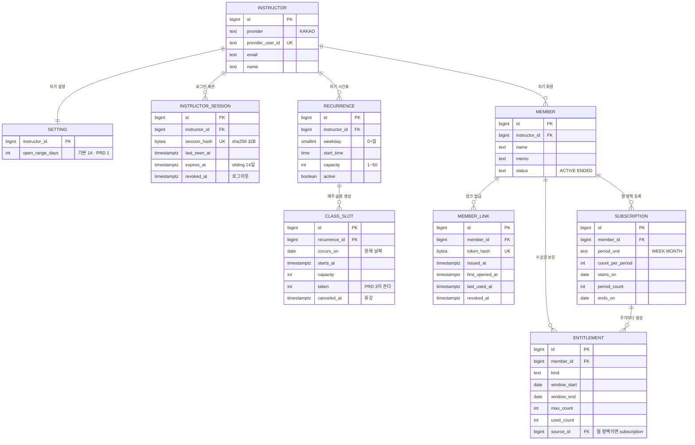

# BE-0001 개발 PRD · 강사 세팅

> Notion "테이블 설계 · ERD" 문서에서 이 기능에 해당하는 부분을 옮긴 뒤, 2026-09-25 회의 결정([DEC-0001~0006](https://github.com/Fit-link-v2/Fit-link-PRD/tree/main/decisions))을 반영했다. 아직 recatch-tdd prd 단계 전이다. [템플릿](../../../templates/prd.md) 형식(인수 조건 · API 절)으로 다시 쓰는 것은 이 기능의 prd 단계에서 한다. API 절은 FE 개발을 먼저 시작할 수 있게 2026-10-05에 초안을 넣었다.

## 근거

- 제품 PRD: [PRD-0001](https://github.com/Fit-link-v2/Fit-link-PRD/tree/main/prd/0001-instructor-setup)

## 기술 설계

### 이 기능이 만드는 범위

PRD 1 단계에서 실제로 `CREATE TABLE`하는 것은 이 9개다. `booking` · `waitlist` · `event_log` · `entitlement_adjustment`는 PRD 3 이후에 붙는다.



| 컬럼 | PRD 1이 쓰나 | 지금 넣는 이유 |
|---|---|---|
| `class_slot.taken` | **아니오** | PRD 3 AC 1.3.1의 조건부 UPDATE 대상. 나중에 넣으려면 이미 생성된 슬롯 전부를 backfill해야 한다 |
| `entitlement.used_count` | 예 | AC 3.2.3의 "잔여 = max_count - used_count"와 강사의 수기 수정에 쓴다 |
| `member_link.revoked_at` | 예 | AC 4.3.1 재발급 |
| `class_slot.canceled_at` | 예 (쓰기) | AC 2.3.1 휴강. 읽는 쪽은 PRD 2다 |

표에서 첫 줄 하나만 "PRD 1이 안 쓰는" 컬럼이다. 그리고 그 하나가 **PRD 1의 인수 조건만으로는 도출되지 않는다.**

AC 2.1.1은 `capacity`(정원 상한)를 요구하지만 `taken`(현재 찬 인원)을 요구하지 않는다. PRD 1 범위에는 `booking`이 없어 자리를 차지하는 쓰기 경로 자체가 없고, 따라서 경쟁도 없다. `taken`이 필요해지는 근거는 **"예약이라는 쓰기 경로가 생긴다"**는 사실이고, 그것은 PRD 0(상위 구상)에 있다.

정리하면 이렇다. 세부 인수 조건(PRD 3~5)이 없어도 상위 구상만 있으면 `taken`은 나온다. 그러나 **PRD 1만으로는 나오지 않는다.** 그 상태에서 설계하면 "예약 인원은 `booking`을 COUNT하면 되니 `taken`은 필요 없다"로 가게 되고, 정원 조건부 UPDATE를 쓸 수 없게 된다.

반대로 `booking.restored`(PRD 3 휴강 · PRD 5 마감)처럼 **PRD 1 시점에 알 수도 없고 나중에 넣으면 비싼** 항목도 남는다. 스키마를 앞 단계 문서만으로 전부 확정할 수는 없다는 뜻이다. 이 문서가 PRD 1~5를 한 번에 읽고 작성된 이유다.

팀원과 공유할 때는 전체 그림과 이 절을 같이 본다. 전체 그림은 "최종적으로 여기로 간다", 이 절은 "이번 단계에 손대는 범위"를 말한다.

### 테이블 정의 (DDL)

#### 1. 강사 · 설정

```sql
CREATE TABLE instructor (
  id               bigserial   PRIMARY KEY,
  provider         text        NOT NULL CHECK (provider IN ('KAKAO')),
  provider_user_id text        NOT NULL,
  email            text,       -- 카카오 필수 동의로 받는다. 비즈 앱 전환 전에는 비어 있을 수 있다
  name             text,
  created_at       timestamptz NOT NULL DEFAULT now(),

  CONSTRAINT instructor_identity_uk UNIQUE (provider, provider_user_id)
);

-- 강사마다 1행. PK가 곧 소유자다.
CREATE TABLE setting (
  instructor_id         bigint      PRIMARY KEY REFERENCES instructor(id),
  open_range_days       int         NOT NULL DEFAULT 14
                          CHECK (open_range_days BETWEEN 7 AND 28),
  updated_at            timestamptz NOT NULL DEFAULT now()
);
```

비밀번호를 담는 컬럼이 없다. 카카오가 인증을 끝내고 우리는 `(provider, provider_user_id)`만 받는다([DEC-0001](https://github.com/Fit-link-v2/Fit-link-PRD/blob/main/decisions/0001-instructor-kakao-oauth.md)). 유출 시 비밀번호가 새지 않고, 재설정 화면도 필요 없다. `provider` CHECK는 지금 `KAKAO` 하나다. 다른 로그인 수단을 붙이면 CHECK 값만 늘린다.

`instructor_identity_uk`가 PRD 1 AC 1.2.3("같은 카카오 계정으로 다시 로그인하면 새로 가입되지 않는다")의 물리적 표현이다. 가입은 `INSERT ... ON CONFLICT (provider, provider_user_id) DO NOTHING` 뒤 조회로 처리하면 동시에 두 번 눌러도 강사가 두 명 생기지 않는다.

`cancel_deadline_hours`(취소 마감)는 기능 0005의 마이그레이션 004에서 붙는다.

`setting`의 PK가 `instructor_id`이므로 강사당 정확히 1행이 강제된다. 가입과 같은 트랜잭션에서 기본값으로 1행을 만든다(PRD 1 AC 1.2.2).

#### 1-1. 로그인 세션

```sql
-- 강사 로그인 세션 (DEC-0002). 세션 ID 원본은 쿠키에만 있고 DB에는 해시만 남는다.
CREATE TABLE instructor_session (
  id            bigserial   PRIMARY KEY,
  instructor_id bigint      NOT NULL REFERENCES instructor(id),
  session_hash  bytea       NOT NULL UNIQUE,   -- SHA-256, 32바이트
  created_at    timestamptz NOT NULL DEFAULT now(),
  last_seen_at  timestamptz NOT NULL DEFAULT now(),
  expires_at    timestamptz NOT NULL,          -- last_seen_at + 14일
  revoked_at    timestamptz                    -- 로그아웃
);

CREATE INDEX instructor_session_owner_idx ON instructor_session (instructor_id);
```

```sql
-- 요청마다: 유효한 세션인지 확인하면서 만료를 연장한다 (PRD 1 AC 1.1.6)
UPDATE instructor_session
   SET last_seen_at = now(), expires_at = now() + interval '14 days'
 WHERE session_hash = $hash AND revoked_at IS NULL AND expires_at > now()
RETURNING instructor_id;
-- 0행이면 로그인 화면으로

-- 로그아웃 (PRD 1 AC 1.1.7)
UPDATE instructor_session SET revoked_at = now()
 WHERE session_hash = $hash AND revoked_at IS NULL;
```

세션 ID 원본을 저장하지 않는 이유는 `member_link`와 같다. DB가 유출돼도 살아 있는 세션을 가져갈 수 없다([DEC-0002](https://github.com/Fit-link-v2/Fit-link-PRD/blob/main/decisions/0002-instructor-session-cookie.md)).

만료를 요청마다 연장하면 요청마다 쓰기가 한 번 생긴다. 강사 수십 명 규모에서는 문제되지 않는다. 부담이 되면 `last_seen_at`이 일정 시간 이상 지났을 때만 갱신한다. 만료되거나 로그아웃한 행은 주기적으로 지운다. 세션은 이력이 아니라 보안 자료라 BE-ADR-0003(지우지 않는다)의 예외다.

이 테이블을 직접 만들지, Spring Session JDBC를 쓸지는 [BE-ADR-0008](../../../decisions/0008-session-store.md)에서 다룬다. Spring Session JDBC의 기본 스키마는 세션 ID를 원본으로 저장한다.

#### 2. 시간표

```sql
CREATE TABLE recurrence (
  id            bigserial   PRIMARY KEY,
  instructor_id bigint      NOT NULL REFERENCES instructor(id),
  weekday       smallint    NOT NULL CHECK (weekday BETWEEN 0 AND 6),  -- 0=일
  start_time    time        NOT NULL,
  capacity      int         NOT NULL CHECK (capacity BETWEEN 1 AND 50),
  active        boolean     NOT NULL DEFAULT true,
  created_at    timestamptz NOT NULL DEFAULT now()
);

CREATE INDEX recurrence_owner_idx ON recurrence (instructor_id);

-- 같은 강사가 같은 요일 · 같은 시각에 규칙을 두 개 두지 못한다.
CREATE UNIQUE INDEX recurrence_slot_uidx
  ON recurrence (instructor_id, weekday, start_time) WHERE active;

CREATE TABLE class_slot (
  id            bigserial   PRIMARY KEY,
  recurrence_id bigint      NOT NULL REFERENCES recurrence(id),
  occurs_on     date        NOT NULL,   -- 반복 규칙이 만든 원래 날짜. 시각을 바꿔도 그대로
  starts_at     timestamptz NOT NULL,
  capacity      int         NOT NULL CHECK (capacity >= 0),
  taken         int         NOT NULL DEFAULT 0,
  canceled_at   timestamptz,
  created_at    timestamptz NOT NULL DEFAULT now(),

  CONSTRAINT class_slot_occurrence_uk UNIQUE (recurrence_id, occurs_on),
  CONSTRAINT class_slot_taken_range CHECK (taken >= 0 AND taken <= capacity)
);

-- 회원 화면은 항상 "휴강 아닌 슬롯을 시각순으로" 읽는다.
CREATE INDEX class_slot_open_starts_at_idx
  ON class_slot (starts_at) WHERE canceled_at IS NULL;
```

`class_slot.capacity`는 생성 시점에 `recurrence.capacity`를 복사한다. 반복 규칙의 정원을 나중에 바꿔도 이미 생성된 슬롯은 흔들리지 않는다. 복사하지 않고 참조하면 "그때 정원이 몇이었나"를 영원히 복원할 수 없다.

`class_slot_taken_range`는 예약 트랜잭션의 조건부 UPDATE가 뚫렸을 때를 막는 마지막 방어선이다. 애플리케이션 버그로 정원을 넘기는 UPDATE가 들어오면 DB가 거부한다.

**슬롯 생성의 중복 방지 키는 `(recurrence_id, occurs_on)`이다.** `starts_at`으로 걸면 강사가 개별 슬롯의 시각을 바꾼 뒤(PRD 1 AC 2.3.2) 다음 배치가 "원래 시각 슬롯이 없다"고 보고 다시 만든다. 그러면 AC 2.3.3(변경은 그 슬롯에만)과 AC 2.2.2(여러 번 돌려도 결과 같음)가 깨진다. 원래 날짜를 따로 저장하고 그것으로 중복을 막으면 시각을 바꿔도 배치가 같은 회차를 다시 만들지 않는다. 휴강은 행을 지우지 않으므로(`canceled_at`) 역시 다시 만들어지지 않는다.

반복 주기는 매주로 고정돼 있다. 격주 · 월 n번째 주는 PRD 1의 범위 밖이다(인터뷰 7번). 넣게 되면 `recurrence`에 `interval_weeks`와 `anchor_date` 두 컬럼이 붙는다. 기존 행은 각각 1과 생성일로 채우면 되므로 나중에 넣어도 비용이 낮다.

#### 3. 회원 · 링크

```sql
CREATE TABLE member (
  id            bigserial   PRIMARY KEY,
  instructor_id bigint      NOT NULL REFERENCES instructor(id),
  name          text        NOT NULL,
  memo          text,
  status        text        NOT NULL DEFAULT 'ACTIVE'
                  CHECK (status IN ('ACTIVE', 'ENDED')),
  created_at    timestamptz NOT NULL DEFAULT now()
);
-- name에 UNIQUE를 걸지 않는다. 동명이인 허용이 인수 조건이다 (PRD 1 AC 3.1.2).

CREATE INDEX member_owner_idx ON member (instructor_id, status);

CREATE TABLE member_link (
  id              bigserial   PRIMARY KEY,
  member_id       bigint      NOT NULL REFERENCES member(id),
  token_hash      bytea       NOT NULL UNIQUE,   -- SHA-256, 32바이트
  issued_at       timestamptz NOT NULL DEFAULT now(),
  first_opened_at timestamptz,
  last_used_at    timestamptz,
  revoked_at      timestamptz
);

-- 회원 1명에게 살아 있는 링크는 최대 1개.
CREATE UNIQUE INDEX member_link_active_uidx
  ON member_link (member_id) WHERE revoked_at IS NULL;
```

토큰 원본을 담는 컬럼이 없다. 이것이 PRD 1 AC 4.1.2의 물리적 표현이다. 원본은 발급 응답에만 실려 나가고 DB에는 남지 않는다.

`token_hash`가 **전역 UNIQUE**다. 강사가 몇 명이든 토큰은 16바이트 난수라 충돌하지 않는다. 토큰 하나가 회원 한 명을 가리키고, 그 회원의 `instructor_id`가 어느 강사의 시간표를 보여줄지 결정한다. 회원 쪽 격리는 이것으로 자동 성립한다.

재발급은 기존 행에 `revoked_at`을 찍고 새 행을 넣는다. 새 행의 `first_opened_at`은 자연히 NULL이므로 AC 5.1.3의 "재발급하면 초기화"가 별도 로직 없이 성립한다. 죽은 행은 부분 유니크 인덱스의 조건을 만족하지 않아 인덱스에 들어가지 않으므로, 재발급이 쌓여도 조회가 느려지지 않는다.

#### 4. 수강권

`entitlement.source_id`가 `subscription`을 가리키므로 `subscription`을 먼저 만든다. 설명은 5절.

```sql
-- 월 정액 등록 1건 (DEC-0004). 차감 대상이 아니라 주기별 entitlement를 만들어내는 설정이다.
CREATE TABLE subscription (
  id               bigserial   PRIMARY KEY,
  member_id        bigint      NOT NULL REFERENCES member(id),
  period_unit      text        NOT NULL CHECK (period_unit IN ('WEEK', 'MONTH')),
  count_per_period int         NOT NULL CHECK (count_per_period > 0),
  starts_on        date        NOT NULL,   -- 강사가 지정한 시작일. 주기는 여기서부터 센다
  period_count     int         NOT NULL CHECK (period_count > 0),   -- 4주, 3개월
  ends_on          date        NOT NULL,   -- 마지막 주기의 마지막 날. 등록할 때 계산해 저장
  created_at       timestamptz NOT NULL DEFAULT now(),

  CONSTRAINT subscription_range_order CHECK (starts_on <= ends_on),
  -- 주 단위는 종료일이 시작일과 주기 수로 정해진다. 월 단위는 Q12가 정해지면 같은 CHECK를 붙인다
  CONSTRAINT subscription_week_end
    CHECK (period_unit <> 'WEEK' OR ends_on = starts_on + 7 * period_count - 1)
);

CREATE INDEX subscription_member_idx ON subscription (member_id);

CREATE TABLE entitlement (
  id           bigserial   PRIMARY KEY,
  member_id    bigint      NOT NULL REFERENCES member(id),
  kind         text        NOT NULL CHECK (kind IN ('PASS', 'SUBSCRIPTION')),
  window_start date        NOT NULL,
  window_end   date        NOT NULL,
  max_count    int         NOT NULL CHECK (max_count > 0),
  used_count   int         NOT NULL DEFAULT 0,
  source_id    bigint      REFERENCES subscription(id),   -- 월 정액이면 그 등록, 횟수권이면 NULL
  created_at   timestamptz NOT NULL DEFAULT now(),

  CONSTRAINT entitlement_window_order CHECK (window_start <= window_end),
  CONSTRAINT entitlement_used_range
    CHECK (used_count >= 0 AND used_count <= max_count),
  CONSTRAINT entitlement_source_shape
    CHECK ((kind = 'SUBSCRIPTION') = (source_id IS NOT NULL))
);

-- 예약 시 "유효한 것 중 만료가 가장 이른 1장"을 고른다 (PRD 3 AC 1.3.5).
CREATE INDEX entitlement_pick_idx ON entitlement (member_id, window_end);
```

횟수권과 월 정액의 차이는 컬럼이 아니라 행의 수명이다. 횟수권은 구매 1건에 행 1개이고 `window`가 유효 기간 전체다. 월 정액은 주기마다 행이 새로 생기고 `window`가 그 주기다. 예약 · 차감 쿼리는 양쪽에서 완전히 같다.

`entitlement_used_range`가 PRD 3 AC 5.2.1의 "0 이상 `max_count` 이하"를 그대로 담는다. 강사의 수기 수정도 이 범위를 벗어날 수 없다.

#### 5. 월 정액

`subscription` 테이블은 4절에 있다. 여기에는 `entitlement`에 거는 인덱스와 제약을 둔다.

```sql
-- 같은 월 정액의 같은 주기는 한 번만 만든다. 배치를 여러 번 돌려도 결과가 같다.
CREATE UNIQUE INDEX entitlement_period_uidx
  ON entitlement (source_id, window_start) WHERE source_id IS NOT NULL;

-- 한 회원이 다른 종류의 수강권을 기간이 겹치게 가질 수 없다 (PRD 1 AC 3.2.10).
-- 같은 종류끼리는 겹쳐도 된다 (AC 3.2.11). <> 비교에는 btree_gist 확장이 필요하다.
CREATE EXTENSION IF NOT EXISTS btree_gist;

ALTER TABLE entitlement ADD CONSTRAINT entitlement_kind_no_overlap
  EXCLUDE USING gist (
    member_id WITH =,
    kind WITH <>,
    (daterange(window_start, window_end, '[]')) WITH &&
  );
```

횟수권과 월 정액을 한 테이블로 합친 결정(PRD 0)은 그대로다. 합친 것은 **차감 모델**이고, 월 정액 등록 정보는 차감 대상이 아니라 행을 만들어내는 설정이다. 그래서 `entitlement`에 섞지 않고 `subscription`으로 뺐다. 같은 테이블에 두면 PRD 3 AC 1.3.5의 "유효한 것 중 만료가 가장 이른 1장"에 등록 정보 행도 걸려 거기서 차감될 수 있다.

`entitlement_source_shape`가 "월 정액 행은 반드시 등록을 가리키고, 횟수권 행은 아무것도 가리키지 않는다"를 강제한다.

**주기 계산.** 주기는 `starts_on`부터 센다(PRD 1 AC 3.2.7). 주 단위면 7일씩, 월 단위면 한 달씩이다. `ends_on`은 등록할 때 마지막 주기의 끝으로 계산해 저장한다. 월 단위에서 시작일이 29~31일일 때 짧은 달을 어떻게 셀지는 정하지 않았다(열린 질문 Q12).

**주기별 수강권 생성.** 등록할 때와 매일 1회 배치에서 같은 쿼리를 돈다. 오픈 범위 안의 수업을 예약할 수 있어야 하므로, 오늘부터 그 강사의 오픈 범위 끝까지에 걸치는 주기를 미리 만든다(AC 3.2.8). `ends_on`을 넘는 주기는 만들지 않는다(AC 3.2.9). `entitlement_period_uidx`와 `INSERT ... ON CONFLICT DO NOTHING`으로 몇 번을 돌려도 중복이 생기지 않는다. 절차는 [수강권 쓰기 경로](../../entitlement/write-paths.md)에 있다.

**종류 겹침 검사의 한계.** `entitlement_kind_no_overlap`은 이미 만들어진 행끼리만 비교한다. 월 정액의 뒤쪽 주기는 아직 행이 없으므로, 그 기간에 횟수권을 등록하면 DB가 막지 못하고 나중에 배치의 INSERT가 실패한다. 그래서 등록할 때 애플리케이션이 `subscription.starts_on ~ ends_on` 전체 기간과 비교한다. 제약은 그 검사가 뚫렸을 때의 마지막 방어선이다. 결정 근거는 [BE-ADR-0009](../../../decisions/0009-entitlement-kind-exclusion.md).

### 마이그레이션

PRD 단위가 배포 단위는 아니다. 1차 배포에는 PRD 1~3이 함께 나간다.

| 마이그레이션 | 내용 | 시점 |
|---|---|---|
| 001 | btree_gist 확장, instructor, instructor_session, setting(open_range_days), recurrence, class_slot, member, member_link, subscription, entitlement | PRD 1 |

### API

> 2026-10-05 초안. 와이어프레임 I-01 ~ I-13 중 **그려진 화면**만 다룬다. 그려지지 않았거나 화면이 정해지지 않아 모양을 못 정한 것은 아래 "와이어프레임 대조" 절에 모았다. FE는 이 절의 모양으로 fixture를 만들어 개발하고, BE 구현 뒤 openapi에서 생성한 타입으로 바꾼다([회의 안건 2026-10-03](https://github.com/Fit-link-v2/Fit-link-meeting-log/blob/docs/2026-10-03-agenda/2026/2026-10-03.md) 3번).
>
> 근거 AC가 없는 규칙은 **(제안)**으로 표시했다. 아직 `proposed`인 결정에 기대는 규칙은 결정 번호 뒤에 (proposed)를 붙였다.

#### 공통 규칙

| 항목 | 규칙 | 근거 |
|---|---|---|
| 호스트 | `https://api.{도메인}`. 브라우저가 직접 호출한다 | DEC-0008 (proposed) |
| 인증 | 세션 쿠키 `__Host-Http-SESSION`. 요청에 `credentials: 'include'`(axios는 `withCredentials: true`) | DEC-0008 (proposed) |
| CSRF | GET이 아닌 모든 요청에 헤더 `X-CSRF: 1` | DEC-0008 (proposed) |
| 형식 | 요청 · 응답 본문은 JSON. 목록은 `{ "items": [...] }`로 감싼다 | (제안) |
| 날짜 · 시각 | 날짜 `YYYY-MM-DD`, 시각 `HH:mm`, 순간은 `+09:00`이 붙은 ISO 8601. 날짜 경계는 `Asia/Seoul` | BE-ADR-0006 |
| 요일 | `MON` `TUE` `WED` `THU` `FRI` `SAT` `SUN`. DB의 `weekday`(0=일)는 API에 드러내지 않는다 | (제안) |
| 에러 본문 | `{ "code": "SNAKE_CASE", "message": "개발자용 설명" }`. 화면 문구는 FE가 `code`로 고른다 | `code`는 PRD-0003 AC 3.1과 같은 방식. `message`는 (제안) |
| 소유자 | 강사 API는 세션의 강사 데이터만 다룬다. 남의 id나 없는 id는 똑같이 404 | PRD-0001 AC 1.3.1 · 1.3.2 |

모든 강사 API에 공통으로 나는 에러. 상태 코드와 `code` 이름은 (제안)이다.

| HTTP | code | 상황 | 화면 |
|---|---|---|---|
| 401 | UNAUTHENTICATED | 쿠키가 없거나 세션이 만료 · 로그아웃됨 | 로그인 화면(I-01)으로 이동 (AC 1.1.3 · 1.1.7) |
| 403 | CSRF_HEADER_MISSING | GET이 아닌 요청에 `X-CSRF` 헤더가 없음. DEC-0008은 "거절한다"까지만 정했다 | FE 버그. 화면 처리 없음 |
| 404 | NOT_FOUND | 없는 id이거나 다른 강사의 id (AC 1.3.2) | 와이어프레임 대조 C-4 |
| 400 | VALIDATION_FAILED | 입력값이 형식이나 범위를 벗어남. `fields: [{ "name": "capacity", "reason": "..." }]`를 같이 준다 | 입력칸 아래 표시 |

409와 422는 이렇게 나눈다. **409는 같은 것이 이미 있는 경우(중복), 422는 지금 상태가 요청의 전제 조건을 채우지 못한 경우다.** PRD-0003 AC 3.1의 표(ALREADY_BOOKED는 409, NO_REMAINING · CLASS_STARTED는 422)에서 읽어 낸 기준이다(제안). 기준 문장 자체는 PRD에 없다. SEAT_TAKEN(409)은 다른 회원과의 경합에서 진 경우라 이 기준의 예외로 둔다.

**자동 재시도는 하지 않는다.** GET이 아닌 요청이 타임아웃되면 다시 보내지 말고 관련 GET으로 결과를 확인한다. PRD-0003 AC 3.2와 같은 방식이다.

**GET이 아닌 요청은 응답이 올 때까지 버튼을 막는다** (제안). 회원 추가 · 횟수권 등록 · 잔여 수정은 같은 요청이 두 번 가면 두 번 반영된다. 동명이인과 횟수권끼리의 겹침이 허용되므로 서버가 중복으로 거르지 못한다. 재발급은 두 번째 요청이 첫 번째 링크를 무효로 만들기 때문에, 먼저 도착한 응답의 `linkUrl`을 보여주면 이미 무효가 된 링크를 보내게 된다. 버튼을 막지 못해 두 번 갔다면 **마지막에 도착한 응답의 `linkUrl`만** 보여준다.

**에러 판정 순서**: 401(세션) → 403(`X-CSRF`) → 400(입력) → 404(대상) → 409 · 422 (제안). 슬롯 시각 변경은 입력 검사에 슬롯 날짜가 필요해 2절의 표를 따른다.

**DB 제약 위반도 에러 코드로 바꾼다.** 화면과 애플리케이션 검사를 통과한 경합은 DB 제약이 막는다. 이때 500이 아니라 해당 409 · 422로 답한다. 유니크 위반(SQLSTATE 23505)은 RECURRENCE_DUPLICATE, EXCLUDE 위반(23P01)은 ENTITLEMENT_PERIOD_OVERLAP이다.

#### 1. 로그인 · 로그아웃 (I-01, I-13)

인증 API의 모양은 DEC-0008 합의할 것 6번(API 설계 회의)에서 확정한다. 이 묶음은 경로를 빼고 전부 (제안)이다.

| 메서드 | 경로 | 요청 | 응답 | 에러 |
|---|---|---|---|---|
| GET | `/auth/kakao` | 없음. `fetch`가 아니라 **페이지 이동**으로 연다 | 302 → 카카오 인가 화면. `__Host-Http-KAKAO-STATE` 쿠키를 심는다 | |
| GET | `/auth/kakao/callback` | 카카오가 붙여 보내는 `code` · `state` 또는 `error` · `error_description` · `state` | 성공: 세션 쿠키를 심고 302 → 강사 화면. 실패: 302 → 로그인 화면 | |
| GET | `/me` | 없음 | 200 `{ "id": 1, "name": "김강사", "email": "a@b.c" }` | 401 UNAUTHENTICATED |
| POST | `/auth/logout` | 없음 | 204. 세션 쿠키를 지우는 `Set-Cookie`. 세션이 이미 없어도 204 | |

- `I-01/기본`의 `카카오로 시작하기`는 `location.href = 'https://api.{도메인}/auth/kakao'`다. 두 경로는 DEC-0008 (proposed)에 있다
- 콜백 실패는 세 경우다. 셋 다 로그인 화면으로 보내 `I-01/인증 실패`를 띄운다(AC 1.1.5). 원인은 서버 로그에만 남긴다
  - 카카오가 `error`를 보냄. 동의 화면에서 취소하면 `error=access_denied&error_description=User%20denied%20access`가 온다(카카오 REST API 문서)
  - `state`가 쿠키와 다름
  - 토큰 교환 실패
- 어느 경우든 `state` 쿠키를 비교한 뒤 지운다
- 302 목적지는 설정에 박힌 고정값이다. `returnTo` 같은 요청 파라미터로 목적지를 받지 않는다(DEC-0008). 받으면 외부 주소로 보내는 open redirect가 된다
- 로그인에 성공하면 새 세션 ID를 만들고, 요청에 기존 세션 쿠키가 있으면 그 세션을 무효로 한다(세션 고정 방지, DEC-0008 "로그인마다 새 ID")
- 카카오 인가 `code`와 토큰은 서버 로그에 남기지 않는다
- 성공 · 실패 때 302 할 `app.` 쪽 경로와 실패를 알리는 방법(예: `?login=failed`)은 DEC-0008 합의할 것 3번과 같이 정한다(와이어프레임 대조 B-7)
- 앱을 처음 열 때 `/me`를 불러 로그인 여부를 판단한다. 401이면 로그인 화면이다(DEC-0008 "로그인 판정은 401")
- `name` · `email`은 `null`일 수 있다. DDL에서 둘 다 NULL을 허용하고, 이메일은 카카오 비즈 앱 전환 전에는 못 받을 수 있다(AC 1.2.4, Q14)
- 가입은 따로 없다. 처음 로그인한 카카오 계정은 콜백에서 강사와 설정 1행이 함께 만들어진다(AC 1.2.1 · 1.2.2 · 1.2.3)

#### 2. 시간표 (I-02, I-03, I-04, I-05, I-06)

| 메서드 | 경로 | 요청 | 응답 | 에러 |
|---|---|---|---|---|
| GET | `/instructor/recurrences` | 없음 | 200 `{ "items": [Recurrence] }` | |
| POST | `/instructor/recurrences` | `{ "weekdays": ["MON","WED","FRI"], "startTime": "20:00", "capacity": 8 }` | 201 `{ "items": [Recurrence] }` 요일마다 1개 | 400, 409 RECURRENCE_DUPLICATE |
| PATCH | `/instructor/recurrences/{id}` | `{ "active": false }` 또는 `true` | 200 `Recurrence` | 400, 404, 409 RECURRENCE_DUPLICATE |
| GET | `/instructor/slots` | 없음 | 200 `{ "openRangeDays": 14, "items": [SlotSummary] }` | |
| GET | `/instructor/slots/{id}` | 없음 | 200 `SlotDetail` | 404 |
| PATCH | `/instructor/slots/{id}` | `{ "startTime": "19:30" }` | 200 `SlotDetail` | 400, 404, 422 SLOT_HAS_BOOKINGS, 422 SLOT_CANCELED, 422 CLASS_STARTED |
| POST | `/instructor/slots/{id}/cancel` | 없음 | 200 `SlotDetail` | 404, 422 CLASS_STARTED |

예시 날짜는 실제 2026년 달력에 맞췄다. 와이어프레임의 "9/10 (수)"는 2025년 달력이라 그대로 쓰면 요일이 틀린다.

```jsonc
// Recurrence
{ "id": 4, "weekday": "WED", "startTime": "19:00", "capacity": 8, "active": true }

// SlotSummary — I-02 "다가오는 수업" 한 줄
{ "id": 101, "startsAt": "2026-09-09T19:00:00+09:00", "capacity": 8, "taken": 3, "canceledAt": null }

// SlotDetail — I-04 상단 "예약 3 / 정원 8명 · 반복 규칙: 매주 수 19:00"
{
  "id": 101, "startsAt": "2026-09-09T19:00:00+09:00", "capacity": 8, "taken": 3, "canceledAt": null,
  "recurrence": { "id": 4, "weekday": "WED", "startTime": "19:00" }
}
```

- **규칙 목록(I-02)**: 월요일부터 일요일 순, 같은 요일은 시각 순 (제안)
- **규칙 등록(I-03/기본)**: 요일을 여러 개 받아 요일마다 규칙 1개를 만든다(AC 2.1.5, DEC-0009 (proposed)). 저장하면서 오픈 범위 안의 슬롯을 바로 만든다(AC 2.1.2)
  - 입력 범위: `capacity` 1~50(AC 2.1.5), `weekdays` 1개 이상 · 중복 없음, `startTime`은 `HH:mm`
  - 한 트랜잭션이다. 하나라도 같은 요일 · 시각의 켜진 규칙과 겹치면 전부 저장하지 않고 409 RECURRENCE_DUPLICATE에 `weekdays: ["WED"]`(겹친 요일)를 같이 준다 (제안). 애플리케이션 검사를 지나 DB 유니크 위반으로 걸린 경우에는 PostgreSQL이 첫 위반에서 멈추므로 `weekdays`에 일부 요일만 담길 수 있다
  - 오늘 이미 지난 시각의 회차는 만들지 않는다 (제안). 예: 수요일 21:00에 "수 19:00" 규칙을 등록하면 오늘 슬롯은 생기지 않는다(Q17)
- **규칙 끄기 · 켜기(I-02 토글)**: `active: false`면 이후 슬롯 생성이 멈추고 이미 만든 슬롯은 남는다(AC 2.1.4). 다시 켤 때 같은 요일 · 시각에 켜진 규칙이 있으면 409 RECURRENCE_DUPLICATE다(`recurrence_slot_uidx`). 끈 규칙과 같은 요일 · 시각으로 새 규칙을 만들었을 때 같은 시각 슬롯이 둘 생기는 문제와, 다시 켤 때 빈 구간을 바로 채울지는 정하지 않았다(Q18, 와이어프레임 대조 B-6)
- **다가오는 수업(I-02)**: 시작 시각이 지금 이후인 슬롯부터 오픈 범위 끝까지다(진행 중인 수업은 빠진다, 제안). 머리글 "다가오는 수업 · 14일"은 응답의 `openRangeDays`다. `taken`/`capacity`가 "3/8명"이 된다. 휴강한 슬롯과 오픈 범위 밖 슬롯을 넣을지는 와이어프레임 대조 B-2 · B-3
- **시각 변경(I-05/기본)**: 날짜는 그대로 두고 시각만 바꾼다. 그 슬롯에만 적용된다(AC 2.3.2 · 2.3.3)
  - **이미 시작한 슬롯은 바꾸지 않는다.** 지난 기록이 실제와 달라지는 것을 막는다. PRD AC는 없고 2026-10-05에 정했다(와이어프레임 대조 D-1)
  - 슬롯을 소유자 조건으로 먼저 읽고 아래 순서로 처음 걸리는 것을 답한다. 새 시각(슬롯 날짜 + `startTime`)을 만들려면 슬롯 날짜가 필요하기 때문이다

    | 순서 | 조건 | 응답 |
    |---|---|---|
    | 1 | 없거나 남의 슬롯 | 404 NOT_FOUND |
    | 2 | 이미 휴강 | 422 SLOT_CANCELED |
    | 3 | 이미 시작 | 422 CLASS_STARTED |
    | 4 | 새 시각이 지금 이전 | 400 VALIDATION_FAILED(`fields: [{ "name": "startTime" }]`) |
    | 5 | 예약 있음 | 422 SLOT_HAS_BOOKINGS |

  - 쓰기는 조건부 UPDATE 한 문장이다([예약 쓰기 경로](../../booking/write-paths.md)). 읽은 뒤 UPDATE 사이에 예약 · 휴강이 끼어들어 0행이 되면 한 번 더 읽어 같은 표로 답한다

  - PRD 1만 배포된 상태에서는 예약이 없어 SLOT_HAS_BOOKINGS가 나지 않는다
- **휴강(I-06/확인 · 예약 없음)**: 슬롯에 `canceled_at`을 찍는다(AC 2.3.4). 이미 휴강한 슬롯에 다시 보내도 200이고 아무것도 바뀌지 않는다(PRD-0003 AC 7.2.4). 판정 순서는 404(없거나 남의 슬롯) → 이미 휴강이면 200(변경 없음) → 이미 시작했으면 422 CLASS_STARTED다. PRD 3부터 휴강은 차감을 전부 복구하므로(PRD-0003 AC 7.2.2), 시작한 수업을 휴강하게 두면 출석한 회원의 횟수가 돌아온다. 그래서 막는다(와이어프레임 대조 D-1). 예약 취소 · 복구와 응답의 회원 이름(PRD-0003 AC 7.1.3 · 7.3.4)은 PRD 3에서 붙는다
- 예약자 명단(I-04)과 대기 수(I-02 "대기 1")는 각각 PRD 3 · PRD 4에서 `SlotDetail` · `SlotSummary`에 필드를 더한다

#### 3. 설정 (I-13)

| 메서드 | 경로 | 요청 | 응답 | 에러 |
|---|---|---|---|---|
| GET | `/instructor/settings` | 없음 | 200 `{ "openRangeDays": 14 }` | |
| PATCH | `/instructor/settings` | `{ "openRangeDays": 21 }` | 200 `{ "openRangeDays": 21 }` | 400 |

- `openRangeDays` 7~28(AC 2.4.1)
- 늘리면 같은 요청 안에서 늘어난 구간의 슬롯을 채운다(AC 2.4.2). 월 정액 주기도 같이 만드는 것을 제안한다(Q19)
- 무료 취소 마감(`cancelDeadlineHours`)은 PRD 5에서 같은 자원에 필드를 더한다

#### 4. 회원 · 링크 (I-07, I-08, I-09, I-10, I-12)

| 메서드 | 경로 | 요청 | 응답 | 에러 |
|---|---|---|---|---|
| GET | `/instructor/members` | 없음 | 200 `{ "unopenedCount": 2, "items": [MemberSummary] }` | |
| POST | `/instructor/members` | `{ "name": "김OO", "memo": "목요반" }` | 201 `{ "member": MemberDetail, "linkUrl": "https://app.{도메인}/m/kR7pQ2mXvL9tNwB3cYzHdA" }` | 400 |
| GET | `/instructor/members/{id}` | 없음 | 200 `MemberDetail` | 404 |
| PATCH | `/instructor/members/{id}` | `{ "status": "ENDED" }` 또는 `"ACTIVE"` | 200 `MemberDetail` | 400, 404 |
| POST | `/instructor/members/{id}/link` | 없음 | 201 `{ "linkUrl": "https://app.{도메인}/m/…" }` | 404 |

```jsonc
// MemberSummary — I-07 한 줄
{
  "id": 7, "name": "김OO", "memo": "목요반", "status": "ACTIVE",
  "linkOpened": true,
  "pass": { "remaining": 3 }          // 셀 횟수권이 없으면 null
}

// MemberDetail — I-10
{
  "id": 7, "name": "김OO", "memo": "목요반", "status": "ACTIVE",
  "linkOpened": true,
  "entitlements": [Entitlement]       // 5절
}
```

- **회원 추가(I-08)**: `name` 필수, `memo` 선택(AC 3.1.1). 앞뒤 공백을 지운 뒤 1자 이상이어야 한다 (제안). 동명이인을 막지 않는다(AC 3.1.2). 저장하면서 링크를 발급하고(AC 3.1.3) `linkUrl`을 돌려준다. 이름 · 메모의 최대 길이는 와이어프레임 대조 B-8
- **`linkUrl`은 발급 응답에만 있다.** 서버에는 해시만 남아 다시 조회할 수 없다(AC 4.1.2). 그래서 I-09는 "이 화면을 나가면 다시 볼 수 없다"고 안내한다. 응답 본문을 로그에 남기지 않는다(AC 4.4.1)
  - 경로 `/m/{token}`은 PRD-0001에 정해져 있다. 도메인(DEC-0007)과 `app.` 서브도메인(DEC-0008, proposed)이 정해지지 않았다(와이어프레임 대조 B-9)
  - 이 응답에는 `Cache-Control: no-store`를 붙인다. FE는 응답 본문을 오류 보고(Sentry 등)와 쿼리 캐시 영속화에서 뺀다 (제안)
- **안내 문구(I-09)**: 고정 템플릿에 이름만 바꾼다(AC 4.2.2). 서버는 `linkUrl`만 주고 문구 조립과 클립보드 복사는 FE가 한다 (제안)
- **회원 목록(I-07)**
  - `unopenedCount`는 링크를 열지 않은 ACTIVE 회원 수다. ENDED는 뺀다(AC 5.1.1). 0이면 FE가 배너를 숨긴다(AC 5.1.4)
  - `linkOpened`는 지금 살아 있는 링크의 `first_opened_at` 유무다. 재발급하면 `false`로 돌아간다(AC 5.1.3). `false`인 줄에 "미개봉"을 쓴다(AC 5.1.5, DEC-0009 (proposed)). ENDED 회원 줄에도 쓸지는 와이어프레임 대조 B-10
  - `pass.remaining`은 오늘 유효한 횟수권(시작일 ≤ 오늘 ≤ 종료일)의 잔여 합계다 (제안). 회원 화면 상단 규칙(PRD-0002 AC 2.1.1 "합계")을 빌려 왔다. 시작일이 오늘 이후인 횟수권을 넣을지는 와이어프레임 대조 B-1과 같이 정한다
  - 정렬: 미개봉 → 나머지 ACTIVE → ENDED, 같은 묶음 안에서는 이름순 (제안). 와이어프레임 설명을 따랐고 근거 AC는 없다(I-07 노트)
- **수강 종료 · 다시 활성화(I-10)**: `status`만 바꾼다. 삭제가 아니다(AC 3.3.1 · 3.3.3)
- **재발급(I-10 `재발급 후 복사`, I-12)**: 기존 링크에 `revoked_at`을 찍고 새 링크를 만든다(AC 4.3.1). 예약 · 수강권 기록은 그대로다(AC 4.3.2)
  - 확인 창을 띄울지는 FE가 `MemberDetail.linkOpened`로 판단한다. 서버는 확인 여부를 받지 않는다
  - 경로 이름은 `link`지만 동작은 "기존 링크 무효 + 새 링크 발급"이다
  - 회원 행을 먼저 잠근다(`FOR NO KEY UPDATE`). 두 번 빠르게 눌러도 살아 있는 링크가 하나로 유지된다(`member_link_active_uidx`). 두 번째 요청은 첫 번째가 만든 링크를 다시 무효로 만든다. 그래서 FE는 응답이 올 때까지 버튼을 막는다(공통 규칙)
  - ENDED 회원의 재발급 허용 여부와 이름 · 메모 수정은 와이어프레임 대조 B-11 · B-12

#### 5. 수강권 (I-10, I-11)

지금은 **횟수권만** 다룬다. 월 정액 등록 화면(I-11/월 정액)과 월 정액 카드(I-10/수강권 카드/월 정액)가 미작성이고, 월 정액 규칙이 [DEC-0011](https://github.com/Fit-link-v2/Fit-link-PRD/pull/5)(머지 전)로 바뀌는 중이라 모양을 정하지 않았다(와이어프레임 대조 A-4 · A-7).

| 메서드 | 경로 | 요청 | 응답 | 에러 |
|---|---|---|---|---|
| POST | `/instructor/members/{id}/entitlements` | `{ "kind": "PASS", "windowStart": "2026-09-09", "windowEnd": "2026-11-08", "maxCount": 10 }` | 201 `Entitlement` | 400, 404, 422 ENTITLEMENT_PERIOD_OVERLAP, 422 ENTITLEMENT_OTHER_KIND_ACTIVE |
| POST | `/instructor/entitlements/{id}/adjust` | `{ "delta": 1 }` | 200 `Entitlement` | 400, 404, 422 REMAINING_OUT_OF_RANGE |

```jsonc
// Entitlement — I-10 수강권 카드 "10회권 · 9/1 ~ 10/31 · 잔여 3회"
{
  "id": 12, "kind": "PASS",
  "windowStart": "2026-09-01", "windowEnd": "2026-10-31",
  "maxCount": 10, "remaining": 3,
  "expired": false                    // windowEnd < 오늘(Asia/Seoul)
}
```

- **목록 순서(I-10)**: 만료 안 된 것 먼저, 그다음 만료된 것. 와이어프레임이 이 순서다. 같은 묶음 안의 순서는 종료일 순 (제안). `expired: true`면 흐림 처리한다(AC 3.2.4)
- **등록 입력**: `windowStart <= windowEnd`(`entitlement_window_order`), `maxCount` 1 이상(`max_count > 0`). 횟수 상한과 지난 날짜 등록 허용 여부는 와이어프레임 대조 B-8, ENDED 회원에게 등록할 수 있는지는 B-5
- **등록 거부** (AC 3.2.17. 화면이 미리 막더라도 서버가 다시 검사한다)

  | HTTP | code | 상황 | 같이 주는 값 | 근거 |
  |---|---|---|---|---|
  | 422 | ENTITLEMENT_PERIOD_OVERLAP | 다른 종류 수강권과 기간이 겹침 | | AC 3.2.10 |
  | 422 | ENTITLEMENT_OTHER_KIND_ACTIVE | 만료되지 않은 다른 종류 수강권이 있음 | `availableFrom`: 만료되지 않은 다른 종류 중 가장 늦은 종료일의 다음 날 | AC 3.2.15 · DEC-0011 (머지 전) |

  - 두 조건에 같이 걸리면 ENTITLEMENT_OTHER_KIND_ACTIVE를 준다 (제안). 강사가 언제부터 등록할 수 있는지 알 수 있기 때문이다
  - 횟수권끼리는 겹쳐도 된다(AC 3.2.11)
  - 이 API는 아직 횟수권만 받으므로 다른 종류는 월 정액뿐이다. 월 정액 등록 API가 생기기 전에는 두 코드 모두 나지 않는다
  - ENTITLEMENT_OTHER_KIND_ACTIVE 검사는 [수강권 쓰기 경로](../../entitlement/write-paths.md) 1.1에 아직 없다. DEC-0011이 머지된 뒤 BE 문서를 고칠 때 넣는다
- **잔여 수정(I-10 `-` `+`)**: 바꿀 양(`delta`)을 보낸다. 0이 아닌 정수다. 이 방식은 설계 선택이다. PRD-0003 AC 5.2.1 · 5.2.2는 "`used_count` 직접 수정, 이전 값 기록"까지만 정했다
  - 바꾼 뒤의 값(`remaining: 4`)을 보내지 않는 이유: 화면이 잔여 3을 보는 동안 회원이 예약해 2가 됐는데 강사가 `+`를 눌러 4를 보내면 그 예약의 차감이 사라진다. `delta`면 2에서 3이 된다
  - 쓰기는 상대값 조건부 UPDATE 한 문장이다. `SET used_count = used_count - $delta WHERE id = $id AND used_count - $delta BETWEEN 0 AND max_count` (소유자 조건 포함). 0행이면 소유자 조건으로 한 번 더 읽어, 없거나 남의 수강권이면 404, 있으면 결과가 0 미만이거나 `maxCount`를 넘는 경우라 422 REMAINING_OUT_OF_RANGE다(PRD-0003 AC 5.2.1, `entitlement_used_range`). 만료된 수강권을 고칠 수 있는지는 와이어프레임 대조 B-4
  - 대신 같은 요청을 두 번 보내면 두 번 반영된다. FE는 자동 재시도를 하지 않는다(공통 규칙)
  - `-` · `+`를 빠르게 여러 번 누를 때 요청을 묶을지는 FE가 정한다. 서버는 요청마다 따로 반영한다
  - 수정 이력(`entitlement_adjustment`)은 PRD 3에서 붙는다
  - 잔여를 늘려 `used_count`가 0이 된 뒤 그 수강권으로 잡힌 예약이 취소 · 휴강되면 복구가 범위를 넘어 실패할 수 있다. PRD 3의 열린 질문 Q15([예약 쓰기 경로](../../booking/write-paths.md) 5.2)와 같이 정한다
- 수강권 삭제 · 기간 수정 · 중도 종료 API는 없다(AC 3.2.18, DEC-0011)

#### 에러 코드 목록

| HTTP | code | 나는 곳 | 같이 주는 값 |
|---|---|---|---|
| 400 | VALIDATION_FAILED | 입력이 있는 모든 요청 | `fields: [{ name, reason }]` |
| 401 | UNAUTHENTICATED | 모든 강사 API | |
| 403 | CSRF_HEADER_MISSING | GET이 아닌 모든 요청 | |
| 404 | NOT_FOUND | id가 경로에 있는 모든 요청 | |
| 409 | RECURRENCE_DUPLICATE | 규칙 등록 · 다시 켜기 | `weekdays: ["WED"]` |
| 422 | SLOT_HAS_BOOKINGS | 슬롯 시각 변경 | |
| 422 | SLOT_CANCELED | 슬롯 시각 변경 | |
| 422 | CLASS_STARTED | 슬롯 시각 변경 · 휴강. 회원 예약의 CLASS_STARTED(PRD-0003 AC 3.1)와 같은 뜻이라 이름을 맞췄다 | |
| 422 | ENTITLEMENT_PERIOD_OVERLAP | 수강권 등록 | |
| 422 | ENTITLEMENT_OTHER_KIND_ACTIVE | 수강권 등록 | `availableFrom: "2026-11-01"` |
| 422 | REMAINING_OUT_OF_RANGE | 잔여 수정 | |

## AC 대 제약

인수 조건이 어느 제약으로 내려왔는지의 대응표다. 리뷰는 이 표를 기준으로 하면 된다.

| PRD · AC | 요구 | 물리 제약 |
|---|---|---|
| (제품 형태) | 강사끼리 데이터가 섞이지 않음 | `member.instructor_id`, `recurrence.instructor_id`, `setting` PK |
| 1 · AC 2.1.1 | 정원 1 이상 50 이하 | `recurrence` CHECK capacity BETWEEN 1 AND 50 |
| 1 · AC 1.1.6 | 세션 2주, 요청마다 연장 | `instructor_session.expires_at` 조건부 UPDATE |
| 1 · AC 1.1.7 | 로그아웃 즉시 무효 | `instructor_session.revoked_at` |
| 1 · AC 1.2.2 | 가입 시 설정 1행 | `setting` PK = instructor_id. 가입 트랜잭션에서 INSERT |
| 1 · AC 1.2.3 | 같은 카카오 계정은 한 번만 가입 | `instructor_identity_uk` (provider, provider_user_id) |
| 1 · AC 1.3.1 | 강사는 자기 데이터만 | `member.instructor_id`, `recurrence.instructor_id`. 모든 강사 화면 쿼리에 소유자 조건 |
| 1 · AC 2.1.3 | 같은 규칙 재저장해도 슬롯 중복 없음 | `class_slot` UNIQUE (recurrence_id, occurs_on) |
| 1 · AC 2.2.2 | 배치를 여러 번 돌려도 결과 동일 | 위 유니크 + INSERT ... ON CONFLICT DO NOTHING |
| 1 · AC 2.3.1 | 휴강. 예약이 있으면 확인 창 | `class_slot.canceled_at` + `booking.cancel_reason` (처리는 write-paths 5.2) |
| 1 · AC 2.3.2 | 예약이 있는 슬롯은 시각 변경 불가 | 조건부 UPDATE `WHERE taken = 0` ([쓰기 경로](../../booking/write-paths.md)) |
| 1 · AC 2.3.3 | 삭제 · 변경은 해당 슬롯에만 | `recurrence`와 `class_slot`을 분리. 규칙은 안 건드린다 |
| 1 · AC 2.4.1 | 오픈 범위 7~28일 | `setting` CHECK open_range_days BETWEEN 7 AND 28 |
| 1 · AC 3.1.2 | 동명이인 허용 | `member.name`에 UNIQUE 없음 (의도적 부재) |
| 1 · AC 3.2.3 · 3 · AC 5.2.1 | 잔여는 0 이상 max_count 이하 | `entitlement` CHECK used_count 범위 |
| 1 · AC 3.2.6 | 월 정액 입력값 | `subscription` CHECK period_unit · count_per_period · period_count |
| 1 · AC 3.2.8 | 주기별 수강권 자동 생성, 중복 없음 | `entitlement_period_uidx` (source_id, window_start) |
| 1 · AC 3.2.9 | 마지막 주기 뒤로는 만들지 않음 | 생성 쿼리의 `generate_series(0, period_count - 1)` |
| 1 · AC 3.2.10 | 다른 종류 기간 겹침 금지 | `entitlement_kind_no_overlap` EXCLUDE + 등록 시 애플리케이션 검사 |
| 1 · AC 3.2.11 | 같은 종류는 겹쳐도 됨 | 위 EXCLUDE가 `kind WITH <>`라 같은 종류는 비교하지 않음 |
| 1 · AC 3.3.1 | 수강 종료는 삭제가 아님 | `member.status` ENDED. DELETE 경로 없음 |
| 1 · AC 4.1.2 | 해시만 저장 | `member_link`에 원본 토큰 컬럼 없음 |
| 1 · AC 4.3.1 | 재발급 시 이전 링크 무효 | `revoked_at` · member당 유효 링크 1개 부분 유니크 |
| 1 · AC 4.3.2 | 재발급해도 예약 기록 유지 | `booking.member_id`가 링크가 아닌 회원을 참조 |
| 1 · AC 5.1.3 | 재발급 시 최초 접속 초기화 | 새 행의 first_opened_at이 NULL. 별도 로직 불필요 |

"의도적 부재" 세 줄이 리뷰에서 가장 놓치기 쉬운 부분이다. 컬럼이 없는 것이 설계 누락이 아니라 인수 조건이다.

## 와이어프레임 대조 (FE 확인 필요)

와이어프레임 I-01 ~ I-13을 PRD-0001 AC([PRD PR #5](https://github.com/Fit-link-v2/Fit-link-PRD/pull/5) 반영 기준)와 하나씩 대조한 결과다. 위 API 절은 이 절의 항목을 빼고 썼다. 답이 오면 API 절에 반영하고 이 절의 행을 지운다.

### A. AC는 있는데 화면이 없거나 미작성

| # | AC | 내용 | 와이어프레임 | API 영향 |
|---|---|---|---|---|
| A-1 | 1.1.7 | 로그아웃 | I-13/로그아웃 미작성 | 없음. `POST /auth/logout`은 위에 있다 |
| A-2 | 2.3.2 | 예약이 있는 슬롯은 시각 변경 불가, 사유 표시 | I-05/예약 있어 불가 미작성 | 없음. 422 SLOT_HAS_BOOKINGS. 버튼을 미리 막으려면 `SlotDetail.taken > 0`으로 판단한다 |
| A-3 | 3.2.5 | 수강권 종류 선택(횟수권 · 월 정액) | I-11/횟수권에 없음(노트: 추가 필요) | 없음. 요청의 `kind` |
| A-4 | 3.2.12 ~ 3.2.14 | 월 정액 입력 | I-11/월 정액 미작성. 노트가 옛 기준(주기 단위 주 또는 월)이다. DEC-0011 기준은 횟수 제한 방식(주당 N회 또는 4주마다 N회) · 횟수 · 시작일 · 등록 기간(4주 단위) | **있음.** 월 정액 등록 요청 모양을 못 정했다 |
| A-5 | 3.2.10 | 다른 종류와 기간 겹침 사유 | I-11/기간 겹침 미작성 | 없음. 422 ENTITLEMENT_PERIOD_OVERLAP |
| A-6 | 3.2.15 · 3.2.16 | 만료 전 다른 종류 등록 불가, 등록 전 안내 | 없음(DEC-0011에서 새로 생김) | **있음.** 화면이 미리 막으려면 무엇을 내려줄지 정해야 한다. 제안: `MemberDetail`에 `registrableKinds: [{ "kind": "SUBSCRIPTION", "availableFrom": "2026-11-01" }]` |
| A-7 | 3.2.3 + DEC-0010 (proposed) 7번 | 월 정액 카드, 진행 중인 주기만 잔여 수정 | I-10/수강권 카드/월 정액 미작성 | **있음.** `Entitlement`의 월 정액 모양(등록 정보, 지금 주기)을 못 정했다 |
| A-8 | 3.2.17 | 서버가 등록을 거부했을 때 시트 안 표시 | 없음 | 없음. 위 422 두 가지 |
| A-9 | D-1 · 2.1.5 | 시작한 슬롯을 시각 변경 · 휴강하려 할 때(422 CLASS_STARTED), 겹치는 요일 · 시각으로 규칙을 등록하거나 다시 켤 때(409 RECURRENCE_DUPLICATE)의 사유 표시 | I-03 · I-05 · I-06에 없음 | 없음. 미리 막으려면 `startsAt <= 지금`으로 판단한다 |

### B. API에 영향이 있는데 화면이나 규칙이 정해지지 않은 것

| # | 질문 | 왜 API가 기다리나 |
|---|---|---|
| B-1 | 회원 목록(I-07) 줄에 월 정액 회원은 무엇을 보이나. 지금은 횟수권 "잔여 N회"만 그려져 있다. 시작 전 횟수권도 합계에 넣나 | `MemberSummary`의 수강권 필드 |
| B-2 | 휴강한 슬롯을 다가오는 수업(I-02)에서 숨기나, "휴강" 표시로 남기나 | 목록에 넣을지. 지금 초안은 넣고 `canceledAt`을 준다 |
| B-3 | 오픈 범위를 줄인 뒤 범위 밖에 남은 슬롯(AC 2.4.2)을 강사에게 보이나 | `/instructor/slots`의 조회 끝 날짜 |
| B-4 | 만료된 수강권(I-10/수강권 카드/만료)도 잔여를 고칠 수 있나. 그림에는 `-` `+`가 없다 | 서버가 거부할지(422) |
| B-5 | 수강 종료(ENDED) 회원에게 수강권을 등록할 수 있나. I-10/수강 종료됨에도 `+ 추가`가 있다 | 서버가 거부할지 |
| B-6 | 끈 규칙을 다시 켜거나, 끈 규칙과 같은 요일 · 시각으로 새 규칙을 만들면 (Q18). 지금 제약으로는 같은 시각 슬롯이 둘 생길 수 있다. 다시 켤 때 빈 구간의 슬롯을 바로 채우나 | 새 규칙 등록을 409로 막을지, 겹치는 슬롯 생성을 건너뛸지, 다시 켤 때 빈 구간을 바로 채울지 |
| B-7 | 로그인 성공 · 실패 뒤 이동할 `app.` 경로와 실패를 알리는 방법 (DEC-0008 3번) | 콜백의 302 목적지 |
| B-8 | 입력 상한: 이름 · 메모 최대 길이, 횟수권 `maxCount` 상한, 지난 날짜로 횟수권을 등록할 수 있나 | 400 조건 |
| B-9 | 회원 링크의 도메인(DEC-0007)과 `app.` 서브도메인(DEC-0008, proposed). 경로 `/m/{token}`은 PRD-0001에 있다 | `linkUrl` 값 |
| B-10 | ENDED 회원의 링크가 미개봉이면 "미개봉"을 보이나. AC 5.1.5는 ENDED를 빼지 않았는데 I-07의 ENDED 줄에는 표시가 없다 | 없음. FE가 `status`로 판단할 수 있다. 화면 규칙만 정하면 된다 |
| B-11 | ENDED 회원의 링크를 재발급할 수 있나. I-10/수강 종료됨에도 `재발급 후 복사`가 있다 | 서버가 거부할지 |
| B-12 | 회원 상세(I-10)에서 이름 · 메모를 고칠 수 있나. 그림에는 수정 수단이 없다 | `PATCH /instructor/members/{id}`가 `name` · `memo`를 받을지 |

### C. PRD와 와이어프레임이 다른 것

화면 흐름이 PRD와 다르면 **와이어프레임을 따르고 PRD를 고친다**(2026-10-05). 와이어프레임은 PRD를 바탕으로 UX를 다듬은 결과이기 때문이다. 범위 자체가 바뀌는 것은 따르지 않고 FE와 논의한다.

| # | PRD | 와이어프레임 | 정리 | API 영향 |
|---|---|---|---|---|
| C-1 | `prd.md` 회원 목록 줄 상태 표와 User Flow 5번: 목록 줄에서 `재발급 후 복사` · `다시 활성화` | 목록 줄에 버튼 없음. 회원 상세(I-10)에서만 | **와이어프레임을 따른다.** PRD 고칠 것: 줄 상태 표의 "동작" 열, User Flow 5번 | 없음. 같은 API |
| C-2 | AC 4.3.1: `재발급 후 복사`를 누르면 발급과 복사가 함께 일어난다 | I-12 노트: 재발급 후 I-09로 이동, `카톡으로 보내기`를 한 번 더 눌러 복사 | **와이어프레임을 따른다.** PRD 고칠 것: AC 4.3.1 · 4.2.3 문장. 참고: 요청 응답을 기다린 뒤 복사하면 iOS Safari에서 클립보드 쓰기가 막힐 수 있다고 알려져 있어 두 단계가 더 안전하다(FE 확인 필요) | 없음. 응답의 `linkUrl` |
| C-3 | 반복 규칙과 별개인 일회성 슬롯은 범위 밖 · 열린 질문(AC 2.3.2) | I-03/매주 반복 · I-03/한 번만의 "매주 반복 / 한 번만" 선택(회의 안건 5번 제안) | **FE와 논의.** 범위가 바뀌는 일이라 자동으로 따르지 않는다. 넣기로 하면 `class_slot`의 소유자 표현(슬롯에 `instructor_id`를 둘지, 한 번짜리 규칙으로 할지)부터 정한다 | 정해지면 추가 |
| C-4 | AC 1.3.2: 남의 id는 없는 것과 같은 응답 | 없는 회원 · 슬롯을 열었을 때 화면이 없다 | FE 화면 필요 | 없음. 404 NOT_FOUND |
| C-5 | (AC 없음) | 반복 규칙 0개인 I-02, 회원 0명인 I-07이 없다. 가입 직후 처음 보는 화면이다 | FE 화면 필요 | 없음. 빈 `items` |
| C-6 | 무료 취소 마감은 PRD 5 | I-13/기본(확정)에 "무료 취소 마감 0~72시간"이 있다 | 1차 배포(PRD 1~3)에서 이 칸을 숨길지 FE 확인 | 없음. PRD 5에서 `settings`에 필드를 더한다 |

### D. 이번에 정한 것 (PRD에 반영할 것)

| # | 결정 | 반영할 곳 |
|---|---|---|
| D-1 | 이미 시작한 슬롯은 시각 변경과 휴강을 거부한다(422 CLASS_STARTED). 지난 시각으로 옮기는 것도 거부한다(400) | PRD-0001 AC 2.3 · PRD-0003 AC 7에 AC 추가. [예약 쓰기 경로](../../booking/write-paths.md)의 조건부 UPDATE에는 반영했다 |
| D-2 | C-1 · C-2는 와이어프레임을 따른다 | PRD-0001 `prd.md` 줄 상태 표 · User Flow 5번, AC 4.2.3 · 4.3.1 |

## 열린 질문

| # | 질문 | 영향 |
|---|---|---|
| ~~Q1~~ | ~~`class` 테이블을 `class_slot`으로 개명할 것인가~~ | **해소.** `class_slot`으로 개명([BE-ADR-0007](../../../decisions/0007-class-slot-naming.md)) |
| ~~Q2~~ | ~~같은 요일 · 시각의 규칙 2개 허용~~ | **해소.** `recurrence (instructor_id, weekday, start_time) WHERE active` 부분 유니크로 금지 |
| ~~Q3~~ | ~~`recurrence.capacity`를 바꾸면 이미 생성된 슬롯은~~ | **해소.** 안 바뀐다. 생성 시점 복사를 유지([BE-ADR-0005](../../../decisions/0005-snapshot-capacity.md)) |
| ~~Q4~~ | ~~타임존을 상수로 박을 것인가~~ | **해소.** `Asia/Seoul` 상수. 국내 강사만 받는 동안 유지([BE-ADR-0006](../../../decisions/0006-time-and-timezone.md)) |
| ~~Q5~~ | ~~`entitlement.kind`를 어느 쪽으로 둘 것인가~~ | **해소.** 둘 다 지원([DEC-0004](https://github.com/Fit-link-v2/Fit-link-PRD/blob/main/decisions/0004-entitlement-pass-and-subscription.md)). `subscription` 테이블과 주기 배치가 이 기능에 들어왔다 |
| Q7 | PK를 bigserial로 둘 것인가 | 강사당 회원 15~20명 규모면 충분하다. `class_slot_id`는 URL에 노출되지만 비밀이 아니다. 비밀인 것은 `member_link.token_hash` 하나뿐이고 그것만 난수다 |
| ~~Q8~~ | ~~OAuth provider를 무엇으로 할 것인가~~ | **해소.** 카카오([DEC-0001](https://github.com/Fit-link-v2/Fit-link-PRD/blob/main/decisions/0001-instructor-kakao-oauth.md)). CHECK는 `KAKAO` 하나 |
| ~~Q9~~ | ~~가입을 열어둘 것인가~~ | **해소.** 개방([DEC-0001](https://github.com/Fit-link-v2/Fit-link-PRD/blob/main/decisions/0001-instructor-kakao-oauth.md)) |
| Q10 | 휴강 통보를 어떻게 할 것인가 | 강사가 카톡으로 한다([DEC-0006](https://github.com/Fit-link-v2/Fit-link-PRD/blob/main/decisions/0006-booking-rules.md)). 회원이 링크를 열기 전까지 모른다. 자동 알림은 PRD 0에서 범위 밖 |
| Q11 | 세션 저장을 직접 만들지, Spring Session JDBC를 쓸지 | [BE-ADR-0008](../../../decisions/0008-session-store.md) (proposed) |
| Q12 | 월 단위 주기에서 시작일이 29~31일이면 짧은 달을 어떻게 세나 | `ends_on`과 주기별 `window_start`·`window_end` 계산이 달라진다. PRD 1 열린 질문과 같다 |
| Q13 | 월 정액을 중간에 끝내면 | 남은 주기, 이미 만든 수강권, 그 수강권으로 잡은 예약을 어떻게 할지. 정하기 전까지 `subscription`에는 종료 컬럼을 두지 않는다 |
| Q14 | 카카오 이메일을 못 받으면 | 비즈 앱 전환이 막히면 `instructor.email`이 계속 비어 있다. 스키마는 이미 NULL을 허용한다 |
| Q17 | 슬롯 생성 배치의 SQL과 타임존 변환 | `recurrence × 날짜 → class_slot`의 SQL이 아직 없다. `occurs_on + start_time`을 `Asia/Seoul` 기준 `timestamptz`로 바꾸는 방법과 함께 이 기능의 prd 단계에서 쓴다 |
| Q18 | 규칙을 끄고 같은 요일 · 시각으로 새 규칙을 만들면 | 부분 유니크가 `WHERE active`라 허용되고, 끈 규칙의 남은 슬롯과 새 규칙의 슬롯이 같은 시각에 둘 다 생긴다. 끈 규칙을 다시 켜면 유니크 위반이다. 재활성화 흐름을 정해야 한다 |
| Q19 | 오픈 범위를 늘릴 때 월 정액 주기도 즉시 만들 것인가 | 슬롯은 즉시 채운다(AC 2.4.2). 수강권 주기를 다음 배치까지 기다리면 그 사이 늘어난 날짜의 수업은 보이는데 예약하면 NO_REMAINING이다. 오픈 범위 변경 트랜잭션에서 그 강사의 주기 생성도 같이 돌리는 것을 제안한다 |
| Q20 | AC 대 제약 표가 아직 모든 AC를 덮지 않는다 | 1.2.1, 1.3.2, 2.1.4, 2.4.2, 3.2.5, 3.2.7, 3.3.3, 5.1.1 등. 템플릿 형식으로 다시 쓰는 prd 단계에서 채운다 |
