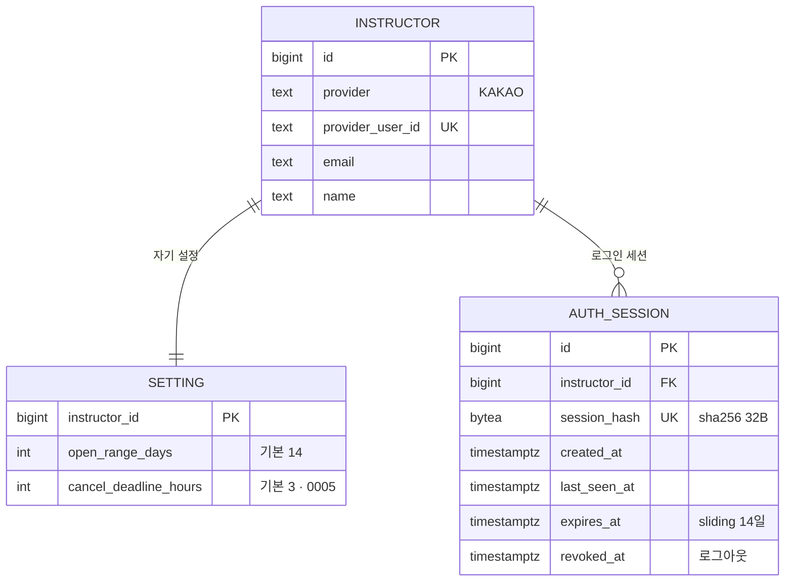

# 강사 도메인 데이터 모델

도메인 사이 관계는 [컨텍스트 맵](../../architecture/context-map.md). 다른 도메인 테이블은 이름과 id만 그렸다.

## ERD

## 테이블

| 테이블 | 도입 기능 |
|---|---|
| `instructor` | 0001 |
| `setting` | 0001 (`cancel_deadline_hours`는 0005) |
| `auth_session` | 0001 (코드는 `auth` 모듈, [BE-ADR-0016](../../decisions/0016-auth-module.md)) |

## 인덱스

| 이름 | 내용 | 쓰는 곳 |
|---|---|---|
| `instructor_identity_uk` | `(provider, provider_user_id)` 유니크 | 카카오 계정 하나에 강사 1명. 동시 가입도 1명 |
| `auth_session.session_hash` | 유니크 | 요청마다 세션 확인 · 로그아웃 |
| `auth_session_owner_idx` | `(instructor_id)` | 외래 키 열 인덱스. 지금 이 열로 찾는 쿼리는 없다 |
| `auth_session_expires_idx` | `(expires_at)` | 매일 자정 만료 세션 삭제(`expires_at <= now()`) |

- `setting.open_range_days`는 `instructor`가 쓰고, `schedule`의 회차 생성 SQL이 JOIN으로 읽는다. 늘리면 `InstructorOpenRangeExtendedEvent`를 발행해 `schedule`이 같은 트랜잭션에서 회차를 만든다([BE-ADR-0019](../../decisions/0019-module-events.md))

> 변경 이력: [0001](0001-instructor-setup/prd.md) Phase 1 — 세 테이블 도입. Phase 2 — 오픈 범위 변경, `auth_session_expires_idx`
