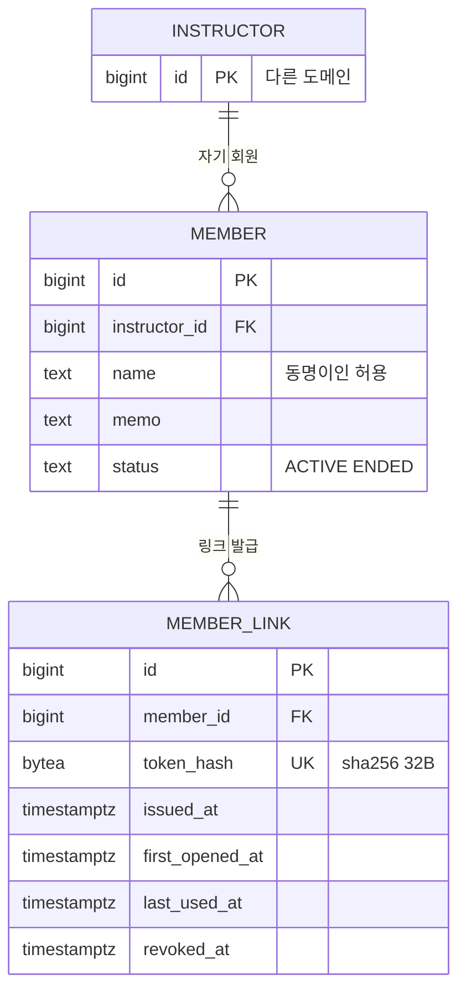

# 회원 도메인 데이터 모델

도메인 사이 관계는 [컨텍스트 맵](../../architecture/context-map.md). 다른 도메인 테이블은 이름과 id만 그렸다.

## ERD



## 테이블

| 테이블 | 도입 기능 |
|---|---|
| `member` | 0001 |
| `member_link` | 0001 |

## 주의할 쿼리

### 회원 화면의 격리

토큰이 회원을 가리키고, 회원이 강사를 가리킨다.

```sql
-- 1. 토큰 검증
SELECT m.id AS member_id, m.instructor_id
  FROM member_link l
  JOIN member m ON m.id = l.member_id
 WHERE l.token_hash = $hash AND l.revoked_at IS NULL;

-- 2. 그 강사의 슬롯만
SELECT c.id, c.starts_at, c.capacity - c.taken AS remaining
  FROM class_slot c
  JOIN setting    s ON s.instructor_id = c.instructor_id
 WHERE c.instructor_id = $그_강사
   AND c.canceled_at IS NULL
   AND c.starts_at >= $today_start                                  -- 오늘 0시 (Asia/Seoul)
   AND c.starts_at <  $today_start + make_interval(days => s.open_range_days);
```

오픈 범위도 강사별 설정에서 읽는다. 범위는 날짜 단위 `[오늘, 오늘 + N일)`이다. `$today_start`는 `Asia/Seoul` 기준 오늘 0시를 `timestamptz`로 바꾼 값이다. 오늘 이미 시작한 수업도 목록에 나오고 회색으로 표시된다(PRD 2 AC 3.2.3).

`make_interval(days => N)`은 일 단위 간격이라, 서머타임이 없는 `Asia/Seoul`에서는 N일 뒤 0시와 같다.

### 강사 회원 목록 · 미개봉 회원 수

```sql
SELECT m.id, m.name, m.memo, m.status, l.first_opened_at IS NOT NULL AS link_opened
  FROM member m
  LEFT JOIN member_link l ON l.member_id = m.id AND l.revoked_at IS NULL
 WHERE m.instructor_id = $me
 ORDER BY CASE WHEN m.status = 'ENDED' THEN 2
               WHEN l.first_opened_at IS NULL THEN 0
               ELSE 1 END,
          m.name COLLATE "C", m.id;
```

- 살아 있는 링크만 붙인다. 조건을 `ON`에 둬야 링크가 없는 회원도 빠지지 않는다. 회원당 살아 있는 링크는 `member_link_active_uidx`로 1개라 행이 늘지 않는다
- 미개봉 회원 수는 이 결과에서 ACTIVE이고 `link_opened`가 false인 행을 센다. 따로 COUNT하지 않는다
- 이름 정렬은 DB 기본 정렬 규칙(collation)에 따라 달라지므로 `"C"`(문자 코드 순)로 고정한다. `postgres:17` 기본(en_US.utf8)이면 `a, B`, C면 `B, a`다. 한글 음절은 둘 다 가나다 순이다

### 링크 재발급

```sql
SELECT 1 FROM member WHERE id = $id AND instructor_id = $me FOR NO KEY UPDATE;  -- 0행이면 404
UPDATE member_link SET revoked_at = now() WHERE member_id = $id AND revoked_at IS NULL;
INSERT INTO member_link (member_id, token_hash) VALUES ($id, $hash);
```

회원 행을 먼저 잠그지 않으면 같은 회원의 재발급 두 개가 같이 새 링크를 넣다가 `member_link_active_uidx`에 걸린다. `FOR NO KEY UPDATE`는 링크 INSERT의 외래 키 확인(KEY SHARE)과 충돌하지 않는다.

## 제약

| 제약 | 지키는 것 |
|---|---|
| `member` CHECK `name` 1 ~ 50자 · `memo` 500자 이하 · `status` ACTIVE · ENDED | 입력 상한. 애플리케이션이 먼저 400으로 거른다 |
| `member_link.token_hash` UNIQUE | 토큰 하나가 회원 하나를 가리킨다 |
| `member_link_token_hash_length` | 해시는 32바이트(SHA-256) |
| `member_link_active_uidx` (`member_id`) `WHERE revoked_at IS NULL` | 회원당 살아 있는 링크 1개 |
