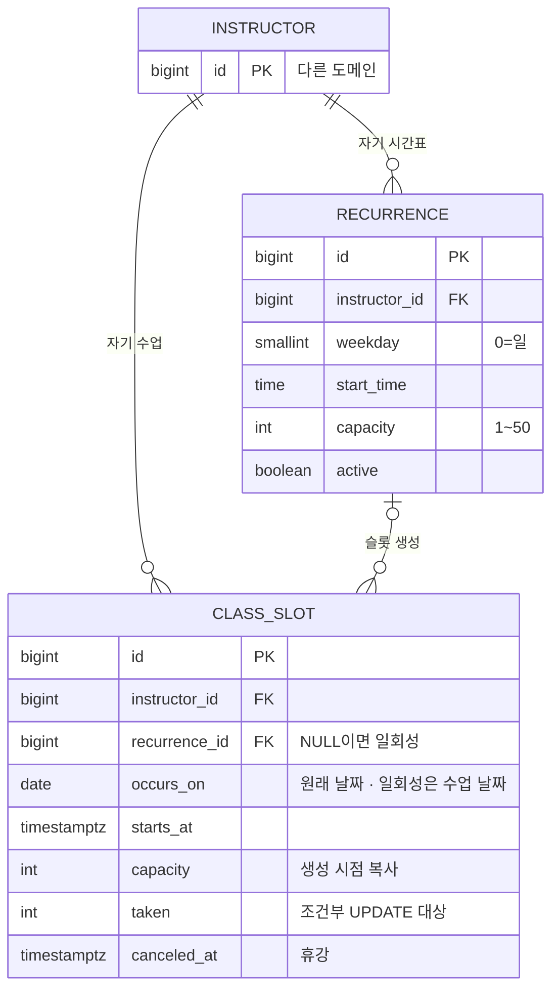

# 시간표 도메인 데이터 모델

도메인 사이 관계는 [컨텍스트 맵](../../architecture/context-map.md). 다른 도메인 테이블은 이름과 id만 그렸다.

## ERD

## 테이블

| 테이블 | 도입 기능 |
|---|---|
| `recurrence` | 0001 |
| `class_slot` | 0001 |

## 소유자

`class_slot`은 `instructor_id`를 직접 가진다. 일회성 수업은 `recurrence_id`가 NULL이라 `recurrence`를 타고 소유자를 찾을 수 없기 때문이다. 슬롯 쿼리의 소유자 조건은 `class_slot.instructor_id`로 건다.

규칙이 만든 슬롯은 복합 FK `(recurrence_id, instructor_id) → recurrence (id, instructor_id)`로 규칙의 강사와 같은 값이 강제된다. 정의는 [BE-0001](../instructor/0001-instructor-setup/prd.md).

## 제약 · 인덱스

| 이름 | 내용 | 막는 것 · 쓰는 곳 |
|---|---|---|
| `recurrence_slot_uidx` | `(instructor_id, weekday, start_time) WHERE active` 유니크 | 같은 요일 · 시각의 켜진 규칙 둘. 위반은 409 `RECURRENCE_DUPLICATE` |
| `class_slot_occurrence_uk` | `(recurrence_id, occurs_on)` 유니크 | 시각을 바꾸거나 휴강한 회차를 같은 날 다시 만들기 |
| `class_slot_time_uidx` | `(instructor_id, starts_at) WHERE canceled_at IS NULL` 유니크 | 같은 강사 · 같은 시각의 휴강 아닌 수업 둘. 위반은 409 `SLOT_TIME_TAKEN` |
| `class_slot_owner_idx` | `(instructor_id, starts_at)` | 회차 생성의 "그 시각에 슬롯이 있나"(휴강 포함), 강사 슬롯 목록 |
| `class_slot_taken_range` | `0 <= taken <= capacity` | 정원 초과 |

- `occurs_on`은 회차의 원래 날짜다. 시각을 바꿔도 그대로다. 일회성 수업은 날짜를 옮기면 같이 바뀐다
- 제약 이름 → 에러 코드 대응은 `schedule/exception/ScheduleConstraintErrors`에 있다. 제약 이름을 바꾸면 같이 고친다

## 주의할 쿼리

- **회차 생성** (`SlotRepository.generate`): `recurrence × setting.open_range_days × generate_series`를 한 문장의 `INSERT … SELECT … ON CONFLICT DO NOTHING`으로 만든다. `setting`은 `instructor` 모듈의 테이블이지만 강사마다 다른 범위를 한 문장으로 펼치려고 직접 JOIN한다(읽기만). 같은 시각 검사는 `NOT EXISTS`로 휴강한 행까지 본다. `ORDER BY`로 동시 실행끼리 같은 순서로 넣어 deadlock을 피한다
- **시각 변경 · 휴강**: 읽고 판정한 뒤 판정 조건을 WHERE에 다시 건 조건부 UPDATE를 한다. 0행이면 다시 읽어 같은 순서로 판정한다. 첫 시도를 포함해 3번까지 하고, 그래도 못 쓰면 500이다
- **이어받기** (`SlotRepository.takeOver`): 꺼진 규칙의 오늘 이후 회차를 `DISTINCT ON (occurs_on)`으로 날짜마다 한 행만 옮긴다. 규칙 끄기와 자정 실행이 겹치면 한 날에 옮길 회차가 둘일 수 있어서다. 규칙 여러 개를 함께 켤 때는 모두 이어받은 뒤 생성을 한 번만 돌린다(`SlotGeneration.takeOverAndGenerate`). 먼저 만들면 이어받기가 회차 유니크에 걸린다
- **규칙 잠금** (`RecurrenceRepository.findForUpdate`): `FOR NO KEY UPDATE`다. `FOR UPDATE`는 회차 INSERT의 외래 키 확인(KEY SHARE)과 충돌해 자정 생성과 deadlock이 날 수 있다

> 변경 이력: [0001](../instructor/0001-instructor-setup/prd.md) Phase 2 — 두 테이블 도입, 회차 생성 · 이어받기 · 시각 변경 · 휴강 · 일회성 수업
