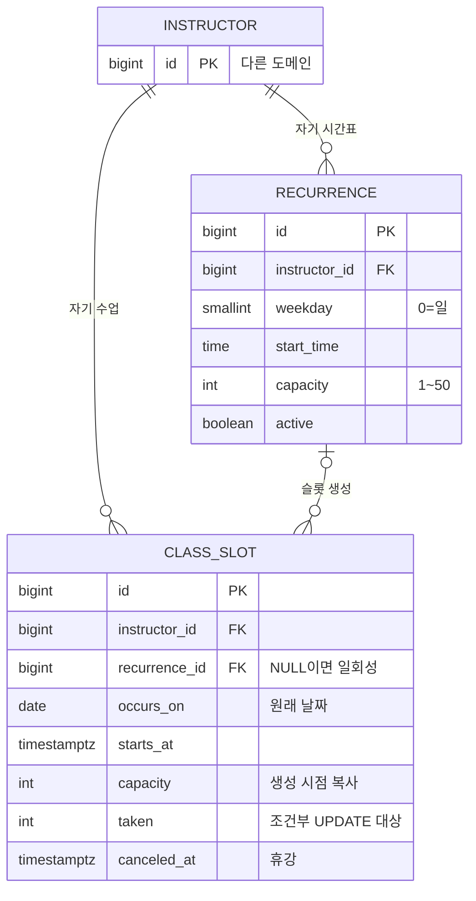

# 시간표 도메인 데이터 모델

도메인 사이 관계는 [컨텍스트 맵](../../architecture/context-map.md). 다른 도메인 테이블은 이름과 id만 그렸다.

## ERD

## 테이블

| 테이블 | 도입 기능 |
|---|---|
| `recurrence` | 0001 |
| `class_slot` | 0001 |

## 소유자

`class_slot`은 `instructor_id`를 직접 가진다. 일회성 수업은 `recurrence_id`가 NULL이라 `recurrence`를 타고 소유자를 찾을 수 없기 때문이다. 슬롯 쿼리의 소유자 조건은 `class_slot.instructor_id`로 건다.

규칙이 만든 슬롯은 복합 FK `(recurrence_id, instructor_id) → recurrence (id, instructor_id)`로 규칙의 강사와 같은 값이 강제된다. 정의는 [BE-0001](../instructor/0001-instructor-setup/prd.md).

> 변경 이력 (구현 전, 설계상 관련 기능): [0001](../instructor/0001-instructor-setup/prd.md)
